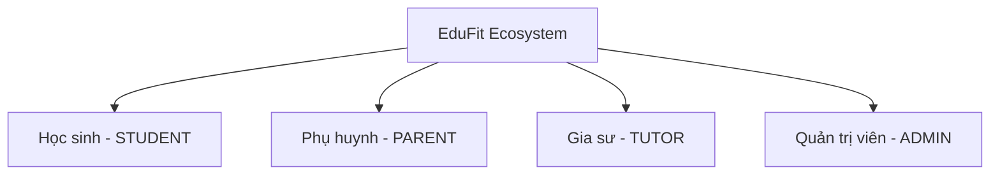

# EduFit — Nền Tảng Kết Nối Gia Sư & Quản Lý Học Tập Thông Minh

<p align="center">
  
</p>

<p align="center">
  <strong>Nền tảng EdTech toàn diện kết nối Gia sư uy tín với Học sinh & Phụ huynh thông qua thuật toán AI Smart Matching, quản lý lộ trình học tập, lịch học chống trùng và thanh toán ký quỹ minh bạch.</strong>
</p>

<p align="center">
  
  
  
  
  
  
  
  
  
</p>

---

## 📖 Mục lục

- [1. Giới thiệu Dự án](#1-giới-thiệu-dự-án)
- [2. Các Vai trò Người dùng (User Roles)](#2-các-vai-trò-người-dùng-user-roles)
- [3. Tính năng Nổi bật (Core Features)](#3-tính-năng-nổi-bật-core-features)
- [4. Kiến trúc & Công nghệ (Tech Stack)](#4-kiến-trúc--công-nghệ-tech-stack)
- [5. Cấu trúc Dự án (Project Structure)](#5-cấu-trúc-dự-án-project-structure)
- [6. Hướng dẫn Khởi chạy (Getting Started)](#6-hướng-dẫn-khởi-chạy-getting-started)
- [7. Tài khoản Demo Trải nghiệm (Demo Accounts)](#7-tài-khoản-demo-trải-nghiệm-demo-accounts)
- [8. Kiểm thử & Đảm bảo Chất lượng (Testing & QA)](#8-kiểm-thử--đảm-bảo-chất-lượng-testing--qa)
- [9. Tài liệu Kỹ thuật Liên quan (Documentation)](#9-tài-liệu-kỹ-thuật-liên-quan-documentation)

---

## 1. Giới thiệu Dự án

Tìm kiếm gia sư truyền thống thường gặp phải nhiều rào cản lớn:
- **Thiếu tính xác thực:** Bằng cấp, chứng chỉ và năng lực sư phạm của gia sư khó kiểm chứng độc lập.
- **Khó ghép cặp chuẩn xác:** Học sinh có nhu cầu học tập rất đặc thù (ôn thi vào 10 chuyên, bồi dưỡng học sinh giỏi, theo học các bộ sách mới như *Cánh Diều, Kết Nối Tri Thức, Chân Trời Sáng Tạo*, ngân sách giới hạn và khung giờ rảnh phân tán).
- **Trùng lấn lịch học:** Việc thỏa thuận lịch qua tin nhắn thủ công dễ gây xung đột giờ dạy và hủy buổi.
- **Rủi ro tài chính:** Phụ huynh e ngại việc đóng học phí trước theo tháng/quý mà không được đảm bảo chất lượng, còn gia sư lo ngại bị quỵt tiền sau khi dạy.
- **Thiếu minh bạch tiến độ:** Phụ huynh khó theo dõi con mình thực sự học đến đâu và tiến bộ thế nào sau từng buổi.

**EduFit** được xây dựng như một nền tảng **All-in-One EdTech** để giải quyết triệt để các vấn đề trên thông qua:
1. **Lòng tin & Xác minh (Trust & Verification):** Quy trình nộp và kiểm duyệt bằng cấp KYC nghiêm ngặt bởi Quản trị viên.
2. **AI Smart Match:** Thuật toán AI phân tích chi tiết nhu cầu học để đối sánh với năng lực và lịch rảnh của gia sư.
3. **Lịch trình thông minh chống trùng (Double-booking Protection):** Hệ thống đặt lịch học theo thời gian thực với ràng buộc loại trừ ở mức cơ sở dữ liệu.
4. **Theo dõi tiến độ qua Lộ trình & Sổ liên lạc:** Kế hoạch học tập 3–8 cột mốc với tiêu chí đánh giá cụ thể và sổ liên lạc điện tử ghi nhận sau mỗi buổi.
5. **Thanh toán Ký quỹ An toàn (Escrow Payment):** Tích hợp cổng PayOS tạo mã QR VietQR tự động; học phí được giữ trong ký quỹ và chỉ giải ngân cho gia sư khi buổi học hoàn thành và được xác nhận.

---

## 2. Các Vai trò Người dùng (User Roles)

EduFit phục vụ 4 nhóm người dùng chính với bảng điều khiển và trải nghiệm chuyên biệt:



### 🎓 Học sinh (Student)
- **Tìm kiếm gia sư công khai:** Bộ lọc đa diện theo môn học, khối lớp, giá tiền, hình thức (Online/Offline/Cả hai), khu vực và đánh giá.
- **Tạo nhu cầu học tập chi tiết:** Khai báo khối lớp, môn học, bộ sách đang học, mục tiêu (thi chuyên/HSG kèm tỉnh thành thi và trường chuyên đích), ngân sách tối đa và khung giờ có thể học.
- **AI Matching:** Nhận danh sách gia sư phù hợp nhất kèm điểm tương thích và phân tích lý do ghép đôi từ AI.
- **Quản lý lịch học:** Xem lịch học dạng Lưới tuần hoặc Dòng thời gian, gửi yêu cầu học, yêu cầu đổi lịch và hủy buổi có điều kiện.
- **Theo dõi học tập:** Xem lộ trình học tập, trạng thái hoàn thành cột mốc, sổ liên lạc điện tử và đánh giá gia sư sau khóa học.

### 👨‍👩‍👧 Phụ huynh (Parent)
- **Bảng điều khiển đa học sinh (Multi-Child Dashboard):** Quản lý tiến độ học tập của một hoặc nhiều con cùng lúc.
- **Liên kết tài khoản con an toàn:** Gửi lời mời liên kết qua mã PIN bảo mật, theo dõi trạng thái xác nhận và quản lý danh sách con.
- **Tìm & thuê gia sư thay con:** Tạo nhu cầu học tập, đối sánh AI và đặt lịch học cho con.
- **Ví ký quỹ & Thanh toán:** Nạp tiền qua mã QR VietQR (PayOS), kiểm tra số dư khả dụng, số dư đang ký quỹ và lịch sử biến động số dư.
- **Giám sát chất lượng:** Nhận thông báo sau mỗi buổi học, đọc nhận xét sổ liên lạc từ gia sư và gửi phản hồi/khiếu nại nếu có tranh chấp.

### 👨‍🏫 Gia sư (Tutor)
- **Hồ sơ chuyên môn & Gói dạy:** Thiết lập thông tin cá nhân, tiểu sử, khu vực giảng dạy, các gói dịch vụ (offerings) kèm mức học phí rõ ràng.
- **Lịch rảnh (Availability Slots):** Đăng ký các khung giờ rảnh cố định trong tuần để học sinh/phụ huynh thuận tiện đặt lịch.
- **Xác thực hồ sơ KYC:** Nộp ảnh thẻ sinh viên, bằng tốt nghiệp, chứng chỉ ngoại ngữ/sư phạm để nhận tích xanh xác minh từ Admin.
- **Quản lý yêu cầu lớp học:** Tiếp nhận yêu cầu học, xem hồ sơ học tập chi tiết của học sinh trước khi đồng ý hoặc từ chối.
- **Lập kế hoạch học tập (Learning Plan):** Thiết kế lộ trình 3–8 cột mốc học tập có deadline và tiêu chí đo lường (hỗ trợ tạo gợi ý bằng AI).
- **Sổ liên lạc từng buổi học:** Điểm danh, ghi chú nội dung đã dạy, giao bài tập về nhà và nhận xét thái độ học tập của học viên.
- **Thu nhập & Rút tiền:** Theo dõi bảng kê học phí từng buổi, số tiền ký quỹ đang chờ giải ngân và yêu cầu rút tiền về tài khoản ngân hàng.

### 🛡️ Quản trị viên (Admin)
- **Hàng đợi duyệt bằng cấp (KYC Queue):** Thẩm định hồ sơ bằng cấp/chứng chỉ gia sư, duyệt cấp huy hiệu hoặc từ chối kèm lý do.
- **Quản trị danh mục hệ thống:** Quản lý danh sách môn học, khối lớp, bộ sách giáo khoa, chủ đề kiến thức, tỉnh thành và quận huyện.
- **Quản lý tài khoản & người dùng:** Xem danh sách người dùng, kích hoạt, vô hiệu hóa tài khoản và giám sát liên kết phụ huynh - học sinh.
- **Kiểm soát giao dịch & Tranh chấp:** Đối soát dòng tiền nạp/rút PayOS, xử lý các khiếu nại buổi học giữa học viên và gia sư.
- **Nhật ký kiểm toán (Audit Logs):** Ghi vết các thao tác quan trọng trong hệ thống để bảo đảm an toàn thông tin.

---

## 3. Tính năng Nổi bật (Core Features)

### 🎯 1. Khám phá & AI Smart Matching
- **Bộ lọc tìm kiếm đa chiều:** Tìm kiếm theo từ khóa tên gia sư, môn học, lớp học, mức học phí, đánh giá sao, loại gia sư (Giáo viên trường, Giảng viên, Thủ khoa, Sinh viên xuất sắc) và vị trí địa lý.
- **AI Match Wizard:** Khảo sát chi tiết mục tiêu của học viên (ví dụ: thi vào 10 chuyên Toán tại Hà Nội, sách Cánh Diều, ngân sách 250.000đ/buổi), từ đó AI chấm điểm tương thích theo % và phân tích rõ thế mạnh của từng gia sư tương ứng với nhu cầu.

### ⏰ 2. Đa dạng hóa Khung giờ học (Flexible Slot Picker)
- Thay thế hoàn toàn giao diện chọn giờ cố định cũ bằng bộ chọn linh hoạt:
  - **13 ca học mẫu (Presets)** chia theo 4 tab: *Buổi Tối, Buổi Chiều, Buổi Sáng, Cuối tuần*.
  - **Công cụ tự tạo khung giờ (Custom Builder):** Cho phép chọn bất kỳ thứ trong tuần kèm giờ bắt đầu & kết thúc tùy biến theo block 1h, 1h30, 2h.
  - **Kiểm tra xung đột thời gian thực:** Ngăn chặn việc chọn các khung giờ bị trùng lấn hoặc có giờ kết thúc sớm hơn giờ bắt đầu.

### 📅 3. Quản lý Lịch học & Chống trùng lịch (Smart Scheduling)
- **Chế độ xem kép (Dual View):** Chuyển đổi mượt mà giữa Lưới tuần (Weekly Grid trực quan) và Dòng thời gian (Timeline chi tiết).
- **Máy trạng thái Buổi học:** Luân chuyển trạng thái chặt chẽ: `PROPOSED` ➔ `CONFIRMED` ➔ `COMPLETED` / `CANCELLED` / `REJECTED`.
- **Ràng buộc loại trừ (Exclusion Constraints):** Sử dụng cơ chế khóa PostgreSQL để chống double-booking tuyệt đối, ngay cả khi có nhiều yêu cầu đặt lịch đồng thời.

### 💳 4. Ví Ký quỹ Minh bạch & Cổng PayOS (Escrow Wallet)
- **Thanh toán qua VietQR tự động:** Tích hợp PayOS tạo mã QR động cho từng giao dịch nạp ví; hệ thống webhook cập nhật số dư tức thời.
- **Mô hình Ký quỹ (Escrow):** Khi lịch học được xác nhận, học phí của buổi học được tạm giữ ở trạng thái ký quỹ (`ESCROW_LOCKED`). Sau khi buổi học diễn ra và được học sinh/phụ huynh xác nhận hoàn thành, tiền mới được chuyển sang số dư khả dụng của gia sư.
- **Bảo vệ quyền lợi hai chiều:** Hỗ trợ quy trình khiếu nại (dispute) và hoàn tiền minh bạch nếu buổi học không diễn ra theo cam kết.

### 📊 5. Kế hoạch Học tập & Sổ liên lạc Điện tử (Progress Tracking)
- **Lộ trình học tập (Learning Plan):** Thiết kế từ 3 đến 8 cột mốc tiến độ với hạn chót bắt buộc và danh sách tiêu chí đánh giá. Hỗ trợ lưu mẫu lộ trình dùng lại hoặc sinh lộ trình tự động bằng AI.
- **Sổ liên lạc sau mỗi buổi:** Gia sư chấm chuyên cần, tóm tắt kiến thức đã truyền đạt, đính kèm bài tập về nhà và nhận xét học lực. Phụ huynh nhận thông báo tức thời ngay khi sổ liên lạc được lưu.

### 🌗 6. Giao diện Thân thiện, Dark Mode & Trợ năng (A11y)
- **Chế độ Sáng / Tối toàn diện:** Tự động nhận diện thiết lập hệ thống hoặc tùy chọn thủ công, bảng màu tối ưu độ tương phản văn bản cao đạt chuẩn WCAG.
- **Trải nghiệm Onboarding phân quyền chặt chẽ:** Hướng dẫn 3 bước thông minh theo từng vai trò (Student, Tutor, Parent), ghi nhớ tiến trình theo từng người dùng trên trình duyệt và tự động điều hướng an toàn sau đăng nhập/OAuth.

---

## 4. Kiến trúc & Công nghệ (Tech Stack)

EduFit áp dụng kiến trúc **Modular Monolith** ở Backend kết hợp với kiến trúc **Package-by-Feature** ở Frontend:

```
┌────────────────────────────────────────────────────────┐
│               Frontend: Next.js 16 + React 19          │
│   (App Router, Tailwind CSS v4, Lucide Icons, Vitest)   │
└──────────────────────────┬─────────────────────────────┘
                           │ HTTPS / REST API / OAuth2
┌──────────────────────────▼─────────────────────────────┐
│             Backend: Spring Boot 4.1.1 (Java 21)       │
│               Kiến trúc Modular Monolith               │
│                                                        │
│  ┌──────────────────────────────────────────────────┐  │
│  │ 9 Business Modules:                              │  │
│  │ • iam           • profile       • verification   │  │
│  │ • discovery     • connection    • scheduling     │  │
│  │ • progress      • review        • notification   │  │
│  │ • payment (ví ký quỹ & tích hợp PayOS)          │  │
│  └──────────────────────────────────────────────────┘  │
│  ┌──────────────────────────────────────────────────┐  │
│  │ Platform & Shared Kernel:                        │  │
│  │ • platform/shared   • platform/ai                │  │
│  │ • platform/storage  • platform/audit             │  │
│  └──────────────────────────────────────────────────┘  │
└──────────────────────────┬─────────────────────────────┘
                           │ JDBC / Flyway
┌──────────────────────────▼─────────────────────────────┐
│                 PostgreSQL 17 Database                 │
│         (Postgres Exclusion Constraints, Triggers)     │
└────────────────────────────────────────────────────────┘
```

### Bảng công nghệ chi tiết

| Thành phần | Công nghệ | Phiên bản | Vai trò & Mục đích |
| :--- | :--- | :--- | :--- |
| **Ngôn ngữ Backend** | Java | 21 (LTS) | Virtual Threads, Pattern Matching, Record, hiệu năng cao. |
| **Framework Backend** | Spring Boot | 4.1.1 | Quản trị dependency, Spring Data JPA, Spring Security, Validation. |
| **Cơ sở dữ liệu** | PostgreSQL | 17 | RDBMS đảm bảo ACID, hỗ trợ ràng buộc chống trùng lịch và khóa bi quan. |
| **Database Migration** | Flyway | 10.x | Quản lý lịch sử và áp dụng schema/seed data tự động. |
| **Bảo mật & Mã hóa** | Argon2id & JWT / Cookie | Argon2 2.11 | Băm mật khẩu đạt chuẩn OWASP; quản lý phiên đăng nhập an toàn. |
| **Framework Frontend** | Next.js (App Router) | 16.3.6 | Server Components, tối ưu SEO, định tuyến mạnh mẽ với Turbopack. |
| **Thư viện Giao diện** | React | 19.2.8 | Xây dựng UI phản hồi cao, Server Actions & Client Components. |
| **Kiểu dữ liệu** | TypeScript | 5.x | Kiểm soát kiểu chặt chẽ toàn bộ luồng dữ liệu frontend. |
| **CSS Framework** | Tailwind CSS | v4 | Utility-first CSS hiện đại, hỗ trợ Dark Mode và Design System. |
| **Cổng thanh toán** | PayOS | SDK / REST | Thanh toán VietQR động, webhook xác nhận giao dịch tự động. |
| **Trí tuệ nhân tạo (AI)**| Gemini API / Stub | 2.5 Flash | Phân tích nhu cầu học, tính điểm tương thích và sinh lộ trình học tập. |
| **Email Testing** | Mailpit | Latest | Giả lập SMTP server cục bộ để kiểm tra email kích hoạt và đổi mật khẩu. |
| **Container & DevOps** | Docker & Docker Compose | Latest | Đóng gói môi trường đồng nhất giữa Local và Production. |

---

## 5. Cấu trúc Dự án (Project Structure)

```
EduFit/
├── .github/workflows/          # Quy trình CI/CD GitHub Actions (Backend & Frontend)
├── backend/                    # Mã nguồn Backend (Maven Multi-Module)
│   ├── pom.xml                 # Parent POM quản lý phiên bản toàn hệ thống
│   ├── app/                    # Entrypoint Spring Boot (@SpringBootApplication, Config, Migrations)
│   │   └── src/main/resources/ # application.yml, db/migration/, db/seed/
│   ├── platform/               # Các module kỹ thuật dùng chung
│   │   ├── shared/             # Shared Kernel (Money, TimeInterval, ErrorCode, BaseException)
│   │   ├── ai/                 # Tích hợp AI LLM (Gemini API & Stub Provider)
│   │   ├── storage/            # Quản lý lưu trữ tệp tin chứng chỉ KYC
│   │   └── audit/              # Ghi vết kiểm toán hành động hệ thống
│   └── modules/                # 10 module nghiệp vụ độc lập
│       ├── iam/                # Đăng ký, đăng nhập, phân quyền, phiên làm việc
│       ├── profile/            # Hồ sơ gia sư, học sinh, phụ huynh
│       ├── verification/       # Nộp và thẩm định chứng chỉ KYC gia sư
│       ├── discovery/          # Tìm kiếm, lọc và AI matching gia sư
│       ├── connection/         # Liên kết phụ huynh - con, yêu cầu kết nối
│       ├── scheduling/         # Lịch dạy, máy trạng thái buổi học, chống trùng lịch
│       ├── progress/           # Kế hoạch học tập, cột mốc, sổ liên lạc điện tử
│       ├── review/             # Đánh giá và xếp hạng gia sư
│       ├── notification/       # Tiếp nhận sự kiện và gửi thông báo
│       └── payment/            # Ví ký quỹ, cổng thanh toán PayOS, giải ngân
├── frontend/                   # Mã nguồn Frontend (Next.js 16 + React 19)
│   ├── src/
│   │   ├── app/                # Next.js App Router (Routing, Layouts, Server Pages)
│   │   │   ├── (auth)/         # /login, /register, /forgot-password
│   │   │   ├── student/        # /student/dashboard, /classes, /schedule, /progress...
│   │   │   ├── parent/         # /parent/dashboard, /children, /billing...
│   │   │   ├── tutor/          # /tutor/dashboard, /schedule, /requests, /history...
│   │   │   ├── admin/          # /admin/verification-queue, /payments, /catalogs...
│   │   │   └── onboarding/     # /onboarding/student, /tutor, /parent
│   │   ├── features/           # Module hóa nghiệp vụ theo Feature
│   │   ├── shared/             # UI Components dùng chung, DateTime utils, API Client
│   │   └── __tests__/          # Hơn 600 unit & integration tests (Vitest)
│   └── tests/e2e/              # Kịch bản kiểm thử End-to-End tự động (Selenium)
├── database/                   # Script khởi tạo cơ sở dữ liệu rỗng
├── docs/                       # Tài liệu kiến trúc chuyên sâu (ADR, SRS, Thiết kế DB, API Contract)
├── compose.yaml                # Cấu hình Docker Compose gốc (db + backend)
├── compose.dev.yaml            # Cấu hình phát triển (bật profile dev, Mailpit, seed data)
├── compose.demo.yaml           # Cấu hình chạy toàn bộ hệ thống bằng 1 lệnh (kèm frontend)
└── start-all.cmd               # Script khởi động tự động một chạm trên Windows
```

---

## 6. Hướng dẫn Khởi chạy (Getting Started)

### Yêu cầu tiên quyết
- **Docker & Docker Desktop** (đang chạy).
- **Node.js 20+** & **npm** (nếu chạy frontend độc lập trên máy).
- **Java 21** & **Maven 3.9+** (chỉ cần nếu chạy backend trực tiếp ngoài Docker).

---

### Cách 1: Khởi chạy toàn bộ hệ thống bằng Docker (Khuyên dùng)

Dành cho người muốn chạy thử toàn bộ ứng dụng (Cơ sở dữ liệu, Backend, Mailpit và Frontend) chỉ với 1 bước:

1. **Sao chép tệp biến môi trường:**
   ```bash
   cp .env.example .env
   ```

2. **Chạy Docker Compose:**
   ```bash
   docker compose -f compose.yaml -f compose.dev.yaml -f compose.demo.yaml up --build -d
   ```

3. **Truy cập các dịch vụ:**
   - 🌐 **Giao diện Web Frontend:** [http://localhost:3000](http://localhost:3000)
   - 🔌 **API Backend & Swagger UI:** [http://localhost:8080/swagger-ui.html](http://localhost:8080/swagger-ui.html)
   - 🩺 **Kiểm tra trạng thái Health:** [http://localhost:8080/actuator/health](http://localhost:8080/actuator/health)
   - 📧 **Hộp thư thử nghiệm Mailpit:** [http://localhost:8025](http://localhost:8025)

4. **Dừng hệ thống:**
   ```bash
   docker compose -f compose.yaml -f compose.dev.yaml -f compose.demo.yaml down
   ```

---

### Cách 2: Khởi chạy dành cho Lập trình viên (Local Development)

#### Bước 1: Dựng Database & Mailpit qua Docker
```bash
cp .env.example .env
docker compose -f compose.yaml -f compose.dev.yaml up -d db mailpit
```
> *Lưu ý:* PostgreSQL trên máy host mặc định ánh xạ ra cổng `5433` để tránh trùng lấn cổng `5432` có sẵn.

#### Bước 2: Khởi động Backend (Spring Boot)
- **Trên Windows PowerShell:**
  ```powershell
  cd backend
  .\mvnw.cmd spring-boot:run -Dspring-boot.run.profiles=dev
  ```
- **Trên macOS / Linux:**
  ```bash
  cd backend
  ./mvnw spring-boot:run -Dspring-boot.run.profiles=dev
  ```

#### Bước 3: Khởi động Frontend (Next.js)
```bash
cd frontend
cp .env.example .env.local
npm install
npm run dev
```
Mở trình duyệt tại [http://localhost:3000](http://localhost:3000).

---

## 7. Tài khoản Demo Trải nghiệm (Demo Accounts)

Khi chạy ở profile `dev`, hệ thống được nạp sẵn các tài khoản thử nghiệm với mật khẩu chung là:  
👉 **`Password123@`**

| Vai trò | Họ và tên | Email đăng nhập | Quyền hạn chính |
| :--- | :--- | :--- | :--- |
| **Học sinh** | Trần Minh Anh | `student.demo@edufit.vn` | Tạo nhu cầu học, tìm gia sư, đặt lịch học, xem sổ liên lạc. |
| **Gia sư** | Nguyễn Hoàng Lan | `tutor.demo@edufit.vn` | Quản lý gói dạy, lịch rảnh, nhận yêu cầu học, tạo lộ trình và sổ liên lạc. |
| **Phụ huynh** | Trần Văn Hưng | `parent.demo@edufit.vn` | Quản lý tài khoản con, nạp tiền ví, thanh toán học phí ký quỹ. |
| **Quản trị viên** | Quản Trị Viên EduFit | `admin.demo@edufit.vn` | Duyệt bằng cấp KYC, đối soát thanh toán, quản lý danh mục và người dùng. |

> 📦 **Dữ liệu demo:** gia sư đa dạng, 3 lớp học, buổi học đủ trạng thái, thanh toán, lộ trình và báo cáo nằm ở `backend/app/src/main/resources/db/seed/V1.34__seed_demo_journeys.sql` (chỉ profile dev, nạp khi tạo CSDL mới). Muốn dữ liệu tươi theo ngày hiện tại: `docker compose down -v` rồi `up` lại.

> 💡 **Mẹo:** Ở trang đăng nhập, khi bật `NEXT_PUBLIC_ENABLE_DEMO_LOGIN=true`, giao diện sẽ có sẵn các nút bấm điền nhanh tài khoản demo chỉ với một cú nhấp chuột.

---

## 8. Kiểm thử & Đảm bảo Chất lượng (Testing & QA)

Dự án áp dụng quy trình kiểm thử đa tầng nghiêm ngặt nhằm bảo đảm tính ổn định và an toàn nghiệp vụ:

### Frontend Testing (Vitest & React Testing Library)
- **Hơn 600 ca kiểm thử** bao phủ toàn bộ các module: Auth, Onboarding redirect logic, Schedule calendar, Learning need slot picker, Progress milestones, Payment panel, KYC schemas.
- Chạy toàn bộ test frontend:
  ```bash
  npm --prefix frontend test
  ```
- Kiểm tra lỗi kiểu TypeScript:
  ```bash
  npm --prefix frontend run type-check
  ```
- Kiểm thử giao diện End-to-End (Selenium):
  ```bash
  npm --prefix frontend run test:e2e
  ```

### Backend Testing (JUnit 5 & Testcontainers)
- Sử dụng **Testcontainers** khởi chạy PostgreSQL 17 thật để kiểm thử tích hợp, kiểm tra toàn vẹn ràng buộc dữ liệu và máy trạng thái.
- Kiểm thử kiến trúc với **ArchUnit** nhằm đảm bảo các ranh giới giao tiếp giữa các module không bị vi phạm.
- Chạy kiểm thử backend:
  ```bash
  cd backend
  ./mvnw clean verify
  ```

---

## 9. Tài liệu Kỹ thuật Liên quan (Documentation)

Để tìm hiểu sâu hơn về kiến trúc kỹ thuật và quy chuẩn phát triển của dự án, vui lòng tham khảo các tài liệu trong thư mục `docs/`:

- [Tài liệu Thiết kế Kiến trúc Phần mềm (Software Architecture Design)](docs/software-architecture-design-specification.md)
- [Quyết định Kiến trúc Công nghệ (ADR-001: Tech Stack)](docs/ADR-001-tech-stack.md)
- [Quyết định Kiến trúc Đa module (ADR-002: Modular Monolith)](docs/ADR-002-multi-module-architecture.md)
- [Luồng và quy tắc Thanh toán Ký quỹ payOS](docs/payment/payment-flow-and-rules.md)
- [Quy chuẩn Đóng góp & Phát triển Mã nguồn (CONTRIBUTING.md)](CONTRIBUTING.md)

---

<p align="center">
  Được phát triển với tất cả tâm huyết bởi Đội ngũ EduFit — Dự án SWP391.
</p>
