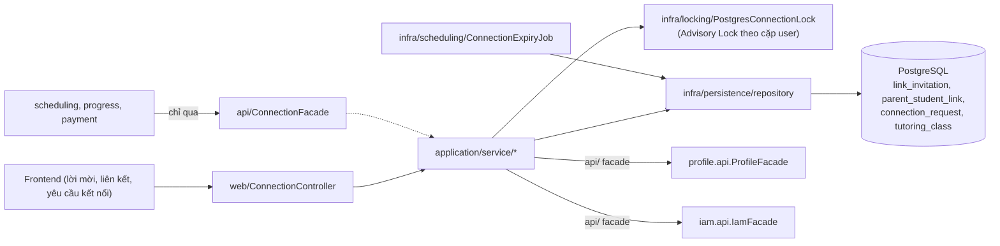
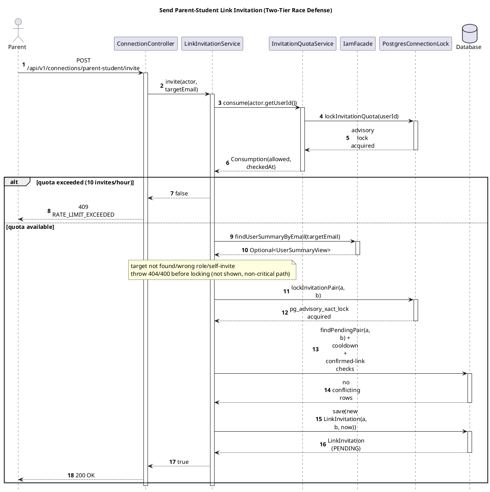
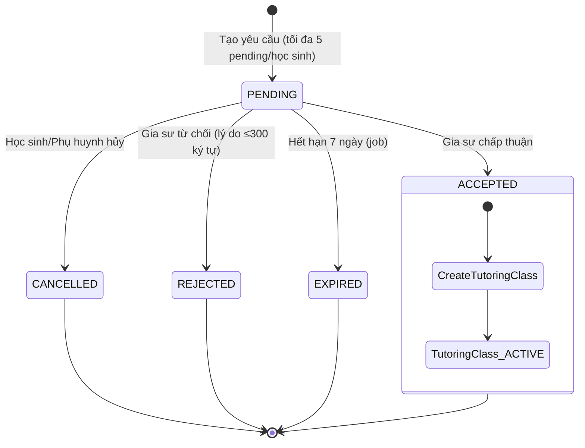

# Module Connection

- **Mã nguồn:** `backend/modules/connection/`
- **Mẫu kiến trúc:** Loại 2 — Complex Domain (chính sách/máy trạng thái thuần Java trong `application/policy/`), theo [backend-module-structure-guide.md](../backend-module-structure-guide.md).
- **Cập nhật nội dung:** 11/11/2026 — cấu trúc lại từ `connection_implementation_plan.md` cũ (đã gộp nội dung vào đây và xóa khỏi repo) theo khung README chuẩn.

---

## 1. Kiến trúc (Architecture)

```
backend/modules/connection/src/main/java/vn/edufit/connection/
│
├── api/
│   ├── ConnectionFacade.java              # hasConfirmedParentLink, findActiveClass, findClassById...
│   └── event/  ConnectionRequestChangedEvent, LinkInvitationChangedEvent,
│               ParentStudentLinkChangedEvent, TutoringClassCreatedEvent
│
├── application/
│   ├── policy/                             # Java thuần — TTL, cooldown, quota window, máy trạng thái
│   │   ├── ConnectionTransitions.java
│   │   └── ConnectionRequestInput.java     # Parse & validate khung giờ (slots)
│   ├── port/ConnectionLock.java            # Interface khóa đồng thời (Advisory Lock)
│   ├── dto/   ClassResult, ConnectionRequestResult, InvitationResult, ParentStudentLinkResult,
│   │          TransitionResult (sealed: Success/Conflict), TutorInboxResult (BR-37 compliant)
│   └── service/
│       ConnectionFacadeImpl · ConnectionRequestService · LinkInvitationService
│       ParentStudentLinkService · ConnectionQueryService · ConnectionExpiryService · InvitationQuotaService
│
├── infra/
│   ├── locking/PostgresConnectionLock.java # Hiện thực ConnectionLock bằng PostgreSQL Advisory Lock
│   ├── persistence/
│   │   ├── entity/  ConnectionInviteQuota, ConnectionRequest, LinkInvitation, ParentStudentLink, TutoringClass
│   │   └── repository/  ...Repository (+ FreshConnectionRowRepository — khóa bi quan & tải lại bản ghi tươi, xóa cache EntityManager)
│   └── scheduling/ConnectionExpiryJob.java # Cron job quét hết hạn lời mời/yêu cầu
│
└── web/
    ├── ConnectionController.java           # /api/v1/connections/**
    ├── ConnectionWriteExceptionHandler.java# Bắt vi phạm ràng buộc ghi → HTTP 409
    ├── request/  InviteBody, RespondBody, CreateRequestBody, RequestRespondBody, RevokeBody
    └── response/ ClassResponse, InvitationResponse, LinkResponse, RequestResponse, TutorInboxResponse
```



---

## 2. Tổng quan & Bối cảnh (Overview & Situation)

Connection là **trục xương sống quản trị mối quan hệ** giữa 3 chủ thể: Phụ huynh (Parent), Học sinh (Student), Gia sư (Tutor). Nó đảm nhiệm:

1. **Xác lập quan hệ ủy quyền & đồng thuận gia đình (UC3.1–UC3.3):** liên kết Phụ huynh–Học sinh (`ParentStudentLink`) — chỉ khi `CONFIRMED` thì Phụ huynh mới được theo dõi tiến độ, xem mục tiêu học tập, và thay con gửi yêu cầu tìm gia sư. Lời mời (`LinkInvitation`) có quota chống spam (tối đa 10 lời mời/giờ) và TTL 14 ngày.
2. **Khởi tạo & điều phối yêu cầu học tập tới Gia sư (UC3.4–UC3.5):** `ConnectionRequest` dựa trên mục tiêu học tập `ACTIVE` và hồ sơ gia sư `VERIFIED`; tối đa 5 yêu cầu `PENDING`/học sinh. Gia sư chấp nhận → tạo `TutoringClass (ACTIVE)` nguyên tử — đầu vào trực tiếp cho `scheduling` và `progress`.
3. **Hiệu năng & ranh giới bảo mật:** triệt tiêu N+1 query bằng Batch Hydration từ `ProfileFacade`/`IamFacade`; bảo vệ dữ liệu nhạy cảm của người học (BR-37 Privacy Whitelist) — hộp thư gia sư không lộ email/SĐT/mật khẩu băm hay mục tiêu học tập khác ngoài phạm vi yêu cầu.

**Quyết định UX đã chốt — bỏ Anti-Enumeration quá đà:** vì API mời liên kết bắt buộc đăng nhập và đã có rate limit 10/giờ, hệ thống trả lỗi tường minh thay vì luôn "200 OK giả": 404 (không tìm thấy email), 400 (sai vai trò / tự mời chính mình), 409 (đã liên kết / đang pending / đang cooldown) — tránh tình trạng phụ huynh gõ sai email nhưng vẫn thấy "thành công" rồi chờ vô vọng.

---

## 3. API Contract — `/api/v1/connections/**`

| Method | Endpoint | Mô tả |
|---|---|---|
| POST | `/parent-student/invite` | Gửi lời mời liên kết (`targetEmail`) |
| GET | `/parent-student/invitations` / `/invitations/page` | Danh sách lời mời (đến/đi), có phân trang |
| POST | `/parent-student/respond` | Chấp nhận/từ chối lời mời (`invitationId`, `accept`) |
| POST | `/parent-student/invitations/{id}/withdraw` | Rút lại lời mời đã gửi |
| GET | `/parent-student/links` / `/links/page` | Danh sách liên kết đã xác nhận |
| DELETE | `/parent-student/links/{id}` | Học sinh/Phụ huynh tự thu hồi liên kết của chính mình |
| GET | `/admin/parent-student/links` / `/links/all` / `/links/stats` | Admin xem toàn bộ liên kết + số liệu thống kê |
| POST | `/admin/parent-student/links/{id}/revoke` | Admin thu hồi liên kết (`reason`) |
| POST | `/requests` | Tạo yêu cầu kết nối tới gia sư (`CreateRequestBody{needId,tutorId,desiredSlots,message}`) |
| GET | `/requests` / `/requests/page` | Danh sách yêu cầu (lọc theo `studentId`), có bản phân trang |
| POST | `/requests/{id}/respond` | Gia sư chấp nhận/từ chối (`accept`, `reason`, tạo `TutoringClass` nếu accept) |
| POST | `/requests/{id}/cancel` | Học sinh/Phụ huynh hủy yêu cầu |
| GET | `/classes` | Danh sách lớp học đang hoạt động |
| POST | `/classes/{id}/end` | Kết thúc một lớp học |

Actor luôn lấy từ `CurrentUser` qua `ObjectProvider`. Mọi kết quả chuyển trạng thái trả về qua `TransitionResult` (sealed `Success<T>`/`Conflict`) — controller dịch `Conflict` sang `ResourceConflictException` (HTTP 409) thay vì to-string lỗi tùy tiện.

**Giao tiếp nội bộ (`api/ConnectionFacade`)** — module khác chỉ gọi qua đây: `hasConfirmedParentLink` (payment — quyền Phụ huynh thao tác tài chính thay con), `findActiveClass`/`findClassById` (scheduling chốt giá buổi học theo lớp, xem [PAYMENT_README.md §4.2](../payment/PAYMENT_README.md)).

---

## 4. Luồng triển khai từng bước (Implementation Flows)

### 4.1. Mời liên kết Phụ huynh – Học sinh (chống đối chiều, UC3.1/3.2)

**Trace table**

| # | From | To | Real method | File:line |
|---|---|---|---|---|
| 1 | Parent | ConnectionController | `invite(body)` — `POST /api/v1/connections/parent-student/invite` | `web/ConnectionController.java:48-49` |
| 2 | ConnectionController | LinkInvitationService | `invite(actor, targetEmail)` | `application/service/LinkInvitationService.java:72` |
| 3 | LinkInvitationService | InvitationQuotaService | `consume(actor.getUserId())` | `InvitationQuotaService.java:29`, call site `LinkInvitationService.java:75` |
| 4 | InvitationQuotaService | PostgresConnectionLock | `lockInvitationQuota(userId)` | `infra/locking/PostgresConnectionLock.java:19`, call site `InvitationQuotaService.java:30` |
| 5 | LinkInvitationService | IamFacade | `findUserSummaryByEmail(targetEmail)` | `IamFacadeImpl.java:35`, call site `LinkInvitationService.java:79` |
| 6 | LinkInvitationService | PostgresConnectionLock | `lockInvitationPair(a, b)` | `PostgresConnectionLock.java:21`, call site `LinkInvitationService.java:92` |
| 7 | LinkInvitationService | Database | `findPendingPair(a, b)` + cooldown + confirmed-link checks | `LinkInvitationService.java:93,100,103,113` |
| 8 | LinkInvitationService | Database | `save(new LinkInvitation(a, b, now))` | `LinkInvitationService.java:116` |

![Sequence Diagram](https://www.plantuml.com/plantuml/svg/VLN1Rjiu4BthAmOvITXuvHJ10bi4GPFONHYR9cxjNUoXW34MnpOHYbH8oagswBztIAcH5BGzYHBVctdpE1ozSnwjhqkLUEaLmOgqW2LQqdwoyhNW9znA_G0BVPGUlJGQqdLZ9cj95ZvXGJ2Z7Mb7MOArDxekjsIJWnG4EsFyrZmbxa7g2YsMu0ueJ2Fr7dQe70rsIdpwGCxXdbRoVu8_faCMFTQa2-e0LqhkDHIiZ1DTEF-iw39Xf9U5h93rVac0In0Yv3bxatnDBl8ErSSKjCDQ-VT6-pii2Kwk2VwLv3NlBQqv-J4qQZixJn8ilB6TJwFS9pT6Qog2JxporYX5zWJGGVyw9WHtUtDNP8-oeCYuggenj8Tzh8t78JP-U8N6yZqMA5e0lustbyRvlINN2xurnKF4XaKYqECM7LipwrPnRtQT96tTCBaS50LlONc_MaEEbSoFPtdn4jRbLTjFhksdN8OoA7WeZ-XfwCmW7aTd0pXi2q-ZvQV0xRedFozHggmF4QmAQ2P59vZ60bnTThpVcVEF8xiGQJQWjQwr3AQ6kfcf-F7AwhIEv04rUXG9aq5I54VfZ7sECG2BnrfQ4ecWCQ_B-5BYJTHQXNGfAcKQ4gTG7AXu877bio6_bOpAmsCCGay5aI01wTcqiyhb1rFRZ6z1jEJrCRLN3uOV0wOxrBTmFlqJFbsjvvlRnOV5UZF_xsO-dyrd2J6jIuf7jX-tYhxdk0pz5M9BBOBFgxeiqJvVFyU3IaU71l1IJ6XAYDJUY_je0wgBGHo-cSqb8mS-j5HjU6cEN49BRXE5ppnzQYtonXgU0bmcvOxKRj8wz5dxWpKDbtgUdq-diAMTiHGFBGoDDF3TmJJwb4FfIM4btnjKKA4_P7tDF-oN9KgRuYbiHvN6OmTuQPXMRhNVVE-OpHDZD-Es6HNSHUXIpwuxjvSyi5bpdnL-uzOtYkUiZakzaxOaCL5XYiUUSaDXV9yXHEj5QHDPIZ8aUjUuiP986UfmUAHKKmFZMHRr10URBFjroZ4FqkNyRhQu-olxMTxNBUrj_QkEViD7VFztmauDRrAO6OFNmHHwnqZ-9Nu3)



Assumptions: the single `alt` block covers the most business-critical branch (quota exceeded vs available); the email-not-found/wrong-role/self-invite checks (`LinkInvitationService.java:79-90`) are real guard clauses in the code but are folded into one note rather than a second `alt`, per the "at most one alt block" rule.

Hai tầng phòng vệ: **(1)** Advisory Lock tuần tự hóa tuyệt đối mọi request giữa đúng 2 tài khoản đó trước khi đọc/ghi, **(2)** Partial Unique Index (`uq_link_invitation_pending`, `uq_parent_student_confirmed`) chặn ở tầng đĩa nếu có gì lọt qua tầng 1 — giống triết lý 2 tầng của `scheduling` nhưng dùng Advisory Lock thay vì GiST vì bài toán ở đây là cặp định danh rời rạc, không phải dải thời gian liên tục.

**Chuyển trạng thái lời mời:** `PENDING→ACCEPTED` (sinh `ParentStudentLink CONFIRMED`) · `PENDING→DECLINED` (cooldown 7 ngày, người gửi không mời lại được) · `PENDING→WITHDRAWN` (người gửi tự rút, hoặc hệ thống tự đóng khi phát hiện đã có `CONFIRMED` khác) · `PENDING→EXPIRED` (sau 14 ngày, job quét).

### 4.2. Yêu cầu kết nối tới Gia sư & tạo lớp nguyên tử (UC3.4/3.5)



`ConnectionRequestService.respond(accept=true)` trong **một `@Transactional` duy nhất**: khóa bi quan bản ghi request (`PESSIMISTIC_WRITE`, chặn chấp nhận 2 lần đồng thời) → kiểm lại Goal còn `ACTIVE` và Tutor còn `VERIFIED` → đổi `ConnectionRequest → ACCEPTED` → tạo `TutoringClass (ACTIVE)` → publish `TutoringClassCreatedEvent` + `ConnectionRequestChangedEvent`. Vi phạm ràng buộc unique lớp (`uq_class_student_tutor_active`, ví dụ do bấm đúp) rollback toàn bộ — không bao giờ có `ACCEPTED` mà thiếu lớp, hoặc có lớp mà request vẫn `PENDING`.

### 4.3. Batch Hydration cho hộp thư Gia sư (chống N+1, BR-37)

`ConnectionQueryService`: lấy N yêu cầu → gom N `goalId` + N `senderUserId` → **đúng 2 lời gọi batch** (`ProfileFacade.findGoalsForConnection(goalIds)`, `IamFacade.findUserSummariesByIds(senderIds)`, cả hai dùng `WHERE id IN (...)`) → ghép trong RAM thành `TutorInboxResponse`. Số query luôn `O(1)` (cố định 3 câu SQL) bất kể danh sách có 1 hay 100 mục; `spring.jpa.open-in-view=false` đảm bảo không có lazy query nào rò ra ngoài Controller. `TutorInboxResponse` chỉ chứa trường học tập cần thiết — không email/SĐT/mật khẩu băm.

### 4.4. Thu hồi liên kết (UC3.3)

Học sinh/Phụ huynh chỉ thu hồi được liên kết của chính mình (so khớp `parentUserId`/`studentId` với actor) → HTTP 403 nếu thu hồi liên kết người khác. Admin thu hồi được khi nhập lý do. Mọi lần thu hồi ghi `audit_log` và publish `ParentStudentLinkChangedEvent` cho cả hai bên.

### 4.5. Tác vụ ngầm hết hạn

`ConnectionExpiryJob` quét định kỳ: `LinkInvitation` quá 14 ngày chưa phản hồi → `EXPIRED`; `ConnectionRequest` quá 7 ngày chưa phản hồi → `EXPIRED`.

---

## 5. Chi tiết bổ sung & Kỹ thuật

### 5.1. Vì sao Advisory Lock, không chỉ `@Transactional`?

`@Transactional` chỉ định nghĩa ranh giới giao dịch, **không** tự chặn Race Condition ở mức ứng dụng. Khi Phụ huynh và Học sinh mời nhau cùng lúc, hai transaction ở mức cô lập `READ COMMITTED` đều thấy "chưa có gì" và cùng `INSERT`. `PostgresConnectionLock.lockInvitationPair(min(a,b), max(a,b))` — chuẩn hóa thứ tự cặp khóa để tránh deadlock chéo — tuần tự hóa ngay từ đầu mọi thao tác giữa đúng 2 tài khoản, nên tầng DB (Partial Unique Index) chỉ là lưới an toàn cuối, không phải cơ chế chính.

### 5.2. Ma trận trách nhiệm liên module (RACI)

| Hành động | `connection` | `iam` | `profile` | `scheduling` | `notification` |
|---|:---:|:---:|:---:|:---:|:---:|
| Lời mời & liên kết Phụ huynh–Học sinh | **A/R** | C | C | I | I |
| Xác thực vai trò/tài khoản | C | **A/R** | I | I | I |
| Xác thực mục tiêu học tập & hồ sơ Gia sư | C | I | **A/R** | I | I |
| Tạo/chuyển trạng thái yêu cầu kết nối | **A/R** | I | C | I | I |
| Tạo `TutoringClass` | **A/R** | I | I | C | I |
| Thông báo khi có sự kiện thay đổi | C | I | I | I | **A/R** |

(A=Accountable, R=Responsible, C=Consulted, I=Informed)

### 5.3. Rollout 2 chế độ kiểm tra khung giờ

`edufit.connection.slots.validation-mode`: `legacy-compatible` (mặc định — tương thích chuỗi tiếng Việt `"Thứ 2 · 18:00–19:00"` do frontend cũ gửi) hoặc `strict-v1` (định dạng quốc tế `"MONDAY 18:00-19:00"`) — chuyển đổi chỉ bằng cấu hình `application.yml`, không cần sửa code `ConnectionRequestInput`.

### 5.4. Ma trận kiểm thử đồng thời (Testcontainers PostgreSQL 17 thật)

| Kịch bản | Kỳ vọng |
|---|---|
| Double invite đối chiều | Advisory Lock + Partial Unique Index → đúng 1 `PENDING` |
| Hạn mức 10/11 đồng thời | Luồng 10 thành công, luồng 11 nhận 429 |
| Double accept lời mời | Đúng 1 `CONFIRMED`, luồng sau Conflict |
| Accept vs Decline lời mời song song | Kết thúc dứt khoát `ACCEPTED` hoặc `DECLINED`, không lấp lửng |
| Yêu cầu thứ 5 và thứ 6 đồng thời | Đúng 1 được tạo, pending giữ đúng 5 |
| Double accept yêu cầu gia sư | Row lock + Unique Constraint → đúng 1 lớp `ACTIVE` |
| Accept vs Cancel song song | Kết thúc dứt khoát `ACCEPTED` (có lớp) hoặc `CANCELLED` (không lớp) |
| Revoke vs Create Request song song | Không deadlock; liên kết `REVOKED`, yêu cầu phụ huynh bị 403 |

### 5.5. Lộ trình tích hợp liên module

`scheduling` dùng `MockConnectionValidationAdapter` để phát triển độc lập trước khi `ConnectionFacade.findActiveClass(studentId, tutorId)` sẵn sàng — chỉ cần đổi Adapter khi tích hợp thật, không đổi code nghiệp vụ (cùng cơ chế Port/Adapter với [SCHEDULING_README.md §5.2](../scheduling/SCHEDULING_README.md)). `notification` lắng nghe qua `@TransactionalEventListener(phase = BEFORE_COMMIT)` — thông báo được ghi nhận ngay trước khi transaction DB commit, không sau.
