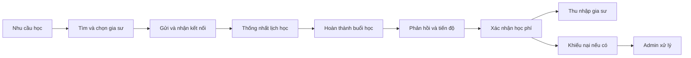

# Hướng dẫn trình bày và thao tác demo bảo vệ EduFit

**Ngày soạn:** 07/11/2026. Đi kèm [đề xuất dữ liệu demo](demo-data-proposal.md).

Tài liệu này hướng dẫn người trình bày. **Cập nhật 08/11/2026:** dữ liệu bổ sung đã nạp vào DB local `edufit` cổng 5434, đến V1.36. Tài khoản `@demo.edufit.test` đã đăng nhập và kiểm tra API thành công. Xem [dữ liệu đã bàn giao](defense-data-ready.md) để chọn đúng bản ghi; vẫn cần rehearsal trên giao diện trước khi bảo vệ.

## 1. Câu chuyện nên kể

> “EduFit hỗ trợ phụ huynh và học sinh tìm gia sư phù hợp, thống nhất lịch học, theo dõi tiến bộ và quản lý học phí. Em sẽ trình bày hành trình của một học sinh từ lúc tìm gia sư đến khi học xong và xử lý học phí, đồng thời cho thấy vai trò kiểm soát của Admin.”

Đi theo chuỗi này thay vì mở lần lượt tất cả menu:

Kết nối và xếp lịch dùng bộ dữ liệu đang chờ để thao tác mới. Buổi đã kết thúc dùng lịch sử có sẵn để trình bày các bước sau học. Nói rõ việc chuyển sang buổi mẫu đã diễn ra; không biến một buổi trong tương lai thành buổi đã hoàn thành ngay trên sân khấu.

## 2. Chuẩn bị trước buổi bảo vệ

### Tài khoản và cửa sổ

| Cửa sổ | Tài khoản xem lịch sử V1.34 | Tài khoản thao tác sau khi bổ sung seed |
| --- | --- | --- |
| Học sinh | `student.demo@edufit.vn` — Trần Minh Anh | `student.live@demo.edufit.test` — Nguyễn Gia Bảo |
| Phụ huynh | `parent.demo@edufit.vn` — Trần Văn Hưng | `parent.live@demo.edufit.test` — Nguyễn Thu Hà |
| Gia sư | `tutor.demo@edufit.vn` — Nguyễn Hoàng Lan | `tutor.live@demo.edufit.test` — Trần Quang Minh |
| Admin | `admin.demo@edufit.vn` | Dùng cùng admin.demo |

Mật khẩu của bộ V1.34 theo source: `Password123@`. Mật khẩu nhóm mới mới là đề xuất, cần đối chiếu sau khi nạp.

Chuẩn bị bốn browser profile/cửa sổ có cookie độc lập. Nhiều tab thông thường trên cùng profile dùng chung phiên đăng nhập, nên đăng nhập role này có thể thay phiên role khác. Đặt tên cửa sổ theo role để chuyển nhanh. Nếu có hai người trình bày, một người thao tác học sinh/phụ huynh, người còn lại thao tác gia sư/admin theo lời dẫn.

### Danh sách phải kiểm tra khi rehearsal

- [ ] Chọn đúng bản build đã tích hợp tính năng cần trình bày; các branch UI riêng chưa merge không tự xuất hiện trên branch hiện tại.
- [ ] Frontend/backend/DB hoạt động, bốn tài khoản đăng nhập đúng role.
- [ ] Có một request PENDING **còn hạn và không trùng lịch** để nhận thành công.
- [ ] Có khoảng giờ trống chung của gia sư và học sinh trong 7 ngày tới để đề xuất lịch mới.
- [ ] Có một buổi COMPLETED còn trong cửa sổ phản hồi payment; một buổi đã SETTLED; một hồ sơ khiếu nại chờ Admin.
- [ ] Số dư đủ thao tác và có bảng số tiền trước/sau; gia sư dùng để tạo yêu cầu rút mới không đang có yêu cầu PENDING.
- [ ] Tệp KYC mẫu mở được. Nếu dùng AI/payOS/email thật, kiểm tra cấu hình và kết nối trước.
- [ ] Chụp màn hình các trạng thái quan trọng sau rehearsal; ảnh chỉ là minh chứng dự phòng, không trình bày như thao tác live.
- [ ] Ghi vào phiếu bên dưới ngày giờ/tên người/tên môn của từng bản ghi; không dựa vào “dòng đầu tiên” vì danh sách có thể đổi thứ tự.

### Phiếu chọn bản ghi trước buổi demo

| Nhãn dùng trong tài liệu | Điền sau rehearsal | Yêu cầu |
| --- | --- | --- |
| Request A | Học sinh: … / Gia sư: … / Môn: … / Hạn: … | PENDING, có thể accept thành công |
| Lịch B | Lớp: … / Ngày: … / Từ: … / Đến: … | Khung trống chung, đủ điều kiện đề xuất |
| Buổi C | Lớp: … / Ngày giờ: … | Đã kết thúc, cần ghi nhận/nhận xét theo đúng service |
| Học phí D | Lớp: … / Buổi: … / Hạn phản hồi: … | Còn được xác nhận hoặc báo vấn đề |
| Khiếu nại E | Lớp: … / Buổi: … / Trạng thái: … | Hai bên có báo cáo hoặc đang chờ Admin xử lý |
| Rút tiền F | Gia sư: … / Số tiền: … | Có thu nhập khả dụng, chưa có yêu cầu chờ cản tạo mới |

## 3. Luồng chính trong 15 phút

### Bước 1 — Cho thấy hệ thống đã được sử dụng: 0:00–1:00

**Tài khoản:** parent.demo. **Trang:** `/parent/dashboard`.

1. Chỉ tên con đang theo dõi, lớp Toán/Tiếng Anh và buổi sắp tới.
2. Mở nhanh `/parent/progress` để chỉ có lộ trình và lịch sử thực tế; quay lại phần câu chuyện tìm gia sư.

**Lời dẫn:** “Đây là góc nhìn của phụ huynh sau một thời gian sử dụng. Dữ liệu lớp, lịch học, tiến độ và học phí được liên kết theo từng học sinh. Bây giờ em sẽ bắt đầu từ bước tìm gia sư.”

**Cần cho thấy:** sản phẩm có hành trình dài hạn, không chỉ form đăng ký. Không đọc từng ô thống kê và chưa phân tích biểu đồ ở bước này.

### Bước 2 — Nhu cầu quyết định cách chọn gia sư: 1:00–3:00

**Tài khoản:** student.live sau khi có dữ liệu bổ sung. **Trang:** `/student/profile`, sau đó `/student/tutors` hoặc `/student/tutors?tab=matches`.

1. Mở nhu cầu Toán lớp 9, luyện thi vào 10: chỉ mục tiêu, ngân sách, hình thức và lịch có thể học.
2. Mở Tìm gia sư, dùng một đến hai bộ lọc và chọn đúng nhu cầu học.
3. Nếu AI đã được rehearsal, mở AI Match và giải thích một điểm phù hợp cùng một tiêu chí chưa khớp; nếu chưa, dùng danh sách tìm kiếm thông thường.
4. Mở hồ sơ Trần Quang Minh: chỉ gói dạy, học phí, xác minh và nhận xét học viên nếu có.

**Lời dẫn:** “Người học không chỉ chọn theo tên môn. Hệ thống dùng nhu cầu gồm mục tiêu, cấp lớp, ngân sách và thời gian để hỗ trợ tìm người phù hợp. Thông tin xác minh và học phí giúp gia đình cân nhắc trước khi kết nối.”

**Kết quả:** có một gia sư đủ điều kiện để gửi request. Không hứa mức điểm AI cố định giữa các lần chạy.

### Bước 3 — Tạo lớp từ sự đồng ý của hai phía: 3:00–5:00

**Trang học sinh:** `/student/tutors`. **Trang gia sư:** `/tutor/requests`.

1. Seed có sẵn một request Gia Bảo → Quang Minh để demo nhận ngay. Nếu muốn trình bày gửi từ đầu, vào Yêu cầu kết nối và rút request có lời nhắn “DEMO A” trước. Sau đó bấm gửi yêu cầu, kiểm tra đúng môn/nhu cầu, mở phần đổi lịch nếu build đã tích hợp branch tính năng này.
2. Sửa một giờ sang **Lịch B đã chọn**, nhập lời nhắn: “Em muốn ôn phương trình và hình học, mong thầy hướng dẫn theo lộ trình.”
3. Gửi, chỉ trạng thái đang chờ ở `/student/tutors?tab=requests`.
4. Chuyển cửa sổ tutor.live, mở request vừa gửi, xem nhu cầu và lịch, chấp nhận.
5. Mở `/tutor/classes` hoặc `/student/classes` và chỉ lớp vừa tạo.

**Lời dẫn:** “Gửi yêu cầu chưa tạo lớp ngay. Gia sư cần xem nhu cầu và đồng ý. Học phí lớp được chốt theo gói dạy phù hợp tại thời điểm nhận.”

**Kết quả:** request đổi trạng thái, lớp xuất hiện. Chỉ bấm notification nếu rehearsal xác nhận event và đường dẫn đã hoạt động trên build này.

**Nếu chỉ dùng V1.34:** dùng request của student.khoi trong hộp thư tutor.demo sau khi kiểm tra còn hạn và không trùng. Đây là trình bày bước nhận request có sẵn; nói rõ như vậy. Không chọn request tối Thứ 6 của student.demo để minh họa accept thành công vì học sinh đã có lớp vào giờ đó.

### Bước 4 — Hai bên chốt lịch, hệ thống chống trùng: 5:00–7:00

**Trang:** `/tutor/schedule` và `/student/schedule`.

1. Gia sư đề xuất một buổi trong lớp vừa tạo, dùng giờ trống B, hình thức online/trực tiếp phù hợp lớp.
2. Chuyển sang học sinh, mở buổi PROPOSED và bấm “Xác nhận lịch học”.
3. Chỉ trạng thái đã chốt trên lịch tuần, ngày giờ và môn học.
4. Nếu còn thời gian, thử một giờ đã bận được chuẩn bị từ trước để chỉ thông báo chặn, sau đó đóng form.

**Lời dẫn:** “Hai phía đều biết buổi nào đã chốt và buổi nào mới được đề xuất. Khoảng giờ đã có lịch sẽ được kiểm tra để tránh nhận hai buổi trùng nhau.”

**Kết quả:** buổi mới là SCHEDULED. Một thao tác lỗi có chủ đích là đủ; không mất thời gian thử nhiều lỗi liên tiếp.

### Bước 5 — Chuyển sang buổi đã học để trình bày kết quả: 7:00–9:00

**Tài khoản:** tutor.demo, sau đó parent.demo/student.demo. **Trang:** `/tutor/schedule` hoặc `/tutor/history`, `/parent/progress`, `/student/progress`.

**Câu chuyển cảnh bắt buộc:** “Buổi vừa xếp là lịch tương lai. Để không phải chờ buổi học diễn ra, em chuyển sang một buổi mẫu đã kết thúc trong bộ dữ liệu lịch sử.”

1. Mở Buổi C đã chọn trong rehearsal. Nếu còn cần ghi nhận kết quả và service cho phép, gia sư ghi nhận hoàn thành trước khi viết phản hồi.
2. Nhập nhận xét cụ thể: “Giải đúng 7/10 bài phương trình; cần luyện đổi dấu. Bài về nhà: hoàn thành 5 bài trong chuyên đề.”
3. Nếu buổi đã có phản hồi, mở để xem thay vì cố tạo thêm bản thứ hai.
4. Chuyển sang phụ huynh: chỉ cột mốc liên quan, mức tự lập và báo cáo kỳ; học sinh có thể chọn cảm nhận sau buổi nếu chưa chọn.

**Lời dẫn:** “Hoàn thành buổi học không chỉ là đếm số buổi. Gia sư ghi bằng chứng học tập, học sinh phản hồi, phụ huynh theo dõi thay đổi theo thời gian.”

**Kết quả:** chỉ ra một thông tin vừa lưu và một xu hướng có lịch sử. Không nói thao tác vừa làm phải tăng phần trăm nếu nó chưa thay đổi tiêu chí hoặc đánh giá làm căn cứ tính tiến độ.

### Bước 6 — Giải thích tiền đi đâu: 9:00–11:00

**Trang người trả:** `/parent/billing` hoặc `/student/payments`. **Trang gia sư:** `/tutor/earnings`.

1. Mở ví đúng người trả phí; chỉ số khả dụng và số đang giữ.
2. Mở Học phí D của buổi 250.000đ; chỉ xác nhận buổi học và chỗ báo vấn đề. Nếu bấm xác nhận thì nói rõ đó là xác nhận đã học.
3. Chỉ hạn phản hồi 24 giờ đang hiển thị.
4. Mở **một buổi đã SETTLED khác** và đối chiếu: học phí 250.000đ, phí nền tảng 25.000đ, gia sư nhận 225.000đ.

**Lời dẫn:** “Tiền học được giữ theo buổi. Người học có thời gian phản hồi sau buổi học. Với buổi 250.000đ đã tất toán, EduFit thu 10%, gia sư nhận 225.000đ. Số dư và lịch sử giao dịch phản ánh các bước này.”

**Điểm cần nói chính xác:** trên cơ chế hiện tại, hai bên xác nhận vẫn có cửa sổ phản hồi 24h; không hứa bấm hai nút là gia sư nhận ngay. Không đợi hết 24h trong buổi bảo vệ. Dùng buổi lịch sử đã tất toán để chỉ kết quả cuối.

### Bước 7 — Luồng ngoại lệ có người chịu trách nhiệm: 11:00–13:00

**Tài khoản:** parent.demo/tutor.demo/admin.demo. **Trang:** `/parent/billing`, `/tutor/earnings`, `/admin/disputes`.

1. Mở Khiếu nại E. Chỉ buổi học liên quan, lý do, tiền đang giữ và trao đổi giữa hai bên.
2. Nếu case mới được chuẩn bị còn đủ điều kiện, người học gửi vấn đề; nếu case đã có khiếu nại thì xem trạng thái thay vì gửi trùng.
3. Chuyển Admin vào `/admin/disputes`, chọn đúng hồ sơ. Chỉ kết quả hai bên gửi và phần Admin xem xét.
4. Chỉ thực hiện quyết định nếu rehearsal xác nhận hồ sơ đang ở trạng thái hợp lệ; xem số tiền được hoàn/tất toán sau đó. Nếu hồ sơ chỉ dành xem lịch sử thì không bấm xử lý lại.

**Lời dẫn:** “Khi có tranh chấp, tiền chưa chuyển cho gia sư. Hai bên trao đổi trong thời hạn quy định, và Admin có hồ sơ để xem xét phân bổ tiền theo quyết định. Hệ thống giữ lịch sử thay vì giải quyết bằng trao đổi ngoài nền tảng.”

**Cần phân biệt:** 24h là cửa sổ phản hồi buổi học; 48h là thời gian xử lý trao đổi khiếu nại theo cơ chế hiện tại. Không khẳng định quá 48h sẽ tự trả tiền cho một bên; phải chỉ trạng thái thực tế sau timeout.

### Bước 8 — Khép hành trình bằng thu nhập và quản trị: 13:00–15:00

**Trang:** `/tutor/earnings`, `/admin/verification-queue`, `/admin/audit-logs`.

1. Gia sư dùng tài khoản Rút tiền F, chỉ thu nhập khả dụng và tài khoản ngân hàng mặc định.
2. Tạo yêu cầu rút với số tiền đã chốt trong rehearsal. Chỉ trạng thái chờ và số tiền được giữ.
3. Admin mở một hồ sơ KYC mẫu: xem tài liệu và lý do duyệt/từ chối; nếu thiếu thời gian chỉ xem hồ sơ đã xử lý.
4. Mở audit và lọc một hành động vừa thực hiện nếu hệ thống có ghi event đó.

**Lời dẫn kết thúc:** “Hành trình đã đi từ nhu cầu, chọn gia sư, chốt lịch, theo dõi kết quả đến học phí và thu nhập. Gia đình, gia sư và Admin có quyền và trách nhiệm riêng trên cùng dữ liệu.”

**Không bấm chuyển tiền ngân hàng thật khi chưa chốt trước.** Tạo yêu cầu rút trong hệ thống và thực hiện payout qua ngân hàng/payOS là hai bước khác nhau.

## 4. Nếu hội đồng chỉ cho 7 phút

| Thời lượng | Trình bày |
| --- | --- |
| 1 phút | Dashboard phụ huynh, mục tiêu và bối cảnh học sinh |
| 2 phút | Hồ sơ gia sư → gửi request → gia sư nhận, hoặc nhận request A có sẵn |
| 1 phút | Đề xuất và xác nhận lịch |
| 1 phút | Buổi lịch sử → phản hồi → tiến độ |
| 1 phút | Ví, hạn phản hồi, minh họa 250.000đ → 225.000đ + 25.000đ |
| 1 phút | Khiếu nại chờ admin và thu nhập gia sư |

Rút gọn bằng cách dùng đúng bản ghi đã chuẩn bị, không bỏ qua giải thích điều kiện hoặc nói một thao tác chưa thực hiện là đã thành công.

## 5. Các nhánh để trả lời câu hỏi của hội đồng

| Câu hỏi | Màn hình / dữ liệu nên mở | Điều cần chứng minh |
| --- | --- | --- |
| “Người mới vào thấy gì?” | student.empty hoặc parent.empty sau khi bổ sung seed | Hướng dẫn hoàn thiện hồ sơ, tạo nhu cầu, liên kết con |
| “Phụ huynh có nhiều con thì sao?” | parent.demo sau khi student.khoi đã nhận lời mời | Chuyển con, lịch và tiến độ đúng từng con |
| “Gia sư có đáng tin không?” | Hồ sơ public và hàng chờ KYC | Chuyên môn, tài liệu, trạng thái duyệt; hồ sơ chưa xác minh bị giới hạn đúng rule |
| “Nếu cần đổi/hủy lịch?” | Một buổi tương lai riêng trong `/student/schedule` | Đề xuất đổi có phản hồi; hủy có lý do, lịch sử và notification nếu được hỗ trợ |
| “Gửi cho hai gia sư cùng giờ?” | student.conflict sau khi bổ sung seed | Trùng lịch đã có lớp/buổi thì bị chặn; request PENDING chưa phải đặt chỗ, accept vẫn kiểm tra lại |
| “Không xác nhận học phí thì sao?” | Case REVIEW_OPEN và một buổi đã auto-settled | Hạn 24h và lịch sử xử lý; phân biệt với khiếu nại đang mở |
| “Tiền trong ví có thật không?” | Lịch sử ledger demo; payOS nếu đã chuẩn bị thật | Seed là dữ liệu minh họa; giao dịch thật cần QR, ngân hàng và webhook xác minh |
| “AI có hoạt động thật không?” | AI Match/Bio với provider đã cấu hình | Công bố đang dùng Gemini hay stub; không trình bày văn bản seed như phản hồi AI trực tiếp |
| “Nếu chưa đủ buổi để đánh giá?” | Lớp mới và lớp đủ điều kiện | Điều kiện tạo review theo service, review mới cập nhật điểm hồ sơ |
| “Thông báo có tự phát không?” | Bấm chuông sau thao tác mới đã rehearsal | Event backend và navigation; lịch sử notification seed không thay cho test sự kiện mới |

## 6. Xử lý khi demo không đúng như dự kiến

| Hiện tượng | Cách trình bày và xử lý |
| --- | --- |
| Request/đề xuất hết hạn | Nói rõ bản ghi đã hết hạn, chọn bản còn hạn từ phiếu hoặc tạo mới. Không sửa DB trực tiếp trước hội đồng. |
| Bị báo trùng lịch | Chỉ lý do, chọn giờ trống chung đã rehearsal. Nếu đang chủ đích minh họa lỗi thì xem đây là kết quả mong muốn. |
| Bấm xác nhận hai bên nhưng tiền chưa về | Chỉ cửa sổ 24h, chuyển sang buổi SETTLED để minh họa kết quả cuối. |
| Không tạo được yêu cầu rút | Kiểm tra số dư khả dụng và yêu cầu PENDING hiện có; dùng đúng tài khoản F. |
| AI/payOS/email bị gián đoạn | Nói dịch vụ tích hợp chưa phản hồi, trình bày phần dữ liệu lịch sử hoặc minh chứng đã chuẩn bị và ghi rõ là bản ghi trước đó. |
| Đổi role ở tab này khiến tab khác đăng xuất | Chuyển sang browser profile độc lập đã chuẩn bị. |
| Không có thông báo sau thao tác | Không tự nhận là đã phát thành công. Kiểm tra refresh/polling và nêu đúng giới hạn nếu chưa khắc phục. |
| Dữ liệu demo mới chưa được nạp | Dùng bộ V1.34 đã kiểm tra; bỏ các bước có email `@demo.edufit.test` và công bố đang trình bày lịch sử mẫu. |

## 7. Quy tắc giúp trình bày rõ ràng

1. Trước mỗi thao tác nói một câu “ai đang làm gì và vì sao”; sau thao tác chỉ vào trạng thái vừa thay đổi.
2. Dùng tên người, tên môn và ngày giờ để chỉ bản ghi; không đọc UUID hoặc tên bảng khi nói về trải nghiệm người dùng.
3. Mỗi luồng chính chỉ minh họa một trường hợp thành công; luồng ngoại lệ quan trọng nhất là khiếu nại và chống trùng lịch.
4. Không trình bày mọi trạng thái seed như thể vừa được tạo trong buổi demo. Chủ động nói khi chuyển sang dữ liệu lịch sử.
5. Phần kỹ thuật như modular backend, session/CSRF, Flyway, event, ledger và DB constraint dành cho phần hỏi đáp hoặc slide kiến trúc.

**Trạng thái tài liệu:** kịch bản dự kiến dựa trên source và đề xuất dữ liệu. Cần điền phiếu bản ghi, rehearsal trên build/DB được chọn rồi mới coi là hướng dẫn đã kiểm chứng để bảo vệ.
