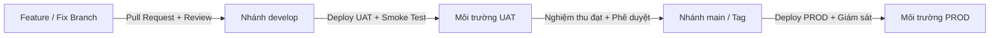

# Quy trình quản lý môi trường và phát hành (Environments & Release Workflow)

Cập nhật: 02/11/2026. Áp dụng cho toàn bộ dự án EduFit (Backend Java 21, Frontend Next.js, PostgreSQL / Supabase, Render).

---

## 1. Phân định môi trường và cơ sở dữ liệu

Dự án phân tách rõ ràng 3 môi trường để đảm bảo an toàn dữ liệu, tính bảo mật và sự ổn định của hệ thống:

| Tiêu chí | Môi trường DEV (Phát triển) | Môi trường UAT (Nghiệm thu / SIT) | Môi trường PROD (Vận hành thực tế) |
| --- | --- | --- | --- |
| **Mục đích** | Phát triển tính năng, kiểm thử đơn vị và tích hợp cục bộ | Kiểm thử tích hợp hệ thống (SIT), nghiệm thu người dùng (UAT), demo đối tác | Phục vụ người dùng cuối, vận hành thực tế |
| **Nhánh Git nguồn** | Nhánh cá nhân (`feat/*`, `fix/*`, `test/*`) và `develop` | `develop` (hoặc nhánh kiểm thử deploy có kiểm soát như `deploy/*`) | `main` (hoặc release tag, ví dụ `v1.0.0`) |
| **Nền tảng hạ tầng** | Máy cục bộ (Localhost), Docker Compose | Render Web Service (Free/Hobby), Frontend Vercel UAT | Render Web Service (Paid/Pro), Frontend Vercel Prod |
| **Cơ sở dữ liệu** | PostgreSQL cục bộ (mặc định port 5433 trong Compose) | PostgreSQL Supabase UAT riêng biệt | PostgreSQL Supabase / Cloud Managed riêng biệt |
| **Dữ liệu mẫu (Seed)** | Bật (`classpath:db/migration,classpath:db/seed`) | **TẮT** (`classpath:db/migration` duy nhất, không nạp seed demo) | **TẮT** (chỉ có bảng và danh mục chuẩn hệ thống) |
| **Bảo mật & Secret** | File `.env` cục bộ (được Git ignore) | Environment Secrets trên Render / Supabase | Key Vault / Secret Manager được mã hóa và phân quyền |

> [!IMPORTANT]
> **Quy tắc cô lập:** Tuyệt đối không dùng chung database giữa DEV, UAT và PROD. Không trỏ cấu hình DEV local sang DB UAT/PROD trừ khi chạy script launcher kiểm thử có chủ đích và có cơ chế bảo vệ.

---

## 2. Quy trình nhánh và cổng chất lượng (Git & Quality Gates)

### 2.1. Quy tắc mở Pull Request và Review
1. Mọi thay đổi mã nguồn phải được phát triển trên nhánh riêng xuất phát từ `develop` mới nhất.
2. Trước khi tạo PR:
   - Chạy `mvn test` (backend) và `npm run type-check` / `npm run test` (frontend).
   - Kiểm tra `git diff --check` để loại bỏ khoảng trắng thừa hoặc định dạng lỗi.
   - Đảm bảo không commit file nhạy cảm (`.env*`, credentials, khóa bí mật).
3. PR vào `develop` yêu cầu ít nhất 01 phê duyệt (approve) từ thành viên phụ trách / Tech Lead.
4. **Cảnh báo về CI:** Nếu CI bị *skipped* do cấu hình đường dẫn hoặc điều kiện lọc, trạng thái này **không** được coi là pass đủ điều kiện phát hành; phải kiểm tra thủ công các bài test tương ứng.

### 2.2. Nghiệm thu UAT (User Acceptance Testing) & SIT
- Nhánh `develop` được tự động hoặc kích hoạt thủ công để deploy lên môi trường UAT.
- Nhóm QA / Product Owner thực hiện kiểm thử theo kịch bản:
  - Xác thực & Phân quyền (Auth/RBAC, session cookie, bảo vệ CSRF).
  - Nghiệp vụ cốt lõi (Hồ sơ gia sư, nhu cầu học sinh, duyệt KYC, danh mục).
  - Tích hợp thanh toán payOS (chế độ Sandbox/Test, không dùng tiền thật).
  - Tích hợp AI Gateway (Gemini API hoặc stub kiểm soát quota).

---

## 3. Trách nhiệm phê duyệt và quy trình phát hành (Release Sign-off)

### 3.1. Người chịu trách nhiệm phê duyệt phát hành
- **Tech Lead / Lead Developer:** Chịu trách nhiệm về tính toàn vẹn kỹ thuật, kiểm tra migration Flyway tương thích ngược, cấu hình biến môi trường, bảo mật và kế hoạch rollback.
- **Product Owner (PO) / QA Lead:** Chịu trách nhiệm xác nhận kết quả nghiệm thu UAT, ký duyệt biên bản kiểm thử trước khi tạo release tag vào `main`.

### 3.2. Quy trình các bước triển khai (Deployment Steps)

#### Bước 1: Chuẩn bị trước khi deploy (Pre-deployment)
- [ ] Xác nhận nhánh nguồn đã hợp nhất đầy đủ và qua kiểm thử.
- [ ] Xuất bản sao lưu (backup) cơ sở dữ liệu đích trước khi chạy bất kỳ migration nào.
- [ ] Đối chiếu danh sách biến môi trường mới hoặc thay đổi, cập nhật lên dashboard hosting trước khi build.

#### Bước 2: Trong khi deploy (During deployment)
- [ ] Kích hoạt build trên Render Web Service.
- [ ] Theo dõi log build Docker: đảm bảo quá trình tải dependencies, biên dịch Maven, build JAR thành công.
- [ ] Theo dõi log khởi động Spring Boot:
  - Kiểm tra Flyway áp dụng các file `V...__*.sql` mới, checksum khớp, không có lỗi khóa advisory lock.
  - Kiểm tra Hibernate ddl-auto `validate` hoàn tất không lỗi thiếu bảng / cột.
  - Kiểm tra Tomcat lắng nghe đúng cổng (`SERVER_PORT` hoặc `PORT` của Render).
- [ ] Kiểm tra endpoint sức khỏe: `GET /actuator/health` phản hồi HTTP 200 với `{"status":"UP"}`.

#### Bước 3: Sau khi deploy (Post-deployment & Smoke Test)
- [ ] Chạy bộ kiểm thử nhanh (Smoke Test):
  - Lấy token CSRF tại `/api/v1/auth/csrf`.
  - Đăng ký / đăng nhập tài khoản test, xác nhận phiên (session) hoạt động.
  - Tải lại trang kiểm tra cookie session `EDUFIT_SESSION` có cờ `HttpOnly` và `Secure` khi qua HTTPS.
  - Lưu và đọc thông tin hồ sơ để đảm bảo quyền ghi DB hoạt động chuẩn xác.
- [ ] Kiểm tra hệ thống giám sát log: không có biệt lệ `ERROR` bất thường hoặc rò rỉ thông tin nhạy cảm.

---

## 4. Kế hoạch theo dõi và xử lý sự cố (Monitoring & Rollback)

### 4.1. Giám sát vận hành (Monitoring)
- **Render Dashboard:** Giám sát mức tiêu thụ CPU, RAM (đặc biệt lưu ý ngưỡng 512 MB của gói Free), và HTTP Response Status Codes.
- **Supabase Dashboard:** Giám sát số lượng kết nối đang mở (Connection Pooling), dung lượng lưu trữ (Storage/Disk quota), và thời gian truy vấn DB.
- **Spring Actuator:** Sử dụng `/actuator/health` để hệ thống tự động khởi động lại nếu dịch vụ bị treo hoặc mất kết nối DB.

### 4.2. Chiến lược Rollback (Khôi phục trạng thái ổn định)

Khi phát hiện sự cố nghiêm trọng sau phát hành:

1. **Trường hợp lỗi ứng dụng (Code-only Bug, DB Schema không đổi):**
   - Trên Render Web Service: Chọn **History / Deploys** -> Chọn commit thành công liền trước -> Chọn **Rollback to this deploy**.
   - Thời gian khôi phục thông thường từ 1 - 3 phút.

2. **Trường hợp có thay đổi cơ sở dữ liệu (Flyway Schema Migration):**
   - **LƯU Ý QUAN TRỌNG:** Rollback image Docker trên Render **KHÔNG** tự động rollback các thay đổi trong cơ sở dữ liệu.
   - Nếu bản build cũ không tương thích với schema mới:
     - **Ưu tiên 1 (Forward-fix):** Tạo nhánh hotfix nhanh để sửa lỗi code mà vẫn tương thích với schema hiện tại.
     - **Ưu tiên 2 (Restore Database):** Trong trường hợp dữ liệu bị sai lệch nghiêm trọng, tạm dừng web service, khôi phục DB từ bản sao lưu trước khi deploy (xem hướng dẫn tại [render-supabase.md](render-supabase.md)), sau đó mới rollback service về bản cũ.
   - Tuyệt đối không tự ý xóa bảng `flyway_schema_history` trên môi trường UAT hoặc PROD.

---

## 5. Tài liệu liên quan

- Hướng dẫn kết nối Render và Supabase: [render-supabase.md](render-supabase.md)
- Kế hoạch triển khai UAT chi tiết: [plan.md](../../tasks/deployment/plan.md)
- Bảng công việc triển khai: [todo.md](../../tasks/deployment/todo.md)
