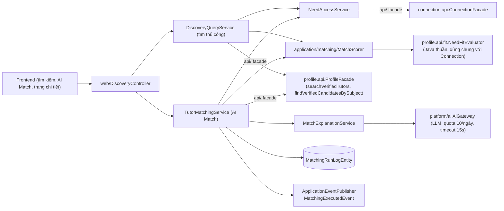
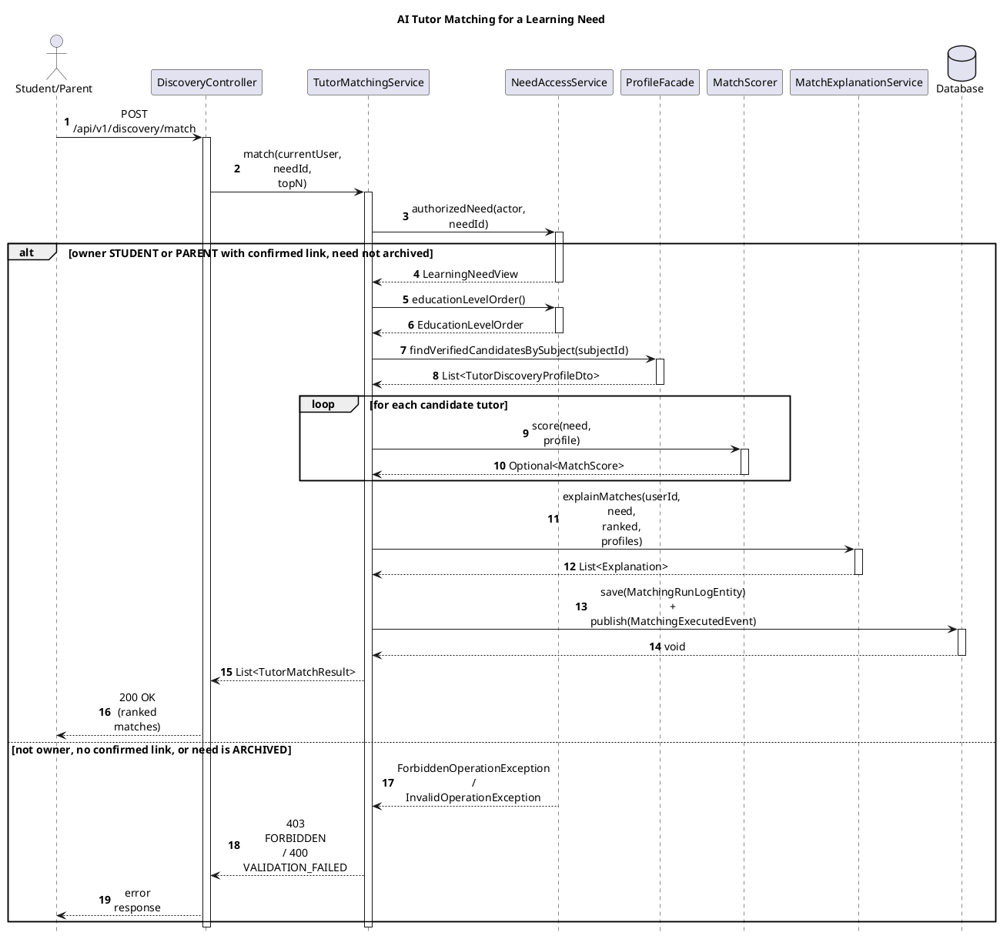

# Module Discovery

- **Mã nguồn:** `backend/modules/discovery/`
- **Mẫu kiến trúc:** Loại 1 — Standard, kết hợp chính sách chấm điểm thuần Java trong `application/matching/` (không có `domain/` riêng; logic cốt lõi nằm ở `application/matching/MatchScorer` + `profile.api.fit.NeedFitEvaluator`), theo [backend-module-structure-guide.md](../backend-module-structure-guide.md).
- **Cập nhật nội dung:** 11/11/2026 — viết lại từ [discovery_implementation_plan.md](discovery_implementation_plan.md) (nhật ký thực thi T00–T15) theo khung README chuẩn, đối chiếu lại với mã nguồn hiện tại (`MatchScorer`, `NeedFitEvaluator`, `MatchWeights`, `DiscoveryController`) — **công thức chấm điểm 5 yếu tố cố định 30/20/20/15/15 trong plan cũ đã được thay bằng cơ chế trọng số động theo tiêu chí áp dụng được** (xem mục 2 và 5.1); tài liệu này mô tả đúng hành vi hiện tại, không phải bản kế hoạch ban đầu.

---

## 1. Kiến trúc (Architecture)

```
backend/modules/discovery/src/main/java/vn/edufit/discovery/
│
├── api/
│   ├── DiscoveryFacade.java                # findTopMatchesForNeed(actor, needId, topN) — public entry cho module khác
│   ├── dto/TutorMatchSummaryDto.java
│   └── event/MatchingExecutedEvent.java    # userId, studentId, needId, resultCount, executedAt
│
├── application/
│   ├── matching/                            # Chính sách chấm điểm — Java thuần, không Spring/JPA
│   │   ├── MatchScorer.java                 # Chấm điểm 1 gia sư so với 1 nhu cầu học
│   │   ├── MatchWeights.java                # @ConfigurationProperties — trọng số theo FitCriterion, tổng = 100
│   │   └── MatchScore.java                  # Kết quả chấm điểm + rankingOrder() (tie-break)
│   ├── service/
│   │   ├── DiscoveryQueryService.java        # Tìm thủ công (search) + chi tiết gia sư + fit 1-1
│   │   ├── TutorMatchingService.java          # AI Match — chấm toàn bộ ứng viên theo 1 nhu cầu, ghi log + event
│   │   ├── NeedAccessService.java             # Phân quyền dùng nhu cầu học + cung cấp EducationLevelOrder
│   │   ├── MatchExplanationService.java       # Giải thích AI cho Top 1 (có fallback)
│   │   └── DiscoveryFacadeImpl.java
│   └── dto/  DiscoveredTutor, TutorMatchResult, TutorSearchCriteria (ở profile.api.dto)
│
├── domain/model/EducationLevelOrder.java    # areAdjacent(levelId1, levelId2) theo sort_order — Java thuần
│
├── infra/persistence/
│   ├── entity/MatchingRunLogEntity.java      # Audit mỗi lượt AI Match
│   └── repository/MatchingRunLogRepository.java
│
└── web/
    ├── DiscoveryController.java              # /api/v1/discovery/**
    ├── request/  TutorSearchRequest, TutorMatchRequest
    └── response/ TutorDiscoveryCardResponse, TutorDetailResponse, TutorMatchResponse
```

Discovery **không có dữ liệu gia sư riêng** — mọi dữ liệu (hồ sơ, gói dạy, khung giờ rảnh) được đọc qua `profile.api.ProfileFacade` (chỉ trả về ứng viên `VERIFIED`, có cận trên `candidateLimit`/`searchLimit`, không full scan). Quyền dùng nhu cầu học và thứ tự cấp học được chuẩn hóa một chỗ ở `NeedAccessService`, dùng chung cho cả tìm thủ công và AI Match.



---

## 2. Tổng quan & Bối cảnh (Overview & Situation)

Discovery có **hai luồng tìm gia sư khác nhau về nguyên tắc**, dùng chung engine chấm điểm nhưng vai trò của tiêu chí khác nhau:

- **Tìm thủ công (`DiscoveryQueryService.searchTutors`):** tiêu chí người dùng tự bấm (môn, cấp, giá, khu vực, hình thức, từ khóa...) là **lọc cứng** ở tầng DB (`ProfileFacade.searchVerifiedTutors`). Nếu có kèm `needId`, các tiêu chí của nhu cầu đó **chỉ dùng để sắp xếp** — gia sư khớp nhiều hơn đứng trước, không bị loại vì thiếu khớp.
- **AI Match (`TutorMatchingService.match`):** chấm **toàn bộ ứng viên đã `VERIFIED` dạy đúng môn** (`ProfileFacade.findVerifiedCandidatesBySubject`, có cận trên `candidateLimit`, mặc định 200 — giới hạn tài nguyên, có thể bỏ sót ứng viên điểm cao ngoài tập lấy mẫu) theo đúng 1 nhu cầu học, trả Top N (1..10, mặc định 5) kèm giải thích AI cho hạng 1.

**Điều kiện cứng duy nhất để một gia sư được xét chấm điểm:** có gói dạy (`TutorOffering`) đúng môn với nhu cầu (`NeedFitEvaluator.bestOffering`) — không có gói dạy đúng môn thì bị loại thẳng (`Optional.empty()`), không tính điểm 0. Mọi tiêu chí khác (**cấp học, mục tiêu, giáo trình, hình thức/khu vực, học phí, khung giờ**) đều là **tiêu chí mềm**: không khớp chỉ bị trừ điểm (nhãn ⚠), không loại ứng viên.

**Quyền truy cập nhu cầu học (dùng chung cho cả 2 luồng, `NeedAccessService.authorizedNeed`):** Học sinh chỉ dùng được nhu cầu của chính mình; Phụ huynh chỉ dùng được khi có `ConnectionFacade.hasConfirmedParentLink(parentUserId, studentId)` — không có "workaround cho phép mọi goal" như từng tồn tại trong bản kế hoạch ban đầu. Nhu cầu đã `ARCHIVED` bị từ chối.

---

## 3. API Contract — `/api/v1/discovery/**`

| Method | Endpoint | Mô tả | Lọc cứng / Quyền |
|---|---|---|---|
| GET | `/tutors` | Tìm kiếm thủ công, phân trang (`page`, `size` ≤100), `sortBy` (relevance/rating/price/experience), `sortDirection` | Tiêu chí trong `TutorSearchRequest` lọc cứng ở DB; `needId` (tùy chọn) chỉ ảnh hưởng thứ tự |
| GET | `/tutors/{tutorId}` | Chi tiết một gia sư `VERIFIED` | 404 nếu không `VERIFIED`/không tồn tại |
| GET | `/needs/{needId}/tutors/{tutorId}/fit` | Độ khớp (✔/⚠ từng tiêu chí) giữa 1 gia sư và 1 nhu cầu — dùng trước khi gửi yêu cầu kết nối | `NeedAccessService.authorizedNeed` |
| POST | `/match` | AI Match — chấm toàn bộ ứng viên đúng môn theo 1 nhu cầu, trả Top N kèm giải thích | `NeedAccessService.authorizedNeed`; chỉ STUDENT/PARENT |

**Giao tiếp nội bộ (`api/DiscoveryFacade`)** — module khác chỉ gọi qua đây: `findTopMatchesForNeed(actor, needId, topN)` — trả `List<TutorMatchSummaryDto>` (điểm 0..100, tên hiển thị, giải thích, cờ `aiGenerated`), không lộ entity/web DTO nội bộ.

---

## 4. Luồng triển khai từng bước (Implementation Flows)

### 4.1. AI Match — chấm điểm, ghi log và publish event cùng transaction

**Trace table**

| # | From | To | Real method | File:line |
|---|---|---|---|---|
| 1 | Student/Parent | DiscoveryController | `matchTutors(request)` — `POST /api/v1/discovery/match` | `web/DiscoveryController.java:87-88` |
| 2 | DiscoveryController | TutorMatchingService | `match(currentUser, needId, topN)` | `application/service/TutorMatchingService.java:63` |
| 3 | TutorMatchingService | NeedAccessService | `authorizedNeed(actor, needId)` | `NeedAccessService.java:28` |
| 4 | TutorMatchingService | NeedAccessService | `educationLevelOrder()` | `NeedAccessService.java:46` |
| 5 | TutorMatchingService | ProfileFacade | `findVerifiedCandidatesBySubject(subjectId)` | `profile.api.ProfileFacade`, impl `ProfileFacadeImpl.java:155` |
| 6 | TutorMatchingService | MatchScorer | `score(need, profile)` per candidate | `application/matching/MatchScorer.java:29` |
| 7 | TutorMatchingService | MatchExplanationService | `explainMatches(userId, need, ranked, profiles)` | `MatchExplanationService.java:35` |
| 8 | TutorMatchingService | Database | `matchingRunLogRepository.save(log)` + `eventPublisher.publishEvent(MatchingExecutedEvent)` | `TutorMatchingService.java:97-100` |

![Sequence Diagram](https://www.plantuml.com/plantuml/svg/VLLDRziu4BthLmnySj0KJhh17eeWg1tPM6DTsx3TN0jQ7CTiQ58bASNPHVzxXvHaKOxHa_ZnPkRnpOU-MCUCAmuoSS99XE4KDeNJ1huob-s5UeOTRHZCa1dbjtD4dZ22gEAmHPFi1KV2QBVLnyI-29KpmmvWzuphrs3FfCNevi2ENz5QzenhyH_2tpUn5VuiK6LO0uPIF2l8K3aAT6_TcyI7X91EP29doi7_2S2ISUxZt7vAVYNtWnhL-kIuOuLq4wtSd1qGUYE49u5EqTtIwDvbQE1sUvSaBFDgzDQkuCHZi6I6FZrW5hvPOXMpwQN2Phf4y_P87eoM4ar0jjikFYZT2Br6KueCWy4mpxj8h_emoqYM3YoST97qf9sGE64PunMgFkd2GjHrfarDiLfUm8oFkMIAEQ5L73eS2vLmvjYMMP8rhLVXEXqbYTS7FZv4huVFi5oiDp1WkHYKjmFUw3Ku-51UQr4oXx5WaJNv8c78IK3tiyBuNFWmrw18e2c_1gVp-LNho0lfRRnf48kigNZtsb1-kLUr7nBSE8XDAt6PTA1V5OLVRxwbu_a6g1oMmvLVlGgtXqohdJ07v225UgaSWT8EcA6ybjGjqCJ-U7f1qqwU0HNZAs4udeS6EAUElCX2AcPOebmOZgP_HRWBbkSHn-zD_noqBXiotGd5dz28dK3-o1GNb7IqexTriVs1cUlRwklLYwWqPGSdJz7pXNNteVfFBLE3KgSVkhnQFrBhF8mZkYJT6oRWl2EwFr6lYfdYMB_e-unSGrxvkGh0a_UwxlrPRTMoNEHUBoRlssPv2CY8tSaU5M-rgxl3PwnQ1Gze-mKLgo_JYf9XwYMYPZlwDHq69szd-aMTUIPPQrhpIKTU35PYlvasgqBDzFDOqTH_ku8Fa1TRAUp-T3y-ObOuvEEIMgp3YreRlCEMJQa5xn88c13xlF_Rp8T8AxGqS3tzkC_9A0oFp_3fvWOM_qA_KgfgVAyJqZybD5beJT9Jl-j3gfFGYeBcvEhnd-dJEBtK5nDjjeBJR5_aQ8AOusE68VCmWAagcHJy_TsVUkVypNStVy5aiHfDKveVvFIE7lKqd4tJuMQwc7-V3AUpmEso16WCFSMWpRMY7wclipWo3RXe6mtEBuIa__fl)



Assumptions: the `score()` call inside the `loop` returns `Optional.empty()` for tutors with no matching subject offering — this filtering is implicit in the real `Optional` return type (`TutorMatchingService.java:81-84` uses `flatMap(Optional::stream)`), not drawn as a second branch to stay within the one-`alt` budget.

Log và event luôn đi cùng nhau trong **một `TransactionTemplate` riêng** (`transactionOperations.executeWithoutResult`) — một lượt chạy thành công, kể cả khi trả về 0 kết quả, vẫn ghi đúng 1 log và publish đúng 1 event với cùng `actor/student/need/count`; lượt chạy lỗi (ví dụ nhu cầu chưa đủ thông tin) không để lại log "thành công" mồ côi. Listener có side-effect (ví dụ ghi thêm dữ liệu) phải nghe ở `AFTER_COMMIT` — đây không phải cơ chế outbox bền (durable), event là in-process.

### 4.2. Chấm điểm 1 gia sư — cơ chế trọng số động (`MatchScorer.score`)

1. `NeedFitEvaluator.evaluate(need, tutor, levelOrder::areAdjacent)` chọn gói dạy phù hợp nhất (`bestOffering` — cùng môn, ưu tiên cùng nhánh/đúng cấp/có mục tiêu, giá thấp hơn). Không có gói đúng môn → `Optional.empty()` → gia sư bị loại khỏi kết quả.
2. Với gói đã chọn, sinh danh sách `FitCheck` theo từng tiêu chí **có áp dụng được** cho nhu cầu này: `LEVEL`, `GOAL` luôn có; `TEXTBOOK` chỉ khi nhu cầu có chọn giáo trình; `LOCATION` chỉ khi nhu cầu có chỉ định hình thức; `BUDGET` chỉ khi có `budgetMaxPerSession > 0`; `SCHEDULE` chỉ khi có khung giờ mong muốn.
3. Điểm tổng = **trung bình có trọng số chỉ trên các tiêu chí áp dụng được + rating** — tiêu chí không áp dụng (ví dụ nhu cầu không khai báo giáo trình) **không có trong mẫu số**, nên trọng số của nó không bị "mất" mà tự động dồn tỷ trọng tương đối cho các tiêu chí còn lại:
   ```text
   weighted = rating_score * weight(rating) + Σ score(check) * weight(check.criterion)
   applicableWeight = weight(rating) + Σ weight(check.criterion)   // chỉ tiêu chí có mặt
   total = weighted / applicableWeight   // scale 2, HALF_UP
   ```
4. `rating_score` (`ratingFit`): gia sư chưa có đánh giá → cố định **35/100**; có đánh giá → `min(ratingAvg,5) * 20 * confidence`, với `confidence = 0.5 + 0.1*min(5, reviewCount)` (độ tin cậy tăng theo số lượt đánh giá, bão hòa ở 5 lượt).
5. Xếp hạng (`MatchScore.rankingOrder`): `total` giảm dần → số tiêu chí khớp (`matchedCount`) giảm dần → điểm khung giờ (`scheduleScore`) giảm dần → số lượt đánh giá giảm dần → `registeredAt` tăng dần (ai đăng ký trước ưu tiên) → `tutorId` (tie-break cuối, ổn định tuyệt đối).

### 4.3. Tìm thủ công (search) — lọc cứng tại DB, nhu cầu chỉ ảnh hưởng thứ tự

`DiscoveryQueryService.searchTutors`: nếu có `needId`, gọi `NeedAccessService.authorizedNeed` trước; gọi `ProfileFacade.searchVerifiedTutors(criteria, searchLimit)` (lọc `VERIFIED` + mọi tiêu chí người dùng chọn tại DB, có cận trên `searchLimit`) → với mỗi gia sư, nếu có nhu cầu kèm theo thì chấm điểm bằng `MatchScorer` để phục vụ sắp xếp `relevance`, nhưng **không loại gia sư nào vì điểm thấp**.

### 4.4. Giải thích AI cho Top 1 (có fallback)

`MatchExplanationService.explainMatches`: chỉ gọi AI cho đúng 1 kết quả (hạng cao nhất); quota 10 lần/ngày theo actor (tính rolling 24h — Phụ huynh trả quota của chính mình, không trả hộ con); timeout provider 15s qua executor ảo có deadline cứng (hủy future khi quá hạn, không chờ provider "best-effort"); prompt chỉ chứa facts đã xác minh từ 5 tiêu chí chấm điểm, **không chứa PII** (không email, SĐT, tiểu sử). Quota hết/timeout/provider lỗi → fallback về câu giải thích dựng từ `FitCheck` có sẵn (không gọi AI), `aiGenerated=false`.

---

## 5. Chi tiết bổ sung & Kỹ thuật

### 5.1. Vì sao không còn công thức 5 yếu tố cố định 30/20/20/15/15

Bản kế hoạch ban đầu (`discovery_implementation_plan.md`, mục 2.3) định nghĩa trọng số cố định `subject 30% / level 20% / price 20% / time 15% / rating 15%`. Trong quá trình triển khai (T07), nhóm phát hiện cách này ép mọi nhu cầu phải có đủ 5 tiêu chí để tính đúng tổng 100%, trong khi nhiều nhu cầu không khai báo giáo trình/khung giờ/ngân sách. Giải pháp được chốt (và là hành vi hiện tại): `MatchWeights` cấu hình theo **7 tiêu chí** (`level, goal, schedule, textbook, budget, location, rating`, bắt buộc tổng = 100, mặc định `MatchWeights.standard() = 15/20/20/10/10/10/15`), và `MatchScorer` **chỉ tính trên tiêu chí áp dụng được cho từng nhu cầu cụ thể** (mục 4.2) — môn học không còn là một "tiêu chí có điểm" mà là điều kiện lọc cứng duy nhất.

### 5.2. Batch Hydration & chống N+1 (giống nguyên tắc ở Connection)

Giống [CONNECTION_README.md §4.3](../connection/CONNECTION_README.md), các truy vấn ứng viên (`searchVerifiedTutors`, `findVerifiedCandidatesBySubject`) chạy **một câu SQL có cận trên** tại `ProfileFacade`/`TutorProfileRepository`, không scan toàn bảng rồi lọc trong RAM. `spring.jpa.open-in-view=false` đảm bảo không có lazy query rò ra tầng Controller.

### 5.3. Giới hạn đã biết (ghi nhận minh bạch, không tuyên bố đã khắc phục)

- **Candidate cap (mặc định 200):** là giới hạn tài nguyên, có thể bỏ sót gia sư điểm cao nằm ngoài 200 ứng viên lấy mẫu đầu — không phải Top N toàn cục chính xác tuyệt đối trên toàn hệ thống.
- **Quota AI 10/ngày:** đếm-rồi-gọi (count-then-call), không phải một phép đặt trước (reservation) nguyên tử — về lý thuyết có thể bị vượt nhẹ dưới tải đồng thời cao.
- **Event `MatchingExecutedEvent`:** in-process (Spring `ApplicationEventPublisher`), không phải cơ chế phân phối bền (durable outbox) — mất nếu tiến trình crash giữa publish và xử lý.
- **Cận trên `candidateLimit`/`searchLimit`:** cấu hình qua `edufit.discovery.matching.candidate-limit` (mặc định 200 ở `ProfileFacadeImpl`) — tăng giá trị này đổi trực tiếp chi phí truy vấn, cần đo lại hiệu năng khi thay đổi.

### 5.4. Ranh giới phụ thuộc

Discovery → `profile.api.ProfileFacade` (dữ liệu gia sư/nhu cầu) và → `connection.api.ConnectionFacade` (xác nhận liên kết Phụ huynh–Học sinh) — **một chiều duy nhất**, không có phụ thuộc ngược lại (`connection`/`profile` không import gì từ `discovery`). `NeedFitEvaluator` thực tế sống ở `profile.api.fit` (không phải trong module `discovery`) vì cả `discovery` và `connection` (hộp thư gia sư, xem [CONNECTION_README.md §4.3](../connection/CONNECTION_README.md)) đều cần dùng chung logic so khớp này — tránh lặp code giữa 2 module.
