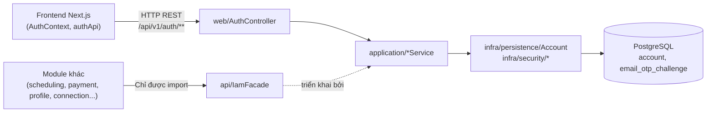
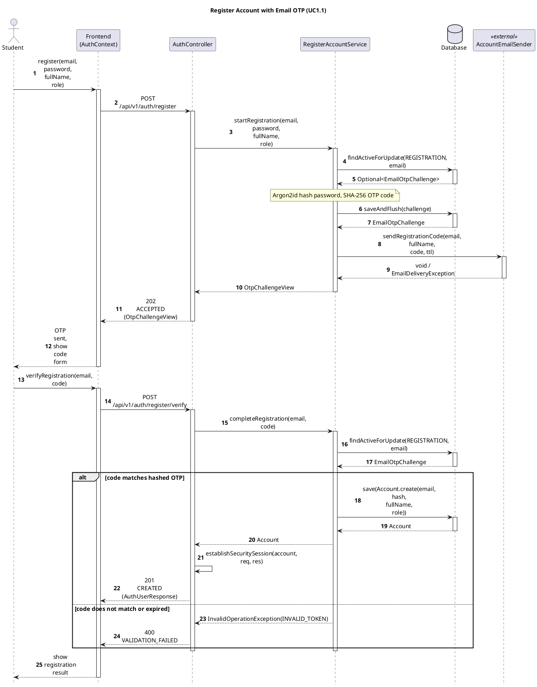
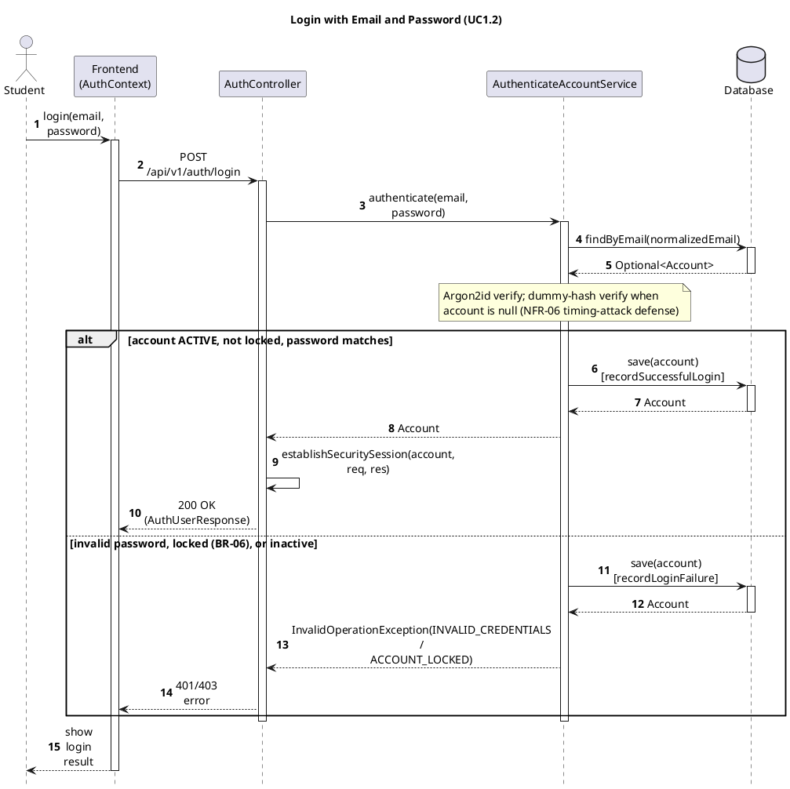

# Module IAM (Identity & Access Management)

- **Mã nguồn:** `backend/modules/iam/`
- **Trạng thái:** Hoàn thành ở Sprint 1, giữ nguyên như hạ tầng xác thực nền tảng (baseline) cho toàn hệ thống.
- **Mẫu kiến trúc:** Loại 1 — Standard / Pragmatic Module (không có `domain/`), theo [backend-module-structure-guide.md](../backend-module-structure-guide.md).
- **Tài liệu liên quan:** [ADR-001](../ADR-001-tech-stack.md), [ADR-002](../ADR-002-multi-module-architecture.md)

---

## 1. Kiến trúc (Architecture)

### 1.1. Vị trí trong hệ thống

IAM là module **nền tảng** — mọi module khác (`scheduling`, `payment`, `connection`, `review`...) đều phụ thuộc gián tiếp vào IAM để xác định danh tính người dùng hiện tại (`CurrentUser`) và để tra cứu thông tin tài khoản an toàn qua `IamFacade`. IAM không phụ thuộc ngược lại module nào khác.

```
vn.edufit.iam/
│
├── api/                                # Bề mặt công khai cho module Java khác
│   ├── IamFacade.java                  # Interface: tra cứu UserSummaryView, đếm số lượng theo vai trò...
│   ├── AccountRole.java / AccountStatus.java
│   └── dto/UserSummaryView.java
│
├── web/                                # HTTP REST cho Next.js
│   ├── AuthController.java             # /api/v1/auth/** — 16 endpoint (mục 3)
│   ├── dto/                            # Request/Response (Record): RegisterRequest, LoginRequest,
│   │                                   # AuthUserResponse, OtpChallengeView, PasswordResetGrant...
│
├── application/                        # Use Case Services (mỗi service = 1 nhóm nghiệp vụ)
│   ├── RegisterAccountService.java     # UC1.1 — đăng ký 2 bước qua OTP
│   ├── AuthenticateAccountService.java # UC1.2 — đăng nhập email/password
│   ├── GoogleOAuthService.java         # UC1.2 — đăng nhập/đăng ký qua Google OAuth2
│   ├── CompleteOAuthRegistrationService.java
│   ├── OAuthOnboardingTokenService.java# Bộ nhớ tạm (ConcurrentHashMap) giữ onboardingToken 30 phút
│   ├── RequestPasswordResetService.java / ResetPasswordService.java   # UC1.3
│   ├── ChangePasswordService.java      # UC1.4
│   ├── UpdateAvatarService.java        # Nhiệm vụ 1.3
│   └── IamFacadeImpl.java              # Triển khai api/IamFacade.java
│
└── infra/
    ├── persistence/
    │   ├── Account.java                # Aggregate chính (@Entity), AccountRepository
    │   ├── EmailOtpChallenge.java       # OTP đăng ký & quên mật khẩu, EmailOtpChallengeRepository
    │   └── TokenType.java               # VERIFY_EMAIL (24h) / RESET_PASSWORD (30 phút)
    ├── security/
    │   ├── Argon2PasswordService.java   # Hash mật khẩu (Argon2)
    │   ├── TokenCryptoService.java      # Sinh & băm OTP/token (SHA-256), raw token 256-bit
    │   └── EduFitUserDetails.java       # Spring Security UserDetails adapter
    └── storage/AvatarStorageService.java
```

### 1.2. Sơ đồ phụ thuộc



---

## 2. Tổng quan & Bối cảnh (Overview & Situation)

IAM chịu trách nhiệm cho **toàn bộ danh tính và phiên làm việc** của người dùng EduFit: đăng ký, đăng nhập (email/password và Google OAuth2), quên/đổi mật khẩu, quản lý ảnh đại diện, và phát `CurrentUser` cho các module khác dùng để phân quyền.

Các nguyên tắc nghiệp vụ cố định (Business Rules):
- **BR-01:** Email được chuẩn hóa — `trim()` + lowercase — trước khi lưu hoặc so khớp.
- **BR-02:** Mật khẩu tối thiểu 8 ký tự, có cả chữ và số (`PasswordPolicy`).
- **BR-03:** Vai trò tự đăng ký công khai chỉ gồm `STUDENT`, `PARENT`, `TUTOR`; **tuyệt đối cấm** tự đăng ký `ADMIN` (chặn cứng trong `Account.create()`).
- **BR-04:** Tài khoản chỉ được tạo **sau khi** người dùng nhập đúng mã OTP gửi tới email (đăng ký 2 bước, OTP không lưu plaintext mà băm SHA-256 theo `challengeId`).
- **BR-05:** Token đặt lại mật khẩu (`PasswordResetGrant.resetToken`) có hạn 30 phút, dùng một lần.
- **BR-06:** Tài khoản bị tạm khóa đăng nhập sau một số lần sai liên tiếp (`Account.isLocked()`, `failedLoginAttempts`).
- **NFR-06:** Endpoint `forgot-password` luôn trả lời trung tính (không tiết lộ email có tồn tại trong hệ thống hay không) để chống dò email.

Danh tính xác thực dùng **session cookie** (`EDUFIT_SESSION`) do Spring Security quản lý, không dùng JWT ở tầng client — `AuthController.establishSecuritySession()` thiết lập `SecurityContext` + cookie sau mọi hành động đăng nhập/đăng ký/đặt lại mật khẩu thành công.

---

## 3. API Contract — Endpoint `/api/v1/auth/**`

| Method | Endpoint | Mô tả | Request | Response (`data`) |
|---|---|---|---|---|
| POST | `/register` | UC1.1 bước 1 — gửi OTP, chưa tạo tài khoản | `RegisterRequest{email,password,fullName,role}` | `OtpChallengeView` (202) |
| POST | `/register/resend` | Gửi lại OTP đăng ký | `EmailRequest{email}` | `OtpChallengeView` |
| POST | `/register/verify` | UC1.1 bước 2 — xác thực OTP, tạo tài khoản + đăng nhập | `VerifyOtpRequest{email,code}` | `AuthUserResponse` (201) |
| POST | `/login` | UC1.2 — đăng nhập email/password | `LoginRequest{email,password}` | `AuthUserResponse` |
| POST | `/oauth2/google` | Đăng nhập/đăng ký qua Google OAuth2 | `OAuthLoginRequest{idToken}` | `OAuthLoginResult` (có thể cần chọn vai trò) |
| POST | `/oauth2/complete-registration` | Hoàn tất đăng ký OAuth sau khi chọn vai trò | `CompleteOAuthRegistrationRequest{onboardingToken,role}` | `AuthUserResponse` (201) |
| POST | `/logout` | Đăng xuất, hủy session | — | — |
| POST | `/forgot-password` | UC1.3 bước 1 — yêu cầu OTP (phản hồi trung tính) | `EmailRequest{email}` | `OtpChallengeView` |
| POST | `/forgot-password/verify` | UC1.3 bước 2 — đổi OTP lấy reset token | `VerifyOtpRequest{email,code}` | `PasswordResetGrant{resetToken,expiresAt}` |
| POST | `/reset-password` | UC1.3 bước 3 — đặt mật khẩu mới + đăng nhập | `ResetPasswordRequest{token,newPassword}` | `AuthUserResponse` |
| POST | `/change-password` | UC1.4 — đổi mật khẩu khi đã đăng nhập | `ChangePasswordRequest{currentPassword,newPassword}` | — |
| GET | `/me` | Lấy thông tin tài khoản đang đăng nhập | — (yêu cầu session) | `AuthUserResponse` |
| POST | `/avatar` | Upload ảnh đại diện (multipart) | `MultipartFile file` | `AuthUserResponse` |
| GET | `/avatar/{fileName}` | Tải tệp ảnh đại diện (công khai, không yêu cầu session) | — | File ảnh |
| PUT | `/avatar` | Cập nhật ảnh đại diện bằng URL có sẵn (không upload file) | `UpdateAvatarUrlRequest{avatarUrl}` | `AuthUserResponse` |
| DELETE | `/avatar` | Xóa ảnh đại diện, về mặc định | — | `AuthUserResponse` |

Tất cả response đều bọc trong `ApiResponse<T>{success, message, data, code, details, timestamp}`. Lỗi nghiệp vụ dùng `InvalidOperationException` kèm `ErrorCode` (ví dụ `UNAUTHORIZED`, `INVALID_CURRENT_PASSWORD`, `USER_ALREADY_EXISTS`, `EMAIL_DELIVERY_FAILED`).

**Giao tiếp nội bộ (`api/IamFacade`)** — các module khác chỉ được gọi qua interface này:
`findUserSummaryById`, `findUserSummaryByEmail`, `findUserSummariesByIds` (batch), `existsById`, `countTotalUsers`, `countUsersByRole`, `findActiveAdminIds`.

---

## 4. Luồng triển khai từng bước (Implementation Flows)

### 4.1. Đăng ký tài khoản 2 bước qua OTP (UC1.1)

Bước triển khai thực tế, theo đúng thứ tự code hiện có:
1. `AuthController.register()` nhận `RegisterRequest`, gọi `RegisterAccountService.startRegistration()`.
2. Service validate mật khẩu (`PasswordPolicy`), chuẩn hóa email (`Account.normalizeEmail`), kiểm tra email chưa tồn tại (`ensureEmailNotRegistered` → `ResourceConflictException` nếu đã có).
3. Hash mật khẩu bằng Argon2 (`Argon2PasswordService.hash`), tạo hoặc cập nhật `EmailOtpChallenge` (upsert theo email đang chờ xác thực).
4. `issueAndSend()`: sinh mã OTP 6 số (`TokenCryptoService.generateOtpCode`), băm SHA-256 theo `challengeId` làm salt, lưu challenge, gửi email qua `AccountEmailSender`. Gửi mail lỗi → rollback toàn bộ transaction (`EMAIL_DELIVERY_FAILED`), để người dùng không bị tính thời gian chờ cho một mã không tới tay.
5. Client nhập mã → `POST /register/verify` → kiểm tra OTP đúng hạn → `Account.createActive()` → lưu `AccountRepository` → `establishSecuritySession()` → trả `AuthUserResponse` (201).

**Trace table**

| # | From | To | Real method | File:line |
|---|---|---|---|---|
| 1 | Student | Frontend | `register(payload)` | `frontend/src/context/AuthContext.tsx:119` |
| 2 | Frontend | AuthController | `register(request)` — `POST /api/v1/auth/register` | `backend/.../web/AuthController.java:125` |
| 3 | AuthController | RegisterAccountService | `startRegistration(email, password, fullName, role)` | `backend/.../application/RegisterAccountService.java:72` |
| 4 | RegisterAccountService | Database | `findActiveForUpdate(REGISTRATION, email)` | `backend/.../infra/persistence/EmailOtpChallengeRepository.java:24` |
| 5 | RegisterAccountService | Database | `saveAndFlush(challenge)` | `backend/.../application/RegisterAccountService.java:134` |
| 6 | RegisterAccountService | AccountEmailSender | `sendRegistrationCode(email, fullName, code, ttl)` | `backend/.../application/RegisterAccountService.java:137` |
| 7 | Student | Frontend | `verifyRegistration(email, code)` | `frontend/src/features/auth/api/authApi.ts:63` (register-verify call, same service) |
| 8 | Frontend | AuthController | `verifyRegistration(request)` — `POST /api/v1/auth/register/verify` | `backend/.../web/AuthController.java:156` |
| 9 | AuthController | RegisterAccountService | `completeRegistration(email, code)` | `backend/.../application/RegisterAccountService.java:109` |
| 10 | RegisterAccountService | Database | `findActiveForUpdate(REGISTRATION, email)` | `backend/.../infra/persistence/EmailOtpChallengeRepository.java:24` |
| 11 | RegisterAccountService | Database | `save(Account.create(...))` | `backend/.../application/RegisterAccountService.java:124-127` |
| 12 | AuthController | AuthController (self) | `establishSecuritySession(account, req, res)` | `backend/.../web/AuthController.java:240` |

![Sequence Diagram](https://www.plantuml.com/plantuml/svg/hLPDRziu4BthLn0vsO1JnqRRGs44LVonQxID3SlfQO624SSMiHIfafJjjEX_to4bMvIQTbkW5oSEPzwyUVE6p5jZgRPbBYBBhG2oWJqt5ZI9qrILqf8ZjncPvvGBijgkIUzXEdenwaUqj4gM-IFeAECCo4uf-wXEaVcNou9gcXEJKQQENEx9ZWe3mKbEJn_06Bg7X7y1ylecp8BF9SWKwe1OyBqaAKYa54sCVH9m6s6avIalADBx6X6ofeovEgDnz2sQ3Eke1fF1ZfR2BfIqzpG7SdK7v2C7A_5ihTNLyw6Us-Xb5D7KAaqIMpAaqIf-jT0O29Bz8tjnQREf-tQo_Ij23JcVjJFEOLe90Te7Db_ReUTHr9D8G1zu2ZubBeg8KKiVgS5sPlLl_cXsrobOPVi99aYdBlh13NGoGRQW9HMtjr5KTqYkRo_SoHkYQnOzS0W3Kb1ZZagp0TcLGZWz1mJPGz_fn0_KGjFv1GOXcouHTBrAjcH82puyZ8PefMnuBjEW1B84kOY4pIE4zsqbaQQMA_aR19ry3WN1PdU8jUEInUuG5ae_5AWiz3RplvR9TXDlbwlx0V7O0GAgZ9dN5pQhmb6WOk9rNjbYcb7aA_TeH0PXcbJuKntSXldCME-L77D6CcgoW7poTtmzVlNQBrsg6BG86tg0MBA5A4tMIy-bViBlEreTLZMuTmN2uyn2QQTO_onl8wfZDI3MXheuWCYZDBKF2hiRLXHc851b_JG_fU0b2tduPC-awvUGEMxkCSnommmDqhRl-6PCukbqljxEPwJNnUc7G87X6kCYsdaltlXPe3PsW9UREde1yEBJUOXoCVyFzWcxvxkdvuphuFxG5WshAh-yJAdA2m4MVe7Mdz-T__Cc5RQIEgSspS3uJG7cfe6NVtSjUlM5zoBLuBZKNRYSxsw4FkQ7bGXf4QkHyCzjGdNHxZYQyBR4hI30U-jHS9Cba9QQswS47pgdDgsoaHbyTX-ctm7g-df4ffjvx6tj7fK70te3fb3IuBW0NznADAPGCRnqAlK8lcHmAhW6zgCsbl901MUh0YeVN5Qrjxp_6BzVpZvjL-_czp-dz_BcXlXWxu5FYtZvVZwBd9ixc_jR--UtJWSUTJhXS_ti_ht53_o_vZy=)



Assumptions: step 1 and step 2 of UC1.1 are two separate HTTP requests but form one business flow, shown together per "Register an account with email OTP"; `AuthContext.tsx` + `authApi.ts` merged into one `Frontend` participant (the latter is a pure HTTP pass-through with no logic of its own). `EmailOtpChallengeRepository`/`AccountRepository` merged into one `Database` participant (plain Spring Data interfaces, no adapter logic).

### 4.2. Đăng nhập email/password (UC1.2)

1. `AuthController.login()` nhận `LoginRequest`, gọi `AuthenticateAccountService.authenticate(email, password)`.
2. Service tra `AccountRepository.findByEmail` (email đã chuẩn hóa); nếu không có, vẫn chạy `passwordService.verify()` với `DUMMY_HASH` để **thời gian phản hồi không khác biệt** giữa "email không tồn tại" và "sai mật khẩu" (chống timing attack / dò email).
3. Kiểm tra `account.isLocked()` (BR-06) và `status == ACTIVE` trước khi xác minh mật khẩu thật.
4. Thành công → `establishSecuritySession()` thiết lập `SecurityContext` + cookie `EDUFIT_SESSION` → trả `AuthUserResponse`.

**Trace table**

| # | From | To | Real method | File:line |
|---|---|---|---|---|
| 1 | Student | Frontend | `login(payload)` | `frontend/src/context/AuthContext.tsx:96` |
| 2 | Frontend | AuthController | `login(request)` — `POST /api/v1/auth/login` | `backend/.../web/AuthController.java:172` |
| 3 | AuthController | AuthenticateAccountService | `authenticate(email, password)` | `backend/.../application/AuthenticateAccountService.java:54` |
| 4 | AuthenticateAccountService | Database | `findByEmail(normalizedEmail)` | `backend/.../application/AuthenticateAccountService.java:61` |
| 5 | AuthenticateAccountService | Database | `save(account)` — `recordSuccessfulLogin` | `backend/.../application/AuthenticateAccountService.java:114-115` |
| 6 | AuthenticateAccountService | Database | `save(account)` — `recordLoginFailure` | `backend/.../application/AuthenticateAccountService.java:97-98` |
| 7 | AuthController | AuthController (self) | `establishSecuritySession(account, req, res)` | `backend/.../web/AuthController.java:240` |




Assumptions: none — every participant and method above is read directly from the files cited.

### 4.3. Đăng nhập/Đăng ký qua Google OAuth2

1. `POST /oauth2/google` — `GoogleOAuthService` xác minh idToken với Google, tra `AccountRepository` theo email.
2. Nếu tài khoản đã tồn tại → đăng nhập luôn (giống luồng 4.2), trả `OAuthLoginResult{needsRoleSelection: false, user}`.
3. Nếu là người dùng mới → chưa tạo `Account`; lưu `OAuthUserInfo` tạm trong `OAuthOnboardingTokenService` (in-memory, TTL 30 phút) → trả `onboardingToken` + `needsRoleSelection: true`.
4. Client hiển thị màn hình chọn vai trò → `POST /oauth2/complete-registration {onboardingToken, role}` → `CompleteOAuthRegistrationService` tiêu thụ token (dùng một lần) → `Account.createOAuthAccount()` → `establishSecuritySession()`.

### 4.4. Quên mật khẩu (UC1.3, 3 bước)

`forgot-password` (yêu cầu OTP, phản hồi trung tính theo NFR-06) → `forgot-password/verify` (đổi OTP đúng lấy `PasswordResetGrant.resetToken`, băm SHA-256 lưu kiểu `TokenType.RESET_PASSWORD`, hạn 30 phút) → `reset-password` (xác minh token chưa dùng/chưa hết hạn, đổi mật khẩu, **thu hồi mọi phiên đăng nhập cũ**, đăng nhập lại ngay với phiên mới).

### 4.5. Đổi mật khẩu khi đã đăng nhập (UC1.4)

`ChangePasswordService.changePassword(accountId, currentPassword, newPassword)`: validate chính sách mật khẩu mới (BR-02) → xác minh mật khẩu hiện tại đúng (`INVALID_CURRENT_PASSWORD` nếu sai) → hash và lưu mật khẩu mới.

### 4.6. Quản lý ảnh đại diện

`POST /avatar` (multipart) → `AvatarStorageService` lưu file → `UpdateAvatarService.updateAvatarUrl()` cập nhật `Account.avatarUrl`. `DELETE /avatar` → `UpdateAvatarService.removeAvatar()` xóa file lưu trữ và đặt lại `avatarUrl = null`.

---

## 5. Chi tiết bổ sung & Kỹ thuật

- **Hash mật khẩu:** Argon2 (`Argon2PasswordService`), không dùng BCrypt/MD5. OTP và token không lưu plaintext — chỉ lưu SHA-256 (`TokenCryptoService.hashToken` / `hashOtpCode`), raw token sinh ngẫu nhiên 256-bit (`SecureRandom`, 32 byte → 64 ký tự Hex).
- **OTP salt theo challenge:** `hashOtpCode(challengeId, code)` băm `challengeId + ":" + code` → cùng một mã 6 số ở hai lần thử thách khác nhau cho ra hash khác nhau, chặn tấn công so khớp hash có sẵn.
- **Chống timing attack khi đăng nhập:** luôn chạy `passwordService.verify()` dù email có tồn tại hay không (so với `DUMMY_HASH` khi không tìm thấy tài khoản), giữ thời gian phản hồi đồng nhất.
- **Phiên làm việc:** dựa trên Spring Security `SecurityContext` lưu server-side + cookie `EDUFIT_SESSION` (không phải JWT); `CurrentUser` (interface dùng chung ở `backend/platform/shared`) được các module khác `ObjectProvider<CurrentUser>` tiêm vào để lấy `getUserId()` cho mỗi request.
- **`OAuthOnboardingTokenService` là bộ nhớ tạm trong RAM** (`ConcurrentHashMap`, TTL 30 phút, tự dọn token hết hạn ở `cleanExpiredTokens()`) — **không** lưu DB vì chỉ là trạng thái trung gian giữa bước xác thực Google và bước chọn vai trò; nếu scale nhiều instance backend, cần thay bằng Redis hoặc bảng DB có TTL.
- **Ranh giới module:** các module khác (`scheduling`, `payment`, `profile`, `connection`, `review`, `progress`, `notification`, `discovery`) **chỉ được** phụ thuộc vào `vn.edufit.iam.api.*` (chủ yếu `IamFacade`, `AccountRole`, `AccountStatus`, `UserSummaryView`) — tuyệt đối không import trực tiếp `Account` entity hay `AccountRepository` từ module khác.
- **Kiểm thử:** `AuthenticateAccountServiceTest`, `RegisterAccountServiceTest`, `EmailOtpChallengeTest`, `PasswordResetAndChangeTest` (dùng `Clock.fixed` giả lập thời gian cho hạn OTP/token theo đúng quy chuẩn ở mục 6 của backend-module-structure-guide.md).
