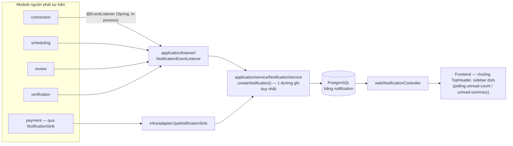
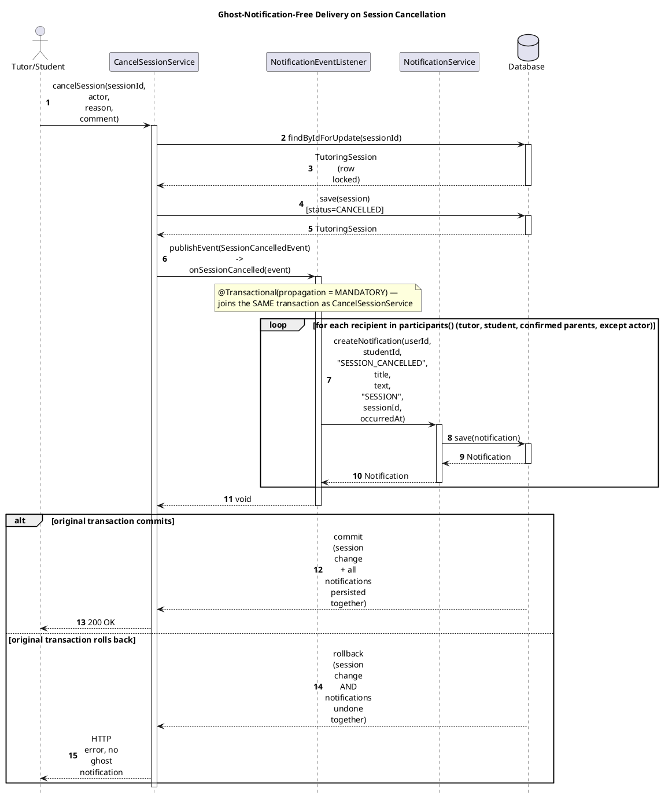
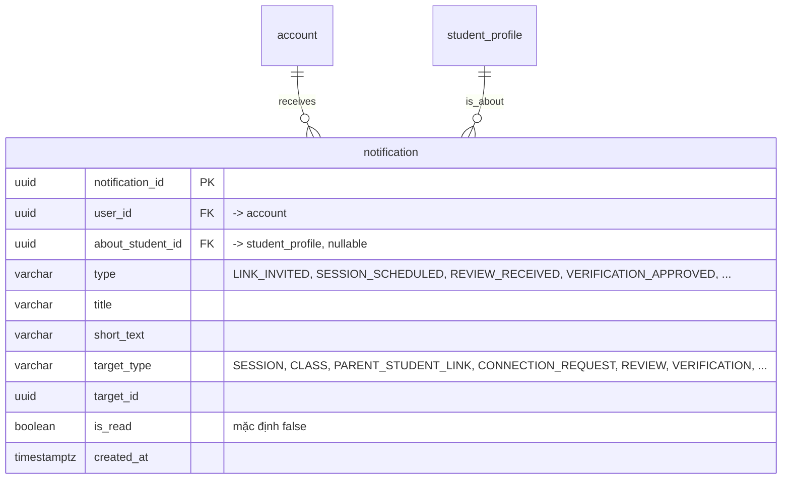

# Module Notification

- **Mã nguồn:** `backend/modules/notification/`
- **Mẫu kiến trúc:** Loại 1 — Standard, vai trò chính là Event Consumer (Hub) + REST API truy vấn, theo [backend-module-structure-guide.md](../backend-module-structure-guide.md).
- **Cập nhật nội dung:** 11/11/2026 — viết lại từ [notification_implementation_plan.md](notification_implementation_plan.md) theo khung README chuẩn, đối chiếu lại với `NotificationEventListener.java`/`NotificationController.java` hiện tại. **Hai sai lệch đã sửa so với bản kế hoạch cũ:** (1) cơ chế chống "thông báo ma" thực tế dùng `@EventListener` + `@Transactional(propagation = MANDATORY)`, không phải `@TransactionalEventListener(BEFORE_COMMIT)`; (2) **endpoint `GET /stream` (Server-Sent Events) chưa được triển khai** — không tồn tại trong `NotificationController` hiện tại, frontend dùng polling qua `unread-count`/`unread-summary`.

---

## 1. Kiến trúc (Architecture)

```
backend/modules/notification/src/main/java/vn/edufit/notification/
│
├── application/
│   ├── listener/NotificationEventListener.java   # Đón ~20 loại Domain Event từ 4 module khác
│   └── service/NotificationService.java           # Đọc/đếm/đánh dấu đã đọc + createNotification (1 đường ghi duy nhất)
│
├── infra/
│   ├── adapter/JpaNotificationSink.java            # Hiện thực Shared Kernel NotificationSink (payment, ... gọi qua đây)
│   └── persistence/
│       ├── entity/Notification.java
│       └── repository/NotificationRepository.java  # Index (user_id, is_read, created_at)
│
└── web/
    ├── NotificationController.java                 # /api/v1/notifications/**
    └── response/ NotificationListResponse, UnreadCountResponse, UnreadSummaryResponse,
                  MarkReadResponse, MarkAllReadResponse
```



Notification **không publish gì ra ngoài** — nó chỉ tiêu thụ. Mọi module khác chỉ biết `vn.edufit.shared...NotificationSink` (Shared Kernel) hoặc tự publish Spring event công khai trong `api/event/` của chính module đó; `NotificationEventListener` import ngược lại các `api.event.*` của `connection`, `scheduling`, `review`, `verification` để lắng nghe — đây là module duy nhất được phép phụ thuộc vào nhiều module khác cùng lúc chỉ để đọc event, không gọi ngược `web`/`application` nội bộ của họ.

---

## 2. Tổng quan & Bối cảnh (Overview & Situation)

Notification là trung tâm chuyển hóa **biến động trạng thái nghiệp vụ** từ các module khác thành bản ghi thông báo cá nhân hóa, phục vụ chuông thông báo và các điểm chấm đỏ (dot) trên sidebar. Nó lắng nghe 4 nhóm sự kiện:

- **`connection`:** lời mời liên kết (`LinkInvitationChangedEvent`), thu hồi liên kết (`ParentStudentLinkChangedEvent`), yêu cầu kết nối gia sư (`ConnectionRequestChangedEvent`).
- **`scheduling`:** đề xuất/từ chối/chốt/đổi lịch/hủy/hết hạn buổi học, nhắc gia sư ghi nhận kết quả quá hạn (FR-20), thay đổi lịch hàng loạt theo lớp (`ClassScheduleChangedEvent`), nhắc lịch sắp tới (FR-31).
- **`review`:** có đánh giá mới hoặc đánh giá được sửa.
- **`verification`:** quyết định duyệt/từ chối/thu hồi hồ sơ xác minh gia sư.

**Nguyên tắc chọn người nhận cho sự kiện buổi học** (`participants()`): gồm Gia sư, Học sinh, và mọi Phụ huynh có liên kết `CONFIRMED` với học sinh đó (`ConnectionFacade.findConfirmedParentUserIds`) — **trừ** người vừa thực hiện hành động (không tự thông báo cho chính mình). Thiếu dữ liệu tham chiếu (ví dụ không tìm được hồ sơ gia sư) chỉ làm bỏ qua thông báo đó, **không ném lỗi** để tránh làm rollback giao dịch nghiệp vụ gốc.

---

## 3. API Contract — `/api/v1/notifications/**`

Tất cả endpoint yêu cầu đăng nhập (`Authenticated`); dữ liệu luôn lọc theo `CurrentUser.getUserId()`.

| Method | Endpoint | Mô tả |
|---|---|---|
| GET | `/` (query `unreadOnly`, `page`, `size`) | Danh sách thông báo có phân trang |
| GET | `/unread-count` | Số lượng chưa đọc — cho badge đỏ trên chuông `TopHeader.tsx` |
| GET | `/unread-summary` | Thống kê chưa đọc **theo danh mục** (`NotificationCategory`) — cho các điểm chấm (dot) ở sidebar và floating toast |
| PATCH | `/{id}/read` | Đánh dấu 1 thông báo đã đọc — 404 nếu thuộc tài khoản khác (không lộ việc ID có tồn tại, chống IDOR) |
| PATCH | `/read-all` | Đánh dấu toàn bộ thông báo của người dùng hiện tại đã đọc |

Không có endpoint SSE (`GET /stream`) trong code hiện tại — xem mục 5.2.

---

## 4. Luồng triển khai từng bước (Implementation Flows)

### 4.1. Chống "thông báo ma" bằng `@Transactional(propagation = MANDATORY)`

**Trace table** — concrete example: cancelling a tutoring session (`SessionCancelledEvent`)

| # | From | To | Real method | File:line |
|---|---|---|---|---|
| 1 | Tutor/Student | CancelSessionService | `cancelSession(sessionId, actor, reason, comment)` | `scheduling/.../CancelSessionService.java:42` |
| 2 | CancelSessionService | Database | `findByIdForUpdate(sessionId)` | call site `CancelSessionService.java:51` |
| 3 | CancelSessionService | Database | `save(session)` [status=CANCELLED] | `session.cancel()` at `:62`, `save` at `:63` |
| 4 | CancelSessionService | NotificationEventListener | `publishEvent(SessionCancelledEvent)` → `onSessionCancelled(event)` | publish at `CancelSessionService.java:76`; listener at `notification/.../NotificationEventListener.java:241-243` |
| 5 | NotificationEventListener | NotificationService | `createNotification(userId, studentId, "SESSION_CANCELLED", title, text, "SESSION", sessionId, occurredAt)` per recipient | `participants()`/`write()` at `NotificationEventListener.java:379,393,400-402` |
| 6 | NotificationService | Database | `save(notification)` | `application/service/NotificationService.java:139` |

![Sequence Diagram](https://www.plantuml.com/plantuml/svg/bPNTRjCm5CVlynH7lKf5gtq8SO6sQUtQmSJMJRH3Ge2G6v-cPguTRAVhG4Wy14_8at3ifgapEY6kclfy_NtExoIdrZ7ZoeLCd70IuTLSMzSTQITc8cDEQDKzDuWmG2cMQ1v0AnYZjMI0CwOob39u9QnqMfMBAPfaBZZ2J6itrQl4tWbLCCCMOEUCwtkXSfWnQJ6oBDZgYdAo7CVY6yAB_JWAlvP8TIg7dXIvWWoLeq97rZr8F4d8qubC54mv-9u0t33EVPs3m-H7ShHNUMrpSfonKhfphTo8BH1QVOHt0fqYsutHhTskGTl1yoHXcTC6MXEwiTaRkvAJcXOm2xUMHCLYMkiMLGqRercA38DhzTpqZji-N5BMIs4TAZGXPFFdwPYuG3XFE7DioYnTSL0z1UEWdoHUB7HFDahW9MInsDIkVozu1yA5Es2GMQqwaEd5WiIrVIF4aZciRxF9HMa7VSeu4uht7oxukJQt1Md1RTOecjIGTxUX9JINPhXXBJNw7gJExf0YESQnZujQjgphjE430UvAUtpM6vqDBo-7Wq__LVZfMfjnK4nHJgMmyp2oj0gibWDvE6tx23-WfYt5PREHzOoLfd-QDYwkSpenJ5dlh1MJQM5qmV8mUJY6gzveq9jSlttVXjy_VtrKNxHG5joSfjEx6eBRXde2Te6PIAqBMbm3TESvZPiO4wGFX8A8EPks8NLbGCAkwVTCg9am2-JUaqvi1t2LOU7MyBHfA-kBK2i2dHuvOifXp71Q4fSUkYgrVsoDX-FnnVNeSpt4LWV2-uf-SEMs7dGUSQkph3G6US_v-dMJrwi1bOW6DYfIqeYXsGDKi6p4nxB9sYIbJjz4vUcOjIfKFDasga7cKWiUurYpmgG3OZON14LZpdvHXRDRvT6k1nDizWIoELCvmZDWKaBS1Gi56kjBSN0wHm8gJBFU14eRNYKluN1_7wxV94WlzzrwZ9RImfHbTxiaUQkt_IMAm7uagLHSA_oNdjUJoGsWCHvKfI7tdxP6ej3jgAERFJYbS_ea_W4=)



Assumptions: `CancelSessionService` was chosen as the concrete business service for this trace (one of many real publishers of a domain event the listener handles) because it is already traced in [SCHEDULING_README.md §4 note](../scheduling/SCHEDULING_README.md); any other listener method (`onSessionProposed`, `onReviewSubmitted`, etc.) follows the identical `MANDATORY`-propagation pattern shown here.

`propagation = MANDATORY` buộc listener phải chạy **bên trong** transaction của service gọi `publishEvent()` — nếu không có transaction nào đang mở (lỗi lập trình), Spring ném `IllegalTransactionStateException` ngay, chủ động lộ lỗi thay vì âm thầm ghi thông báo ngoài transaction. Đây là một lựa chọn khác với mẫu `@TransactionalEventListener(BEFORE_COMMIT)` dùng ở `ConnectionTransitionListener` (xem [CONNECTION_README.md §5.5](../connection/CONNECTION_README.md)) nhưng đạt cùng mục tiêu: notification và dữ liệu nghiệp vụ luôn commit/rollback cùng nhau.

**Ngoại lệ có chủ đích — `onSessionUpcomingReminder`:** dùng `propagation = REQUIRES_NEW` (transaction riêng) vì sự kiện này phát ra từ job quét định kỳ (`SessionReminderJob`), có thể chạy trong giao dịch chỉ đọc (`readOnly`, Hibernate không flush) hoặc không có giao dịch nào — nếu dùng `MANDATORY` như các listener khác, thông báo nhắc lịch sẽ mất âm thầm.

### 4.2. Một đường ghi duy nhất (`NotificationService.createNotification`)

Mọi listener và `JpaNotificationSink` (dùng bởi `payment`, xem [PAYMENT_README.md §5.4](../payment/PAYMENT_README.md)) đều gọi đúng một hàm `createNotification(userId, aboutStudentId, type, title, shortText, targetType, targetId, occurredAt)` — không có đường ghi thứ hai nào tạo bản ghi `notification`. Tham số `occurredAt` cho phép giữ đúng thời điểm sự kiện nguồn xảy ra (ví dụ job quét phát hiện muộn) thay vì luôn lấy `now()`.

### 4.3. Đọc, đếm và đánh dấu đã đọc

`getUnreadCount`/`getUnreadSummary` dùng `COUNT` trên index `(user_id, is_read, created_at)`. `markAsRead` truy vấn **theo cả `notificationId` và `userId` cùng lúc** (`findByNotificationIdAndUserId`) — thông báo của người khác trả `404 EntityNotFoundException` giống như không tồn tại, không phân biệt "không có" với "không phải của bạn" (chống dò ID — IDOR). `markAllAsRead` chạy một câu `UPDATE` hàng loạt (`markAllAsReadByUserId`), không load từng bản ghi.

---

## 5. Chi tiết bổ sung & Kỹ thuật

### 5.1. Lược đồ CSDL


Index `idx_notification_user_unread (user_id, is_read, created_at)` phục vụ cả đếm chưa đọc và phân trang danh sách mới nhất.

### 5.2. SSE chưa triển khai — frontend dùng polling

Bản kế hoạch ban đầu có thiết kế `GET /api/v1/notifications/stream` (Server-Sent Events) để đẩy thông báo thời gian thực tới chuông `TopHeader.tsx`. **Endpoint này không có trong `NotificationController` hiện tại** — thay vào đó, frontend lấy trạng thái mới qua polling `unread-count`/`unread-summary` (cùng kiểu polling 15s đang dùng cho ví ở [PAYMENT_README.md §3.4](../payment/PAYMENT_README.md)). Nếu sau này cần thời gian thực thật, cần bổ sung endpoint SSE hoặc WebSocket — đây là việc chưa làm, không phải lỗi tài liệu.

### 5.3. Bảng ánh xạ sự kiện → loại thông báo (`type`)

| Module nguồn | Sự kiện | `type` tiêu biểu | Người nhận |
|---|---|---|---|
| connection | `LinkInvitationChangedEvent` | `LINK_INVITED` / `LINK_CONFIRMED` / `LINK_DECLINED` / `LINK_EXPIRED` | Người mời/được mời theo trạng thái |
| connection | `ParentStudentLinkChangedEvent` | `LINK_REVOKED` | Cả Phụ huynh và Học sinh |
| connection | `ConnectionRequestChangedEvent` | `CONNECTION_REQUESTED/_ACCEPTED/_REJECTED/_CANCELLED/_EXPIRED` | Gia sư, Học sinh, Phụ huynh (nếu có liên kết xác nhận) |
| scheduling | `SessionProposedEvent` / `...RejectedEvent` | `SESSION_PROPOSED` / `SESSION_PROPOSAL_REJECTED` | `participants()` trừ người hành động |
| scheduling | `SessionScheduledEvent` / `SessionRescheduledEvent` | `SESSION_SCHEDULED` / `SESSION_RESCHEDULED` | `participants()` |
| scheduling | `SessionRescheduleProposedEvent` / `...RejectedEvent` | `SESSION_RESCHEDULE_PROPOSED` / `_REJECTED` | `participants()` |
| scheduling | `SessionCancelledEvent` / `SessionExpiredEvent` | `SESSION_CANCELLED` / `SESSION_EXPIRED` | `participants()` |
| scheduling | `OverdueOutcomeReminderEvent` (FR-20) | `SESSION_OUTCOME_OVERDUE` | Chỉ Gia sư |
| scheduling | `ClassScheduleChangedEvent` (đổi lịch hàng loạt) | `SESSION_RECURRING_CHANGED` / `SESSION_BULK_CANCELLED` / `SESSION_BATCH_SCHEDULED` / `SESSION_BATCH_REJECTED` | `participants()` — đúng 1 thông báo/người, không phải 1/buổi |
| scheduling | `SessionUpcomingReminderEvent` (FR-31) | `SESSION_REMINDER` | `participants()`, transaction riêng (`REQUIRES_NEW`) |
| review | `ReviewSubmittedEvent` / `ReviewUpdatedEvent` | `REVIEW_RECEIVED` / `REVIEW_UPDATED` | Gia sư được đánh giá |
| verification | `VerificationDecidedEvent` | `VERIFICATION_APPROVED` / `_REJECTED` / `_REVOKED` | Gia sư có hồ sơ |

Có một listener bắt tất cả (`handleDomainEvent(BaseDomainEvent)`) chỉ để ghi log debug, không tạo thông báo — dùng để quan sát mọi domain event phát sinh trong hệ thống khi cần gỡ lỗi.
