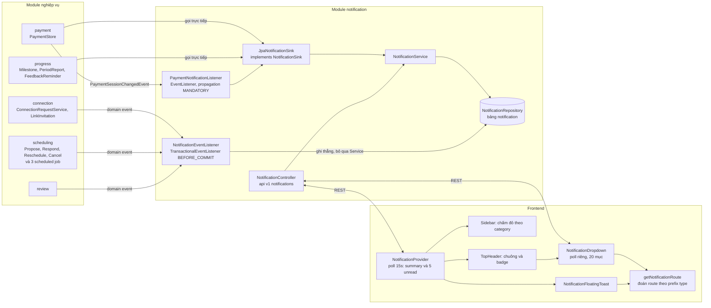
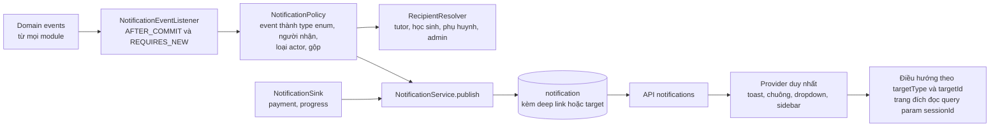

# Hệ thống thông báo: kiến trúc, thay đổi của nhánh và danh sách lỗi cần sửa

- **Nhánh:** `feat/notification-reschedule-toast-sidebar` (so với `develop` @ `d37b922`)
- **Ngày lập:** 2026-11-05
- **Nguồn:** ba lượt `/code-review` (high ×1, xhigh ×1), đối chiếu lại từng điểm với code trên nhánh.
- **Cập nhật 2026-11-05 (lượt rà kiến trúc):** thêm mục 1.5 (hợp đồng của `NotificationSink`), nhóm lỗi kiến trúc A-08 đến A-15 trong mục 3.5, nguyên tắc 7 và 8 trong mục 4.1, và mục 4.4 (thí điểm chuyển `progress` sang publish event). Các mục này dựa trên đọc `NotificationSink`, `JpaNotificationSink`, `NotificationService`, hai listener, các nơi gọi `notify(...)` và hai file ArchUnit.
- **Mức kiểm chứng:** mọi phát hiện dưới đây mới được xác nhận bằng **đọc code**, chưa có test máy nào chạy. Theo AGENTS.md mục 1 và 5, mỗi lỗi phải có test đỏ trước khi sửa.

---

## 1. Kiến trúc hiện tại của phần thông báo

### 1.1 Sơ đồ tổng quan



### 1.2 Backend: các thành phần

| Thành phần | Vai trò | Ghi chú |
|---|---|---|
| `Notification` (entity) | Bảng `notification`: `user_id`, `about_student_id`, `type` (chuỗi ≤60), `title`, `short_text`, `target_type`, `target_id`, `is_read`, `created_at` | Không có cột deep link, actor hay group key |
| `NotificationRepository` | Truy vấn phân trang, đếm unread, bulk mark-all, **mới:** `countUnreadByCategory` (HQL `GROUP BY CASE`) | Index `idx_notification_user_unread (user_id, is_read, created_at)` |
| `NotificationService` | Đọc danh sách, đếm, đánh dấu đã đọc, `createNotification`, **mới:** `getUnreadSummary` | Javadoc ghi là cổng vào duy nhất, nhưng thực tế không phải |
| `NotificationEventListener` | Chuyển domain event của connection, scheduling, review thành thông báo | Chạy `BEFORE_COMMIT` trong transaction nghiệp vụ, **ghi thẳng repository** |
| `PaymentNotificationListener` | Chuyển `PaymentSessionChangedEvent` thành thông báo `PAYMENT_*` | `@EventListener` + `Propagation.MANDATORY`, đi qua `NotificationSink` |
| `NotificationSink` (platform/shared) + `JpaNotificationSink` | Cổng để module khác gửi thông báo mà không import module notification (ArchUnit) | Được dùng bởi payment, progress; `ConnectionRequestService` inject nhưng không dùng |
| `NotificationController` | `GET /`, `GET /unread-count`, **mới:** `GET /unread-summary`, `PATCH /{id}/read`, `PATCH /read-all` | |

**Bốn đường ghi thông báo đang song song tồn tại:**
1. `NotificationEventListener` → `repository.save` (connection, scheduling, review).
2. `PaymentNotificationListener` → `NotificationSink` → `NotificationService`.
3. `PaymentStore` gọi sink trực tiếp (`PAYMENT_WALLET`).
4. Progress gọi sink trực tiếp (`MILESTONE_ACHIEVED`, `PERIOD_REPORT`, nhắc feedback).

**Cơ chế giao dịch:** mọi đường đều chạy **đồng bộ trong transaction nghiệp vụ**. Nếu tạo thông báo ném lỗi, hành động nghiệp vụ bị rollback theo. Tuy nhiên hai listener dùng hai cách khác nhau: `NotificationEventListener` dùng `@TransactionalEventListener(BEFORE_COMMIT)` + `@Transactional`; `PaymentNotificationListener` dùng `@EventListener` + `Propagation.MANDATORY`.

### 1.5 Hợp đồng của `NotificationSink`: bên gọi phải soạn sẵn câu thông báo

```java
void notify(UUID userId, UUID studentId, String type, String title, String text,
            String targetType, UUID targetId);
```

| Nhóm | Tham số | Nhận xét |
|---|---|---|
| Người nhận | `userId` | Bên gọi tự tính |
| Dữ liệu nghiệp vụ | `studentId`, `targetId` | Đúng bản chất |
| Phân loại | `type`, `targetType` | Chuỗi tự do, không có enum |
| **Nội dung hiển thị** | `title`, `text` | Câu tiếng Việt đã soạn sẵn ở module nguồn |

`Notification` (entity) đặt `title` và `shortText` là `nullable = false` và `requireNonNull` trong constructor; `JpaNotificationSink` và `NotificationService.createNotification` chỉ chuyển tiếp. Module notification không có chỗ nào để tự quyết định nội dung hay người nhận.

Các nơi gọi trực tiếp `notify(...)` (đã đọc code):

| Nơi gọi | Việc nó tự làm lẽ ra thuộc về notification |
|---|---|
| `MilestoneAchievementNotifier:28-50` | Soạn "Chúc mừng! Đạt cột mốc mới" và "Bạn đã hoàn thành cột mốc: " + tên; tự tra học sinh qua `ProfileFacade`, phụ huynh qua `ConnectionFacade`; tự lặp từng phụ huynh |
| `PeriodReportService.deliver:166-180` | Soạn tiêu đề và nội dung báo cáo kỳ; tự tra học sinh và lặp phụ huynh |
| `FeedbackReminderService:90-97` | Soạn "Nhắc phản hồi buổi học" và `message(stage)`; tự tra `tutorUserId` |
| `PaymentStore.notice:33` | Nhận `title`, `text` từ nơi gọi, nối `"PAYMENT_" + type`, đẩy thẳng qua sink |

Chỉ luồng `PaymentSessionChangedEvent` → `PaymentNotificationListener` đi đúng hướng: event chỉ mang dữ liệu (`state`, `payerId`, `tutorUserId`, `studentId`, `reviewDeadline`), listener tự quyết tiêu đề, nội dung và người nhận (kể cả admin).

### 1.3 Backend: ma trận sự kiện và người nhận (trên nhánh)

| Sự kiện | Nơi publish | Listener | Người nhận hiện tại | Thiếu |
|---|---|---|---|---|
| `LinkInvitationChangedEvent` (PENDING/ACCEPTED/DECLINED/EXPIRED) | connection | `onInvitationChanged` | người được mời / người mời | |
| `ParentStudentLinkChangedEvent` (REVOKED) | connection | `onLinkChanged` | phụ huynh, học sinh (trừ actor) | |
| `ConnectionRequestChangedEvent` | connection | `onRequestChanged` | tutor, học sinh, phụ huynh gửi | CANCELLED/EXPIRED không báo phụ huynh gửi |
| `TutoringClassEndedEvent` | connection | **không có** (chỉ scheduling hủy buổi) | — | học sinh, phụ huynh, tutor về các buổi bị hủy |
| `SessionProposedEvent` | scheduling | `onSessionProposed` | bên đối diện (tutor hoặc học sinh) | phụ huynh |
| Từ chối đề xuất buổi học (`RespondToProposalService:66`) | **không publish event** | — | — | người đề xuất |
| `SessionScheduledEvent` | scheduling | `onSessionScheduled` | tutor + học sinh (cả actor) | phụ huynh; không loại actor |
| `SessionRescheduleProposedEvent` | `RescheduleSessionService:131` | **mới:** `onSessionRescheduleProposed` | bên đối diện + phụ huynh | **học sinh khi phụ huynh đề xuất** |
| `SessionRescheduleRejectedEvent` | **mới:** `RescheduleSessionService:209` | **mới:** `onSessionRescheduleRejected` | chỉ người đề xuất | học sinh, phụ huynh đã nhận "cần xác nhận" |
| `SessionRescheduledEvent` | `RescheduleSessionService:275` | `onSessionRescheduled` (**mới:** thêm phụ huynh) | tutor + học sinh + phụ huynh | không loại actor |
| `SessionCancelledEvent` | scheduling | `onSessionCancelled` | tutor + học sinh (cả actor) | phụ huynh; lý do hiển thị mã enum |
| `SessionUpcomingReminderEvent` | `SessionReminderJob` (readOnly tx) | `onSessionUpcomingReminder` | tutor + học sinh | **có thể không bao giờ được lưu** (L-01); phụ huynh |
| `SessionExpiredEvent` | `ExpireProposalsJob:92` | **không có** | — | người đề xuất, bên đối diện |
| `OverdueOutcomeReminderEvent` | `OverdueOutcomeReminderJob:71` | **không có** | — | tutor |
| `ReviewSubmittedEvent` | review | `onReviewSubmitted` | tutor | |
| `ReviewUpdatedEvent` | review | **không có** | — | tutor (tùy nghiệp vụ) |
| Duyệt/từ chối/thu hồi xác minh tutor (`AdminVerificationService`) | **không publish event** | — | — | tutor |
| `PaymentSessionChangedEvent` | payment | `PaymentNotificationListener` | payer, tutor, học sinh, admin (một số state) | CASE_MESSAGE báo cả người viết, không báo admin khi ADMIN_REVIEW |
| Milestone, Period report, Feedback reminder | progress (sink trực tiếp) | — | học sinh, phụ huynh đã xác nhận | |

### 1.4 Frontend: các thành phần

| Thành phần | Vai trò |
|---|---|
| `notificationApi` | `getNotifications(unreadOnly, page, size)`, `getUnreadCount`, **mới:** `getUnreadSummary`, `markAsRead`, `markAllAsRead` |
| **mới:** `NotificationContext` / `NotificationProvider` | Đặt trong `DashboardShell`. Poll mỗi 15s và khi focus: lấy summary (tổng + theo category), lấy 5 unread mới nhất để phát hiện thông báo mới và bật toast |
| **mới:** `NotificationFloatingToast` | Hiện toast góc màn hình, tự tắt sau 4,5s; click thì mark read rồi điều hướng bằng `getNotificationRoute` |
| `Sidebar` (**đổi**) | Mỗi mục menu có `notificationCategory`; hiện chấm đỏ nếu category đó còn unread |
| `TopHeader` (**đổi**) | Bỏ poller riêng, dùng `unreadCount` từ context; `onUnreadCountChange` gọi `refreshSummary()` |
| `NotificationDropdown` | Panel thả xuống từ chuông, poll riêng, tối đa 20 mục, tự gọi `notificationApi` để mark read; chứa `getNotificationRoute` |
| `NotificationsSettingsTab` | Màn cài đặt tùy chọn thông báo (hiện chỉ là giả lập) |

**Ánh xạ type → category** đang nằm ở 4 nơi: `CASE` trong `countUnreadByCategory` (backend), `notificationCategory` của Sidebar, icon trong toast, và `getNotificationRoute`.

---

## 2. Những gì nhánh này thêm và thay đổi

6 commit so với `develop`; bảng dưới bỏ qua commit viết lại README (`bcc4b2d`):

| Commit | Nội dung |
|---|---|
| `8a81ea2` | Backend: listener cho đề xuất đổi lịch, từ chối đổi lịch và đổi lịch thành công có báo phụ huynh |
| `e9f274a` | Backend: endpoint `GET /api/v1/notifications/unread-summary` theo category |
| `d006e6c` | Frontend: `NotificationContext` tập trung + floating toast |
| `f233b17` | Frontend: chấm đỏ thông minh trên Sidebar theo category |
| `5b7b09b` | Tài liệu kế hoạch `docs/plans/2026-11-04-reschedule-notification-sidebar-toast-plan.md` |

### 2.1 Backend

| File | Loại | Thay đổi |
|---|---|---|
| `scheduling/api/event/SessionRescheduleRejectedEvent.java` | **Mới** | Event mới: `proposalId`, `sessionId`, `classId`, `tutorId`, `studentId`, `proposedBy`, `rejectedBy`, `reason` |
| `scheduling/.../RescheduleSessionService.java` | Đổi | Publish `SessionRescheduleRejectedEvent` khi từ chối đề xuất đổi lịch |
| `notification/.../NotificationEventListener.java` | Đổi (+96) | Thêm `onSessionRescheduleProposed`, `onSessionRescheduleRejected`; `onSessionRescheduled` báo thêm phụ huynh đã xác nhận |
| `notification/.../NotificationRepository.java` | Đổi | Thêm `countUnreadByCategory` |
| `notification/.../NotificationService.java` | Đổi | Thêm `getUnreadSummary` |
| `notification/web/NotificationController.java` | Đổi | Thêm `GET /unread-summary` |
| `notification/web/response/UnreadSummaryResponse.java` | **Mới** | `{ total, byCategory: Map<String, Long> }` |
| Test: `NotificationEventListenerTest`, `NotificationServiceTest`, `NotificationControllerTest`, `RescheduleSessionServiceTest` | Đổi | Unit test với mock; **chưa có test tích hợp PostgreSQL** cho query mới |

### 2.2 Frontend

| File | Loại | Thay đổi |
|---|---|---|
| `features/notification/context/NotificationContext.tsx` | **Mới** | Provider, poll, phát hiện thông báo mới, quản lý toast |
| `features/notification/components/NotificationFloatingToast.tsx` | **Mới** | UI toast |
| `features/notification/api/notificationApi.ts`, `types/index.ts`, `index.ts` | Đổi | Thêm `getUnreadSummary` và kiểu `UnreadSummary`; export provider và toast |
| `shared/ui/DashboardShell.tsx` | Đổi | Bọc toàn bộ shell trong `NotificationProvider`, gắn `NotificationFloatingToast` |
| `shared/ui/Sidebar.tsx` | Đổi | Thêm `notificationCategory` cho từng mục menu và hiện chấm đỏ |
| `shared/ui/TopHeader.tsx` | Đổi | Bỏ poller `getUnreadCount` riêng, dùng context |
| Test: `NotificationToast.test.tsx` (**mới**), `TopHeaderPolling.test.tsx`, `DashboardShell.test.tsx`, `SidebarNavigation.test.tsx` | Đổi | Vitest |

---

## 3. Danh sách lỗi đã tổng hợp

Mã: **B** = backend, **F** = frontend, **A** = kiến trúc. Mức độ: 🔴 nghiêm trọng, 🟠 trung bình, 🟡 nhẹ.
Cột "Nguồn": nhánh = lỗi do nhánh này đưa vào; có sẵn = lỗi đã có trên `develop` và nhánh chưa sửa.

### 3.1 Thông báo đang chạy có sai không

| Mã | Mức | Vị trí | Vấn đề | Nguồn |
|---|---|---|---|---|
| B-01 | 🔴 | `SessionReminderJob.java:51`, `NotificationEventListener.java:303` | Job publish nhắc lịch trong `@Transactional(readOnly = true)`. Listener `BEFORE_COMMIT` + `@Transactional` gia nhập transaction read-only (FlushMode.MANUAL), nên `save()` có thể không bao giờ được flush. Nhắc lịch 24h/2h bị mất mà không có log. `OverdueOutcomeReminderJob:47` cũng readOnly | có sẵn |
| B-02 | 🟠 | `NotificationEventListener.java:298` | Lý do hủy lấy `cancelReason` (tên enum) trước `cancelComment`, nên người dùng thấy "Buổi học đã bị hủy: PERSONAL_REASON" và mất ghi chú họ nhập. Seed V1.34 cũng có chuỗi tương tự | có sẵn |
| B-03 | 🟠 | `notifyBoth` (`:341`), `onSessionScheduled`, `onSessionCancelled` | Người thực hiện hành động tự nhận thông báo về chính mình (tutor hủy buổi thì tutor nhận "Buổi học đã bị hủy"). `SessionCancelledEvent.cancelledBy` bị bỏ qua | có sẵn |
| B-04 | 🟠 | `PaymentNotificationListener` | `CASE_MESSAGE` báo cả người viết; khi `ADMIN_REVIEW` admin không được báo có tin nhắn mới | có sẵn |
| B-05 | 🟠 | `RescheduleClassScheduleService.java:372` | Thao tác hàng loạt (đổi lịch định kỳ, propose/respond batch) sinh một thông báo cho mỗi buổi × mỗi người nhận, đẩy thông báo quan trọng ra khỏi top 20 | có sẵn |
| B-06 | 🟡 | `notifyBoth`, `resolveRecipientAndNotify` | Mọi sự kiện buổi học dùng chung type `SESSION_UPDATE` hoặc `SESSION_PROPOSAL`, nên frontend không phân biệt được chốt lịch, hủy hay nhắc | có sẵn |

### 3.2 Sự kiện nghiệp vụ chưa được thông báo

| Mã | Mức | Vị trí | Vấn đề | Nguồn |
|---|---|---|---|---|
| B-10 | 🔴 | `NotificationEventListener.java:238` | Phụ huynh đề xuất đổi lịch: chỉ tutor và phụ huynh khác được báo, **học sinh không được báo** | nhánh |
| B-11 | 🔴 | `NotificationEventListener.java:279` | Từ chối đổi lịch chỉ báo người đề xuất. Học sinh và phụ huynh đã nhận "cần xác nhận" không có thông báo kết thúc | nhánh |
| B-12 | 🔴 | `ExpireProposalsJob:92`, `OverdueOutcomeReminderJob:71` | `SessionExpiredEvent` và `OverdueOutcomeReminderEvent` được publish nhưng không có listener | có sẵn |
| B-13 | 🔴 | `RespondToProposalService.java:66` | Từ chối đề xuất buổi học không publish event, người đề xuất không biết | có sẵn |
| B-14 | 🔴 | `ClassEndedEventListener.java:36` | Kết thúc lớp hủy mọi buổi tương lai nhưng không publish `SessionCancelledEvent`, không ai được báo | có sẵn |
| B-15 | 🟠 | `notifyBoth`, `resolveRecipientAndNotify` | Phụ huynh không nhận thông báo đề xuất, chốt, hủy, nhắc lịch (nhánh mới chỉ thêm phụ huynh cho đổi lịch) | có sẵn, nhánh sửa một phần |
| B-16 | 🟠 | `AdminVerificationService.review/revoke` | Duyệt, từ chối, thu hồi xác minh tutor không có thông báo; nhánh route và chấm đỏ `VERIFICATION` vì thế không bao giờ dùng tới | có sẵn |
| B-17 | 🟡 | review module | `ReviewUpdatedEvent` không có listener (cần chốt nghiệp vụ có báo hay không) | có sẵn |

### 3.3 Điều hướng khi bấm thông báo

| Mã | Mức | Vị trí | Vấn đề | Nguồn |
|---|---|---|---|---|
| F-01 | 🔴 | `NotificationDropdown.tsx` `getNotificationRoute` | Bỏ qua `targetId` và `aboutStudentId` với mọi loại trừ `PAYMENT_SESSION`. Click chỉ mở trang danh sách chung; các trang đích cũng không đọc id từ URL. Người dùng phải tự tìm | có sẵn |
| F-02 | 🟠 | `getNotificationRoute` nhánh CONNECTION | Học sinh nhận CONNECTION_REQUESTED/REJECTED/CANCELLED/EXPIRED bị đưa tới `/student/classes`; đúng ra là `/student/tutors?tab=requests` (đúng như Sidebar) | có sẵn |
| F-03 | 🟠 | `getNotificationRoute` | `PERIOD_REPORT` không khớp nhánh nào, rơi về dashboard | có sẵn |
| F-04 | 🟡 | `countUnreadByCategory` + Sidebar | `MILESTONE_ACHIEVED`, `PERIOD_REPORT` rơi vào category `OTHER`, không có chấm đỏ ở mục tiến độ | nhánh |

### 3.4 Giao diện và hành vi frontend

| Mã | Mức | Vị trí | Vấn đề | Nguồn |
|---|---|---|---|---|
| F-10 | 🔴 | `NotificationContext.tsx:110` | Lần tải đầu chỉ đánh dấu "đã thấy" 5 unread mới nhất. Mark read vài cái thì các unread cũ hơn lọt vào top 5 và bị toast như mới. Nếu hơn 5 thông báo đến giữa hai lần poll, phần dư không được toast | nhánh |
| F-11 | 🟠 | `NotificationContext.tsx:133` | Effect không reset `seenIdsRef`/`isInitialFetchRef` khi đổi user, không có guard `active` khi unmount (TopHeader cũ có) | nhánh |
| F-12 | 🟠 | `TopHeader.tsx` + `NotificationDropdown` | Dropdown gọi `notificationApi` trực tiếp thay vì `markAsRead`/`markAllAsRead` của context: toast đang hiện không tắt, unread có thể bị trừ hai lần, `markAllAsRead` của context là code chết | nhánh |
| F-13 | 🟠 | `TopHeader.tsx` `onUnreadCountChange` | Mỗi lần dropdown poll lại kéo theo `refreshSummary()`: khoảng 4 request mỗi 15s khi mở dropdown (trước là 1) | nhánh |
| F-14 | 🟠 | `NotificationDropdown.tsx:214` | `handleMarkRead` gọi `onUnreadCountChange` bên trong updater của `setUnreadCount`: cảnh báo "Cannot update a component while rendering", chạy 2 lần ở StrictMode | có sẵn |
| F-15 | 🟠 | `NotificationDropdown.tsx:289` | Panel nhỏ: rộng `w-80/w-96`, tiêu đề 12px một dòng, nội dung 11px cắt 2 dòng, cao tối đa 384px. Hạn phản hồi thanh toán bị cắt. Cứng 20 mục, không "xem thêm", không có trang thông báo đầy đủ. Tràn mép trái ở màn hình 360px | có sẵn |
| F-16 | 🟠 | `TopHeader.tsx:109` | Bấm chuông không đóng được dropdown: mousedown "bấm ra ngoài" đóng, click lại mở. *Cần xác nhận trên trình duyệt* | có sẵn |
| F-17 | 🟡 | `NotificationsSettingsTab.tsx:25` | Màn cài đặt chỉ giả lập lưu (setTimeout + toast), không gửi backend; ghi nhắc lịch "24 giờ và 1 giờ" trong khi job dùng 24h và 2h | có sẵn |

### 3.5 Kiến trúc, kiểm thử và quy tắc dự án

| Mã | Mức | Vị trí | Vấn đề | Nguồn |
|---|---|---|---|---|
| A-01 | 🔴 | `NotificationRepository.java:52` | Query HQL `GROUP BY CASE` chỉ test qua mock. Nếu Hibernate 7 render sai trên PostgreSQL 17, `/unread-summary` trả 500 cho mọi trang dashboard và frontend nuốt lỗi (chuông và chấm đỏ im lặng ở 0). Cần test Testcontainers (AGENTS.md mục 1) | nhánh |
| A-02 | 🟠 | toàn module | 4 đường ghi thông báo khác nhau (mục 1.2). Không có chỗ chung cho loại actor, gộp thông báo, deep link, tùy chọn người dùng | có sẵn |
| A-03 | 🟠 | các listener | Ghi thông báo đồng bộ trong transaction nghiệp vụ: `Objects.requireNonNull(event.classId())` ném lỗi thì chấp nhận yêu cầu bị rollback | có sẵn |
| A-04 | 🟡 | `NotificationRepository.java:53` + 3 chỗ frontend | `CASE` lặp ở SELECT và GROUP BY; nhánh `RESCHEDULE%`, `KYC%`, `VERIFICATION%` không khớp type nào; ánh xạ type → category nằm ở 4 nơi | nhánh |
| A-05 | 🟡 | `NotificationEventListener.java:203`, `:256` | `onSessionRescheduled` tra profile tutor và học sinh 2 lần; vòng lặp báo phụ huynh bị chép y nguyên giữa 2 handler | nhánh |
| A-06 | 🟡 | `NotificationService.markAsRead` | Dùng `findById` rồi trả 403, để lộ id có tồn tại; nên dùng `findByNotificationIdAndUserId` có sẵn | có sẵn |
| A-07 | 🟡 | `NotificationEventListenerTest.java:133` | Chuỗi hardcode trong test (`'Tutor Name'`, `'Bận việc đột xuất'`), vi phạm AGENTS.md mục 9 | nhánh |
| A-08 | 🟠 | `NotificationSink.java:6` + `MilestoneAchievementNotifier`, `PeriodReportService`, `FeedbackReminderService`, `PaymentStore.notice` | `notify(...)` bắt module nguồn soạn sẵn `title`/`text` và tự tính người nhận. Module `progress` và `payment` phải phụ thuộc `ProfileFacade`, `ConnectionFacade` chỉ để báo tin. Không thể đa ngôn ngữ, không tắt theo loại, không gộp được (xem mục 1.5) | có sẵn |
| A-09 | 🟠 | `MilestoneAchievementNotifier`, `PeriodReportService.deliver`, `NotificationEventListener` | Quy tắc "báo học sinh và mọi phụ huynh đã xác nhận" chép lặp ở ít nhất 3 nơi trong 2 module; đổi quy tắc phải sửa nhiều chỗ | có sẵn, nhánh thêm một chỗ |
| A-10 | 🟠 | `NotificationEventListener` so với `PaymentNotificationListener` | Hai chính sách transaction trong cùng module (`BEFORE_COMMIT` + `@Transactional` so với `@EventListener` + `MANDATORY`). Riêng `onSessionUpcomingReminder` (`:303`) là handler duy nhất đặt `fallbackExecution = true`, không có giải thích | có sẵn |
| A-11 | 🟡 | `NotificationSink`, `Notification.type`, `targetType` | `type` và `targetType` là chuỗi tự do (`"MILESTONE_ACHIEVED"`, `PERIOD_REPORT_SENT`, `"PAYMENT_" + type` nối ở 2 nơi), không có enum hay hợp đồng chung giữa module nguồn, notification và frontend | có sẵn |
| A-12 | 🟡 | `NotificationService.createNotification` Javadoc | Ghi "được gọi bởi `JpaNotificationSink` và `NotificationEventListener`", nhưng listener ghi thẳng `repository.save`, không gọi service. Tài liệu sai so với code | có sẵn |
| A-13 | 🟡 | `ConnectionRequestService.java:54` | Inject `NotificationSink` nhưng không tìm thấy lời gọi `notify` nào trong module `connection`; thông báo của `connection` đi qua event. Dependency thừa, và cho thấy hai kiểu (event, port) lẫn lộn không có quy tắc | có sẵn |
| A-14 | 🟡 | `ArchitectureTest`, `ArchitectureBoundaryTest` | ArchUnit chỉ kiểm tra module nào được import module nào. Không có rule "listener không phụ thuộc repository" và "module nghiệp vụ không soạn nội dung thông báo", nên A-02 và A-08 vẫn qua được | có sẵn |
| A-15 | 🟡 | `NotificationEventListener` (`connectionFacade != null`, `profileFacade != null`) | Kiểm tra null cho bean inject qua constructor chỉ che lỗi cấu hình trong test; lẽ ra phải dùng mock đầy đủ trong test | có sẵn |

---

## 4. Hướng sửa đề xuất

### 4.1 Thiết kế đích



Nguyên tắc:
1. **Một cổng ghi duy nhất:** mọi đường đều đi qua `NotificationService` (listener không gọi repository trực tiếp).
2. **Tách khỏi transaction nghiệp vụ:** `AFTER_COMMIT` + `REQUIRES_NEW`, lỗi thông báo chỉ log, không rollback nghiệp vụ. Sửa luôn B-01 vì không còn phụ thuộc transaction read-only của job.
3. **`RecipientResolver` dùng chung:** tutor, học sinh, phụ huynh đã xác nhận, admin, và luôn loại người thực hiện (cần thêm `actorUserId` vào các event scheduling còn thiếu).
4. **Type là enum có category:** một nguồn duy nhất cho type → category; backend trả `category` trong response để frontend không phải đoán.
5. **Deep link:** frontend ánh xạ `targetType` + `targetId` thành route có id; các trang lịch, lớp, yêu cầu, tiến độ đọc query param để chọn và highlight đúng mục.
6. **Một nguồn trạng thái ở frontend:** dropdown dùng dữ liệu và hành động của `NotificationProvider`; theo dõi thông báo mới bằng mốc `createdAt` thay vì tập id của top 5.
7. **Module nguồn truyền sự thật nghiệp vụ, không truyền câu chữ:** module nghiệp vụ publish domain event có kiểu (ví dụ `MilestoneAchievedEvent`) chứa id và dữ liệu thô (tên cột mốc, kỳ báo cáo, số giờ). Notification tự tra người nhận, soạn tiêu đề và nội dung. Module nguồn không còn phụ thuộc `NotificationSink`.
8. **Quy tắc chọn kiểu:** nếu đã có hoặc tự nhiên có domain event, dùng listener. Chỉ gọi thẳng cổng ghi khi thông báo là mục đích chính và không có sự kiện nghiệp vụ tự nhiên (nhắc lịch từ scheduler, thông báo hệ thống, broadcast của admin), và khi đó cũng truyền intent có kiểu (enum `NotificationType`) thay vì chuỗi và câu soạn sẵn. Không tạo event giả chỉ để gọi notification.

### 4.2 Thứ tự thực hiện

| Bước | Mục tiêu | Lỗi xử lý | Kiểm chứng máy |
|---|---|---|---|
| 1 | Chặn lỗi mất dữ liệu và lỗi do nhánh đưa vào | B-01, A-01, B-10, B-11, F-10, F-11, F-12, F-13 | Testcontainers IT cho reminder và `/unread-summary`; Vitest cho Provider |
| 2 | Đủ sự kiện nghiệp vụ | B-12, B-13, B-14, B-15, B-16 (B-17 chờ chốt nghiệp vụ) | Unit test listener + IT luồng scheduling |
| 3a | **Thí điểm cách 1 trên `progress`** (mục 4.4) | A-08, A-09 (phần `progress`), A-11 (3 type của `progress`) | Unit test listener mới + sửa test của 4 service |
| 3b | Thống nhất kiến trúc ghi | A-02, A-03, A-04, A-05, A-06, A-10, A-12, A-13, A-14, A-15, B-03, B-04, B-06 | ArchUnit (cấm listener gọi repository, cấm module nghiệp vụ soạn nội dung), unit test policy |
| 4 | Deep link | F-01, F-02, F-03, F-04 | Vitest cho bảng route; E2E Playwright click thông báo tới đúng mục |
| 5 | Giao diện | F-14, F-15, F-16, B-02, B-05 | Vitest + E2E trên viewport 360px và desktop |
| 6 | Tùy chọn người dùng (nếu trong phạm vi) | F-17 | Cần quyết định phạm vi trước |

Test dữ liệu phải lấy từ `backend/app/src/test/resources/data/*.csv` và `frontend/e2e/resources/*.json` (AGENTS.md mục 9), bao gồm sửa A-07.

### 4.3b Tiến độ bước 3b (2026-11-05)

| Mục | Trạng thái |
|---|---|
| B-01 nhắc lịch mất khi job `readOnly` | **Đã sửa** (test Postgres đỏ trước): `onSessionUpcomingReminder` dùng `REQUIRES_NEW`; `SessionReminderJob`, `OverdueOutcomeReminderJob` bỏ `readOnly`. Test: `SessionReminderNotificationPostgresTest` |
| A-02 đường ghi duy nhất | **Đã sửa**: `NotificationEventListener` ghi qua `NotificationService.createNotification` (bản mới có tham số `occurredAt` để giữ `createdAt` theo sự kiện), không còn dùng repository/entity |
| A-10 chính sách transaction | **Đã sửa**: mọi listener là `@EventListener` + `MANDATORY` (như `PaymentNotificationListener`); ngoại lệ có chủ đích là nhắc lịch (`REQUIRES_NEW`). Phát event ngoài giao dịch giờ báo lỗi thay vì bị bỏ qua âm thầm |
| A-05 vòng lặp phụ huynh chép lặp | Đã gộp vào `notifyParents` |
| A-12 Javadoc sai | Đã sửa |
| A-13 `NotificationSink` thừa trong `ConnectionRequestService` | **Đã gỡ** dependency và sửa 5 file test dựng thủ công |
| A-14 rule ArchUnit | **Đã thêm** `notification_listeners_should_write_through_the_service` (cùng rule của progress ở 4.4) |
| A-15 null check thừa | Đã gỡ kiểm tra null của `connectionFacade`, `profileFacade` |
| `PaymentStore.notice` | Đã xong: `WalletBalanceChangedEvent` + `PaymentNotificationListener.onWalletChanged`; payment không còn phụ thuộc `NotificationSink` (ArchUnit canh) |

Hệ quả cho test: `ConnectionTransactionPostgresTest` dùng sink mock không có tính giao dịch nên không còn khẳng định "rollback thì sink không bị gọi"; việc thông báo mất theo rollback được kiểm chứng trên DB thật ở `ProgressNotificationPostgresTest.rollbackLeavesNoNotification`.

### 4.3c Tiến độ các bước còn lại (2026-11-05)

Quyết định nghiệp vụ lấy từ mục 4.5: phụ huynh nhận mọi thông báo buổi học của con; thao tác hàng loạt gửi **một thông báo cố định**; `ReviewUpdatedEvent` có báo gia sư; bỏ màn cài đặt thông báo; giữ dropdown (không làm trang riêng).

**Quy tắc người nhận dùng chung** (`NotificationEventListener.participants`): gia sư + học sinh + phụ huynh đã xác nhận, **trừ người thực hiện**. Mỗi sự kiện có `type` riêng.

| Mã | Trạng thái |
|---|---|
| B-02 | **Đã sửa**: chỉ hiển thị ghi chú người dùng nhập, không còn tên enum (`PERSONAL_REASON`). Dữ liệu seed V1.34 chưa đổi |
| B-03 | **Đã sửa**: bỏ người thực hiện (`cancelledBy`, `proposedBy`, `rejectedBy`; `SessionScheduledEvent`/`SessionRescheduledEvent` có thêm `actorUserId`) |
| B-04 | **Đã sửa**: `PaymentSessionChangedEvent` có `actorUserId` và `sessionStatus`; người viết không tự nhận, admin được báo khi hồ sơ đang `AWAITING_ADMIN`/`ADMIN_REVIEW` |
| B-05, B-14 | **Đã sửa**: `ClassScheduleChangedEvent` (một sự kiện cho cả lô: áp dụng lịch định kỳ, lớp kết thúc, chấp nhận/từ chối hàng loạt) → một thông báo mỗi người |
| B-06 | **Đã sửa**: type riêng `SESSION_PROPOSED/SCHEDULED/RESCHEDULED/CANCELLED/EXPIRED/REMINDER/...` (dữ liệu cũ `SESSION_UPDATE`, `SESSION_PROPOSAL` vẫn được ánh xạ) |
| B-10, B-11 | **Đã sửa**: đề xuất/từ chối đổi lịch báo mọi người liên quan (gồm học sinh), trừ bên vừa thao tác |
| B-12 | **Đã sửa**: có listener cho `SessionExpiredEvent` và `OverdueOutcomeReminderEvent` |
| B-13 | **Đã sửa**: `SessionProposalRejectedEvent` (từ chối đơn lẻ và hàng loạt) |
| B-15 | **Đã sửa**: phụ huynh nhận thông báo đề xuất, chốt, hủy, nhắc lịch |
| B-16 | **Đã sửa**: `VerificationDecidedEvent` → `VERIFICATION_APPROVED/REJECTED/REVOKED` cho gia sư |
| B-17 | **Đã sửa**: `ReviewUpdatedEvent` → `REVIEW_UPDATED` cho gia sư |
| A-01 | **Đã sửa**: query đổi thành `GROUP BY type` đơn giản; `UnreadSummaryPostgresTest` chạy trên PostgreSQL thật |
| A-03 | **Đã sửa**: bỏ `requireNonNull` trong listener (thiếu id đích thì trỏ về yêu cầu/lời mời thay vì rollback nghiệp vụ) |
| A-04, A-11 | **Đã sửa một phần**: ánh xạ type → category gom về enum `NotificationCategory` (thêm `PROGRESS`), response có `category`; `NotificationCategoryTest` khóa hợp đồng. Chuỗi `type` vẫn là chuỗi (chưa thành enum) |
| A-06 | **Đã sửa**: `markAsRead` dùng `findByNotificationIdAndUserId`, thông báo của người khác trả 404 |
| A-07 | **Một phần**: test listener viết lại gọn, chưa chuyển sang CSV theo AGENTS.md mục 9 |
| F-01 | **Một phần**: thông báo buổi học dẫn tới `…/schedule?sessionId=` và mở thẳng chi tiết buổi; các loại khác (lớp, yêu cầu, đánh giá) vẫn tới trang danh sách |
| F-02, F-03, F-04 | **Đã sửa**: học sinh → `/student/tutors?tab=requests`; `PERIOD_REPORT`; mục Tiến độ ở sidebar có chấm đỏ |
| F-10, F-11 | **Đã sửa**: toast theo mốc `createdAt` (tối đa 5 mới nhất mỗi lần poll), Provider reset và bỏ phản hồi muộn khi gỡ/gắn lại |
| F-12, F-13, F-14 | **Đã sửa**: dropdown dùng `markAsRead`/`markAllAsRead`/`unreadCount` của Provider; bỏ `onUnreadCountChange` nên không còn `refreshSummary` mỗi lần poll dropdown |
| F-15 | **Đã sửa**: rộng `min(26rem, 100vw-1.5rem)`, tiêu đề 2 dòng, nội dung 4 dòng, nút "Xem thêm" (20 mục mỗi lần) |
| F-16 | **Đã sửa** (cần xem lại trên trình duyệt thật): mousedown trên nút chuông không còn đóng dropdown |
| F-17 | **Đã gỡ** tab cài đặt thông báo (theo quyết định 4.5) |

Chưa làm: trang "Tất cả thông báo" riêng (đã chốt không làm), tùy chọn tắt theo loại, `NotificationType` dạng enum dùng chung giữa các module, gộp thông báo cùng loại trong thời gian ngắn, seed V1.34.

### 4.4 Thí điểm: chuyển `progress` sang publish event (cách 1)

> **Trạng thái 2026-11-05: ĐÃ TRIỂN KHAI** (backend 235 test xanh, frontend 726 test xanh). Khác thiết kế: `FeedbackReminderDueEvent` có thêm `classId`; nếu không tìm thấy gia sư thì listener bỏ qua thông báo nhưng `progress` vẫn ghi `recordSent` (trước đây bỏ qua cả hai). Đã thêm rule ArchUnit `progress_should_publish_events_not_compose_notifications` và `NotificationFlows.test.tsx` (49 test UI); sửa route `PERIOD_REPORT` trước đây rơi về dashboard.

**Trạng thái:** đã thiết kế, **chưa sửa code**. Giữ nguyên hành vi hiện tại (cùng type, targetType, nội dung, người nhận, cùng đồng bộ trong transaction); chỉ đổi nơi soạn nội dung và tìm người nhận.

**Event mới** (package `vn.edufit.progress.api.event`, `implements BaseDomainEvent`, theo mẫu `ReviewSubmittedEvent`):

| Event | Thay cho | Dữ liệu mang theo | Publish ở |
|---|---|---|---|
| `MilestoneAchievedEvent` | `MilestoneAchievementNotifier.notifyAchieved` | `classId`, `studentId`, `milestoneId`, `milestoneTitle` | `LearningPlanService.updateMilestoneStatus`, `SessionFeedbackService.submit` (mỗi cột mốc vừa đạt) |
| `PeriodReportSentEvent` | `notifications.notify` trong `PeriodReportService.deliver` | `reportId`, `classId`, `studentId`, `periodIndex`, `periodStart`, `periodEnd` | `PeriodReportService.deliver` |
| `FeedbackReminderDueEvent` | `notifications.notify` trong `FeedbackReminderService` | `sessionId`, `studentId`, `tutorId` (id hồ sơ), `hoursSinceEnd`, `hoursLeft` | `FeedbackReminderService.sendDueReminders` |

**Listener mới:** `ProgressNotificationListener` trong `vn.edufit.notification.application.listener`:
- Dùng `@EventListener` + `@Transactional(propagation = MANDATORY)` và đi qua `NotificationSink`, giống `PaymentNotificationListener` (giữ đồng bộ trong transaction; chính sách chung sẽ chốt ở bước 3b).
- Tự tra: học sinh (`ProfileFacade.findStudentById`), phụ huynh đã xác nhận (`ConnectionFacade.findConfirmedParentUserIds`), gia sư (`ProfileFacade.findTutorById`). Khử trùng người nhận bằng `Set`.
- Giữ nguyên chuỗi `type`: `MILESTONE_ACHIEVED`, `PERIOD_REPORT_SENT`, `SESSION_FEEDBACK_REMINDER`; `targetType`: `MILESTONE`, `PERIOD_REPORT`, `SESSION`. Câu tiếng Việt chuyển từ `progress` sang listener, tiêu đề cho học sinh và phụ huynh của cột mốc vẫn khác nhau.

**Thay đổi ở `progress`:**
- Xóa `MilestoneAchievementNotifier`; `LearningPlanService`, `SessionFeedbackService` nhận `ApplicationEventPublisher` thay cho nó.
- `PeriodReportService`, `FeedbackReminderService` bỏ `NotificationSink`; `PeriodReportService` vẫn dùng `ConnectionFacade`/`ProfileFacade` cho việc khác nên chỉ bỏ phần tra người nhận trong `deliver`.
- Thứ tự trong `FeedbackReminderService` giữ nguyên: publish rồi `recordSent`.
- `modules/notification/pom.xml` thêm dependency `progress` (chỉ dùng package `api`; ArchUnit cho phép vì `parts[3] == "api"`). `progress` không phụ thuộc `notification` nên không tạo vòng.

**Test (làm đỏ trước, theo AGENTS.md mục 1):**
1. Mới: `ProgressNotificationListenerTest` kiểm tra từng event tới đúng người nhận, đúng `type`/`targetType`/`targetId`, không báo trùng khi học sinh trùng phụ huynh, và `verifyNoMoreInteractions(sink)`.
2. Sửa: `LearningPlanServiceTest` (`:253-256`), `PeriodReportServiceTest` (`:170-173`, `:147`), `FeedbackReminderServiceTest` (`:91`, `:94`), `SessionFeedbackServiceTest`: đổi `verify(notifications).notify(...)` thành capture event từ `ApplicationEventPublisher` và kiểm tra dữ liệu event.
3. Tích hợp Testcontainers: một luồng thật `progress` → event → bảng `notification` để chứng minh listener chạy trong cùng transaction.
4. ArchUnit: thêm rule "module `progress` không phụ thuộc `vn.edufit.shared.notification`" để khóa kết quả thí điểm.

**Rủi ro cần kiểm khi làm:**
- `app/src/test/.../NotificationSinkTestBridge` và `ConnectionNotificationTestConfig` là cầu nối test dùng sink; kiểm tra chúng còn đúng sau khi `progress` không gọi sink.
- Listener `MANDATORY` yêu cầu có transaction; các điểm publish trên đều nằm trong `@Transactional` (`LearningPlanService.updateMilestoneStatus`, `SessionFeedbackService.submit`, `PeriodReportService.deliver` qua `sendNow` và `sendOverdueDrafts`, `FeedbackReminderService.sendDueReminders`), cần test xác nhận.

### 4.5 Câu hỏi cần chốt trước khi sửa

1. Phụ huynh có nhận **mọi** thông báo buổi học của con, hay chỉ các sự kiện cần hành động (đề xuất, hủy, đổi lịch)? - Có phụ huynh có nhận được 
2. Thao tác hàng loạt: gộp thành một thông báo ("Đã đổi lịch 9 buổi") hay giữ từng buổi nhưng ẩn bớt? - thao tác lịch mà hàng loạt thì sẽ là thông báo đổi lịch cố định 
3. `ReviewUpdatedEvent` có cần báo tutor không?- có 
4. Màn cài đặt thông báo có nằm trong phạm vi sprint này không, hay tạm ẩn? - Không và bỏ chúng luông 
5. Có làm trang "Tất cả thông báo" riêng (phân trang, lọc theo category) hay chỉ mở rộng dropdown? Hiện tại thứ cứ hiện dropdown
