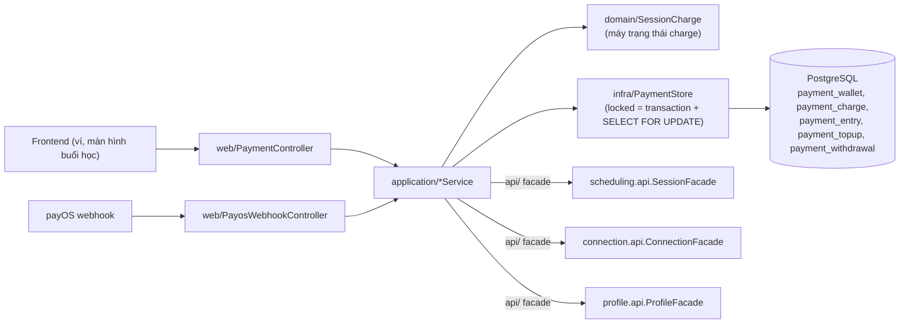
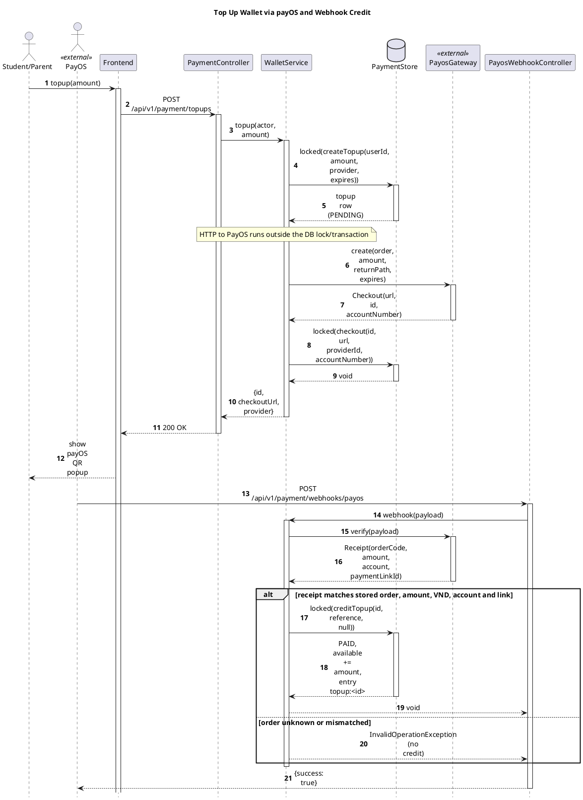
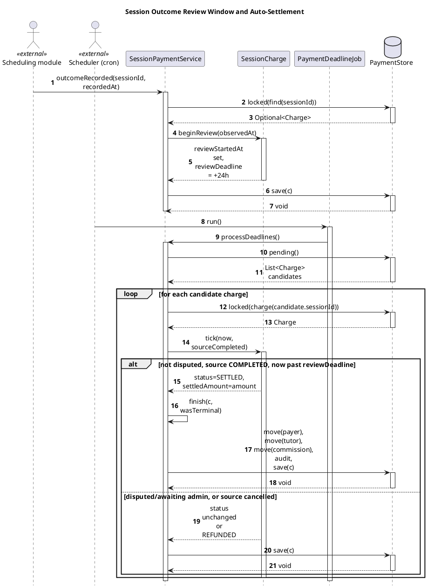
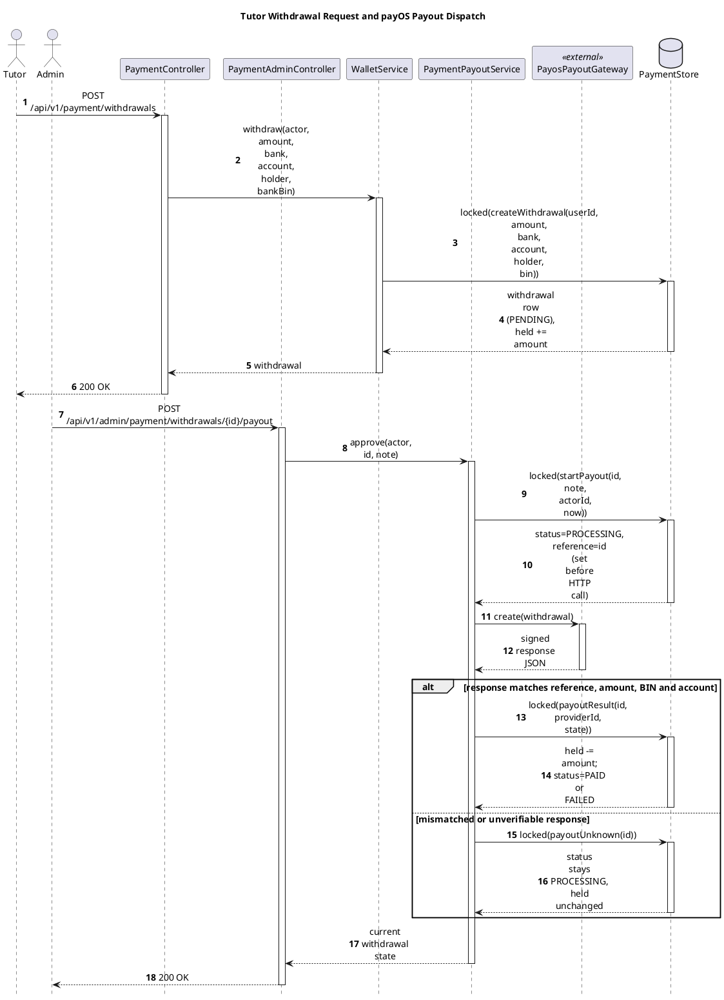

# Module Payment

- **Mã nguồn:** `backend/modules/payment/`
- **Mẫu kiến trúc:** Loại 2 — Complex Domain (`domain/` thuần Java), theo [backend-module-structure-guide.md](../backend-module-structure-guide.md).
- **Cập nhật nội dung:** 11/11/2026 — gộp và cấu trúc lại từ `payment-flow-and-rules.md` cũ (26/10/2026, đối chiếu code `cd8c018`; file đã được gộp hết nội dung vào đây và xóa khỏi repo) theo khung README chuẩn; không đổi nội dung nghiệp vụ, chỉ đổi trình tự trình bày.
- **Tài liệu liên quan:** [verification-report.md](verification-report.md), ảnh minh họa tại [`images/`](images/) (tái tạo bằng `scripts/render-payment-diagrams.py`)

---

## 1. Kiến trúc (Architecture)

```
vn.edufit.payment/
│
├── api/                         # (nếu có) DTO/Facade cho module khác — payment chủ yếu được GỌI bởi
│                                 # scheduling (outcomeRecorded) qua application/, không lộ domain
├── web/
│   ├── PaymentController.java         # /api/v1/payment/** — ví, topup, withdrawal, session charge
│   └── PayosWebhookController.java    # POST /api/v1/payment/webhooks/payos (public, miễn CSRF)
│
├── domain/                      # [TRÁI TIM NGHIỆP VỤ] Java thuần, không Spring/JPA
│   └── SessionCharge.java             # Máy trạng thái 1 charge: fund → review → dispute/report → settle
│
├── application/
│   ├── WalletService.java             # Nạp ví (topup/payOS), rút tiền (withdrawal), webhook, payout account
│   ├── SessionPaymentService.java     # Cấp tiền buổi học, xác nhận, dispute, report, resolve Admin
│   ├── PaymentReconciliationService.java  # Lookup thủ công khi webhook chưa tới
│   ├── PaymentPayoutService.java      # Dispatch & lookup lệnh chi payOS
│   └── PaymentAccess.java             # Kiểm vai trò/quyền tham gia theo actor (payer/tutor/learner/admin)
│
└── infra/
    ├── PaymentStore.java               # locked() = transaction + SELECT FOR UPDATE payment_mutex (mục 5.1)
    ├── PayosPayoutGateway.java / PayosTransport.java / PaymentSettings.java
    └── PaymentDeadlineJob.java         # Job quét hạn 24h review / 48h dispute / payout PROCESSING
```

Payment **gọi vào** `api/` của các module khác để đọc dữ liệu cần thiết, không truy cập trực tiếp bảng của module đó: `SessionFacade` (scheduling — lấy `endAt`, `status`, `outcomeRecordedAt`), `ProfileFacade` (profile), `ConnectionFacade` (connection — giá mỗi buổi chốt theo lớp, `hasConfirmedParentLink`). Ngược lại, `scheduling` gọi `SessionPaymentService.outcomeRecorded()` khi ghi nhận buổi học hoàn thành để Payment mở cửa sổ phản hồi 24h.



---

## 2. Tổng quan & Bối cảnh (Overview & Situation)

Payment quản lý **ba vòng đời tiền tách biệt**: nạp ví qua payOS/QR, cấp tiền (giữ/tất toán) cho buổi học, và rút thu nhập ra ngân hàng. Ví nội bộ là số dư trong DB (`available` + `held`); ngân hàng mới giữ tiền thật — module không tự điều chuyển tiền giữa kênh thu và kênh chi, việc đó do người vận hành quản lý/đối soát.

| Luồng | Tiền thật tại ngân hàng | Số dư trong EduFit | Điều kiện ghi nhận |
|---|---|---|---|
| Nạp ví | Người nạp chuyển vào tài khoản nhận liên kết EduFit | Tăng `available` của đúng người nạp | Receipt/query payOS hợp lệ hoặc Admin xác minh manual |
| Cấp tiền buổi học | Không phát sinh chuyển ngân hàng mới | Chuyển `available` → `held` của payer | Đúng quyền, giá và đủ số dư |
| Tất toán buổi học | Không tự chuyển ngân hàng cho tutor | Giảm `held`, cộng tutor, ghi commission, trả phần dư payer | Đủ 24h phản hồi không vấn đề, hoặc quyết định Admin hợp lệ |
| Rút thu nhập | Chuyển từ nguồn tiền chi tới ngân hàng tutor | Giữ tiền lúc yêu cầu, kết thúc `held` khi xác minh kết quả | Admin manual review hoặc duyệt chi payOS |

**Từ điển nghiệp vụ:** Payer (Student/Parent đã cấp tiền), Learner side (Student của buổi hoặc Parent payer còn confirmed link), Tutor side, Available/Held (số dư chưa dùng / đã dành cho nghĩa vụ), Charge (học phí một session), Topup/Withdrawal (yêu cầu nạp/rút), Settlement (tất toán vào ledger — không đồng nghĩa chuyển khoản ngân hàng), "Refund" trong tài liệu này (giải phóng `held` về `available`, chưa phải bank refund), Ledger/entry (lịch sử thay đổi tiền, có `event_key` và reference để truy vết).

`available` và `held` không bao giờ âm (ràng buộc DB, mục 5.1). Held không chỉ dành cho tranh chấp — ngay khi cấp tiền hoặc tạo yêu cầu rút, khoản đó đã bị giữ; mở dispute giữ nguyên khoản đã dành, không trừ thêm một lần học phí.

---

## 3. API Contract — `/api/v1/payment/**`

| Method | Endpoint | Actor | Mô tả | Request |
|---|---|---|---|---|
| GET | `/wallet` | Authenticated | Xem số dư + lịch sử (phân trang `offset`) | `?offset=` |
| PUT | `/payout-account` | Tutor | Lưu tài khoản nhận tiền (một lần, có versioning qua `expectedAccountId`) | `PayoutAccount{bank,account,holder,bankBin,expectedAccountId}` |
| POST | `/topups` | Student/Parent | Tạo yêu cầu nạp ví qua payOS | `Money{amount}` (10.000–100.000.000, nguyên) |
| POST | `/topups/{id}/refresh` | Owner | Chủ động lookup provider khi webhook chưa tới | — |
| POST | `/withdrawals` | Tutor | Tạo yêu cầu rút (nhập tay thông tin ngân hàng) | `Withdrawal{amount,bank,account,holder,bankBin}` |
| POST | `/withdrawals/saved-account` | Tutor | Rút bằng tài khoản đã lưu | `SavedWithdrawal{amount,payoutAccountId}` |
| GET | `/sessions?from&to` | Payer/Tutor/Admin | Danh sách charge theo khoảng thời gian | query params |
| GET | `/sessions/{id}` | Participant/Admin | Chi tiết một charge | — |
| POST | `/sessions/{id}/fund` | Student/Parent (learner role) | Cấp tiền giữ cho buổi học | `Fund{amount}` |
| POST | `/sessions/{id}/confirm` | Participant | Xác nhận đã học / đã dạy | — |
| POST | `/sessions/{id}/dispute` | Participant | Mở hồ sơ vấn đề | `Issue{text,category,evidence}` |
| POST | `/sessions/{id}/report` | Payer/Tutor | Đề xuất mức tiền giải quyết (0..A) | `Report{amount,text}` |
| POST | `/sessions/{id}/comments` | Participant trong case | Bổ sung thông tin vào hồ sơ đang xử lý | `CaseComment{messageId,text}` |
| POST | `/webhooks/payos` | payOS (public, miễn CSRF) | Nhận biến động nạp tiền (chữ ký HMAC bắt buộc) | raw payload |

Mọi actor được đọc từ `CurrentUser` (session cookie), **không tin `userId`/`role` gửi trong body**. Webhook là ngoại lệ public vì gọi server-to-server — chữ ký HMAC là điều kiện bắt buộc thay cho session.

---

## 4. Luồng triển khai từng bước (Implementation Flows)

### 4.1. Nạp ví qua payOS/QR

Thứ tự xử lý thực tế trong `WalletService.topup()`:
1. Kiểm actor (chỉ Student/Parent) và amount (VND nguyên, 10.000–100.000.000).
2. Tạo `payment_topup` riêng: ID, order riêng, owner, amount, provider, trạng thái `PENDING`, `expires_at`.
3. Gọi payOS tạo checkout **ngoài transaction/khóa DB** (mạng chậm không giữ khóa tiền).
4. Xác minh response tạo checkout: chữ ký, URL HTTPS đúng host payOS, link ID, order/amount/VND, tài khoản nhận hợp lệ (chấp nhận tài khoản ảo payOS cấp riêng cho đơn).
5. Lưu checkout (URL, link ID, tài khoản nhận) vào topup để ghép đúng receipt sau này.
6. Nhận bằng chứng thanh toán qua webhook (ưu tiên) hoặc lookup thủ công (`/topups/{id}/refresh`) — cả hai đi qua **cùng một hàm credit** nên không cộng hai lần.
7. Credit: chuyển `PAID`, `available += amount`, ghi `payment_entry` (event key `topup:<topupId>`), audit, notification — tất cả trong một transaction.

**Trace table**

| # | From | To | Real method | File:line |
|---|---|---|---|---|
| 1 | Student/Parent | Frontend | `topup(amount)` | `frontend/src/features/payment/api/paymentApi.ts:176` |
| 2 | Frontend | PaymentController | `topup(input)` — `POST /api/v1/payment/topups` | `backend/.../web/PaymentController.java:91` |
| 3 | PaymentController | WalletService | `topup(actor, amount)` | `backend/.../application/WalletService.java:54` |
| 4 | WalletService | PaymentStore | `locked(() -> createTopup(...))` | `backend/.../infra/PaymentStore.java:31`, `createTopup` at `PaymentStore.java:221` |
| 5 | WalletService | PayosGateway | `create(order, amount, returnPath, expires)` | `backend/.../application/WalletService.java:68` |
| 6 | WalletService | PaymentStore | `locked(() -> checkout(id, url, providerId, accountNumber))` | `backend/.../application/WalletService.java:69-73`, `checkout` at `PaymentStore.java:236` |
| 7 | PayOS | PayosWebhookController | `receive(payload)` — `POST /api/v1/payment/webhooks/payos` | `backend/.../web/PayosWebhookController.java:16` |
| 8 | PayosWebhookController | WalletService | `webhook(payload)` | `backend/.../application/WalletService.java:110` |
| 9 | WalletService | PayosGateway | `verify(payload)` | `backend/.../infra/PayosGateway.java:119` |
| 10 | WalletService | PaymentStore | `locked(() -> findTopupByOrder(...) + creditTopup(...))` | `backend/.../application/WalletService.java:112-134`, `creditTopup` at `PaymentStore.java:278` |

![Sequence Diagram](https://www.plantuml.com/plantuml/svg/VLRRajeu47tNLtJnnDIIOYQLseSfCfMvv4BjBkC4aZmBgnbK2CchYu6aykzfoJQs6IPFsDRfqxVJQjuvpwqFMyMyz0fXOGhuMi1thXHwA2M7WXyUvy2rWE-uN1kpWNkBGdh6WpSwR9TesLeAX9KnVcdsp6saBhZbMt1hBinEwYTOSUMmSxBb-__GEVw4S_a3uU_BhXN-7r3dM0DkbNpIaAFsv6ZY_47X3IEabxaikFRmam5aN8Zev-er-yKcunhLSWfSyQ3y1wFzZ6yH1dS8toHwJMUPDOFpq1JRrHl6UEwDXS7S1q5nZ3DkwMS0t47zgK5aiLZf83t1P89xYbjpTTCFUl31aWFK8e6Rbpw4ABR4VKzdrb0_RCAshtrqrR8vsbBcc92tHS44ztp97HxPvXHdTVnmzyoTSH-vnnq_943z_8SaaaajYvCmcw_UAiRgAi6hcsEgS0tU5A4Oygq9sb_42igIFBR5E4B9h6Kdm-nnle0nB-Iul1eNLLxZnEPQcawTEiP4HMLfdSUsZU1P3B5q4KVmXpj2AvDlK0npYtIwIAR1ePsAndO4XJKbZG6nuRwG5jr5XuzgJJol-jx1cXqCi_UpX-diumKJs8LhGx-cf90hYq-BHKPcjQviq0vCy2uEdbz7YnJZs5kkNUGnkacWQUCrLE4FZKrXDe5RzC7gZFjr6teRUMtD6fOsX_irvXkAOHYi6e6CfSZpI3bBbq8leORbN4qRciYGg9fAJfzH_g6YfP7Yf8J9sQbsVaOtZS-lNNU_kkPH05tPz9Nx-l8I7l_fuZjgQsLBHetoh-aof6vNb-ddBr140J1MTPDmdN5vIU2x2kBY1zCHUdVIkZJ7qjI6Gx9JXelpCczLGfgJgyCPzCjI-88voi9Nohet0bjrrGqSGPt6lr9lfkAiEBZo9CR4H0l2KvCSk7XT2JYHxBVPmv4vhIP5hBG6peyiBQjgP6FhBQxGnlKo0XsK8aa1T4K3q9DLTZkDhaek5L_IVlphxJ48IiOUgac-daXnGwPz_TNnFEjkaYhIGgpIWg0tskmqlS5MkYfpyQBrL9TSIV5OeELnpD_lSopY0morWIhT2nRlpnCvzxH1j9NsQ29So7FQjNGhsO2zAUXAwnrHql-4tm==)



Assumptions: `PaymentStore` merges the repository/adapter and database boundary into one participant — it wraps `JdbcTemplate` directly (no separate ORM repository layer), so its methods are themselves the SQL round trip. Webhook delivery failure/retry and the manual-lookup fallback (`/topups/{id}/refresh`) are a separate reconciliation path, not shown here to stay within the message budget — see narrative in this section below for that path.

Webhook mất/chậm: localhost không nhận được cuộc gọi payOS nếu chưa có public HTTPS/tunnel. Ngoài webhook, owner/Admin có thể bấm "Kiểm tra tiền đã chuyển" (`/topups/{id}/refresh`); job cũng tự lookup. Lease topup 30 giây (lưu DB) hạn chế API/job/instance cùng query liên tục.

Nếu chỉ dùng QR thủ công (thiếu payOS nhưng đủ BIN/tài khoản/tên người nhận): Admin xem giao dịch ngân hàng thật, nhập reference duy nhất rồi xác nhận manual. **Khoản PAYOS không được manual-confirm** để bỏ qua đối soát; sai amount/tài khoản/nhiều lần chuyển phải xử lý đối soát, không cộng tay bằng SQL.

### 4.2. Cấp tiền và giữ tiền buổi học

`SessionPaymentService.fund()`: kiểm vai trò learner (`PaymentAccess.learnerRole`) → lấy giá chốt theo lớp (`ConnectionFacade.findClassById().pricePerSession()`, giá chốt khi gia sư nhận yêu cầu kết nối, không đổi theo thời gian) → kiểm trạng thái buổi học qua `SessionFacade` phải `SCHEDULED`/`COMPLETED`, trước `max(endAt, outcomeRecordedAt) + 24h` → giữ: `available -= amount`, `held += amount` của payer, snapshot giá và phí 10% vào `payment_charge`. Một charge/một payer cho mỗi buổi (khóa chính `payment_charge`).

### 4.3. Phản hồi việc học và tự tất toán (24h)

Khi `scheduling` ghi `COMPLETED`, nó gọi `SessionPaymentService.outcomeRecorded()` — trong cùng transaction, mở/lưu/thông báo cửa sổ phản hồi: `reviewStartedAt = max(endAt, lúc ghi nhận)`, `reviewDeadline = reviewStartedAt + 24h`. Ghi nhận muộn vẫn có đủ 24 giờ; sự kiện lặp lại không reset hạn.

**Trace table**

| # | From | To | Real method | File:line |
|---|---|---|---|---|
| 1 | Scheduling module | SessionPaymentService | `outcomeRecorded(sessionId, recordedAt)` | `backend/.../application/SessionPaymentService.java:370` |
| 2 | SessionPaymentService | PaymentStore | `locked(() -> find(sessionId))` | `PaymentStore.java:102` |
| 3 | SessionPaymentService | SessionCharge | `beginReview(observedAt)` (via `syncReview`) | `domain/SessionCharge.java:45`, call site `SessionPaymentService.java:366-367` |
| 4 | SessionPaymentService | PaymentStore | `save(c)` | `PaymentStore.java:161` |
| 5 | Scheduler (cron) | PaymentDeadlineJob | `run()` | `infra/PaymentDeadlineJob.java:16` |
| 6 | PaymentDeadlineJob | SessionPaymentService | `processDeadlines()` | `SessionPaymentService.java:304` |
| 7 | SessionPaymentService | PaymentStore | `pending()` | `PaymentStore.java:107` |
| 8 | SessionPaymentService | PaymentStore | `locked(() -> charge(candidate.sessionId()))` | `SessionPaymentService.java:307-309` |
| 9 | SessionPaymentService | SessionCharge | `tick(now, completed)` | `domain/SessionCharge.java:56` |
| 10 | SessionPaymentService | SessionPaymentService (self) | `finish(c, wasTerminal)` | `SessionPaymentService.java:329` |
| 11 | SessionPaymentService | PaymentStore | `move(payer)`, `move(tutor)`, `move(commission)`, `audit(...)`, `save(c)` | `move` at `PaymentStore.java:57`, `audit` at `:85`, `save` at `:161`; call site `SessionPaymentService.java:334-357` |

![Sequence Diagram](https://www.plantuml.com/plantuml/svg/hLLBRnen4BxlhnXnMbJID57KGqLG212fLHueIzlpO0zWPTVUsbv8MlM_TxmFM3PHJZsn7d_VFBynLywZzKMMHbxvb20XvvJHy51uOJA2Hzegsi5FfQNP0Me9uyARauGyepFIFa8-wo9RaeqsIXAiZF5Bynov9wLpj9Y1so2JbLx32bD7hPiCd-yu8AufKRy9Fdzgi-XNGLfG3HYdQgr1S4GED7J-9QLHn4YlXCfHU_WJ0SnHoX3dx3pw6mrFQzJ1fwGL5gc_CThV8rVNkoRueSXhlfjRqtiRMkPsTX55ABonq4l4XcIHXa2PuG_g0JfeMOT3UkOqDQQZKOT45c9XZUwNd0b_7QFR5VNgOSpn9NGw8RjLeWesplCtePCDsdK5cPeCbJv6rPwcX98JfMzcMKBvDvBeSOcEzg24qwuzNKTHgxgJKGWFNy1K6daaOQma6RigXwzo0BQsZNq_D41jqLEPT62oW-aryrCZdfYsOcqTkFqMWGCpy6GVy27tZC5qM9KvYYIriOtlid26BscjT2NWs2mTjw-JKDsYcd28OqjE4ZOZC5YAVb0RczR19NmulzWSPL1vQrVeS4knUAUYhL6oKqNh51eMbHfX0Wyff5RekEKlJ2vSx1tcrWXkPPEcYz_fVquwR4lyJdwtolccso1u_HNhX5mdvTIOdFVU0bit1nY8aiXx-SRKgxju3_xOLW10spt0KKwJnkjn4eSepVnPzq-nDhi1E5DOGHEJvIdnI8y3L6DZI-f16mzIkRnWL4E3oSFT_7Qsc4q7VB-379tlg87P0Azan4-hBznbCbiiRWFPbO-c76UcqFuIov-IMITUiNWTbDl4OW0xT0kocMB5zzkuiesPOMdb-4AsFwWEdX_Y_O4NCrDbGzc2XLIiu4QDmTLnvpeTBbKPhDqE4p_V-_wSuWwL3oy2Iavo02o0kcCyLK4fr_fUOw3GB0Az9XcOZxERx_VJsVHLeVyXQoqxQgb67koTRMiTmsfTCOJ_6_y1)



Assumptions: "Scheduling module" and "Scheduler (cron)" are modelled as two external actors because this flow has no single human actor — it is triggered by a cross-module call and by `@Scheduled` respectively. `SessionCharge.finish()` (private, sets `status`/`settledAmount`) is distinct from `SessionPaymentService.finish(Charge, boolean)` (the wallet-moving method shown here as a self-call) — both are real methods, same name, different classes.

Xác nhận đã học / ghi nhận đã dạy chỉ ghi nhận việc học — **không tất toán sớm**. Hủy/vắng mặt khi chưa có case hoàn `held` theo chính sách hiện có; khi đã có case, mọi state `DISPUTED`/`AWAITING_ADMIN`/`ADMIN_REVIEW` tiếp tục giữ tiền dù nguồn buổi học đổi trạng thái. Dời lịch không reset `reviewStartedAt` đã mở.

### 4.4. Hồ sơ vấn đề (dispute) và quyết định Admin

Participant mở case (`/dispute`): chọn loại vấn đề, mô tả 1–2000 ký tự, bằng chứng tối đa 4000 ký tự. Mỗi buổi chỉ một case; mở trùng nhận case hiện tại. Hạn hai bên giải quyết = `openedAt + 48h`.

Chỉ **payer và tutor** được `/report` mức tiền đề xuất 0..A kèm lý do (tối đa 4000 ký tự) trước 48h. Mỗi participant được thêm tối đa 20 bình luận (`/comments`, mỗi bình luận ≤4000 ký tự); `messageId` chặn retry trùng.

| Điều kiện | Kết quả |
|---|---|
| Hai mức đề xuất khớp trước 48h | `AWAITING_ADMIN`, tiếp tục `held` |
| Đủ 48h chưa khớp | `ADMIN_REVIEW`, tiếp tục `held`; không tự hoàn |
| Admin quyết định S>0 | `SETTLED`: tutor += S−fee, payer hoàn A−S, fee = floor(10%·S) |
| Admin quyết định S=0 | `REFUNDED`: hoàn toàn bộ A, không phí |

Admin (`SessionPaymentService.resolve()`) được phân xử mức 0..A sau `endAt` dựa trên bằng chứng, kể cả khi nguồn chưa `COMPLETED` — quyền mà auto-settlement không có. Chưa có cơ chế appeal/reopen sau khi case đã ở trạng thái terminal.

### 4.5. Rút thu nhập tutor ra ngân hàng

1. Tutor lưu tài khoản nhận tiền một lần (`PUT /payout-account`, versioning qua `expectedAccountId` để tránh ghi đè đồng thời).
2. Tạo withdrawal (`/withdrawals` hoặc `/withdrawals/saved-account`): `available` đủ mới giữ W và lưu `PENDING`. Mỗi tutor chỉ một `PENDING`/`PROCESSING` cùng lúc; gửi lại cùng dữ liệu có thể nhận lại yêu cầu đang có, không giữ thêm tiền.
3. Admin xử lý theo 1 trong 2 cách:
   - **Manual:** chỉ khi `PENDING` — Admin chuyển ngoài app, xác minh kết quả cuối, ghi `paid` với reference thật; hoặc từ chối để trả lại `held`.
   - **payOS** (`PaymentPayoutService`): lưu `PROCESSING` + thời điểm dispatch + reference cố định **trước** khi gọi HTTP → dùng withdrawal UUID làm `referenceId`/`x-idempotency-key` → gọi `create` ngoài khóa (approve đồng thời/lặp không gửi thêm lệnh) → kiểm response ký; nếu chưa rõ kết quả thì `lookup` theo ID/reference.

**Trace table**

| # | From | To | Real method | File:line |
|---|---|---|---|---|
| 1 | Tutor | PaymentController | `withdraw(input)` — `POST /api/v1/payment/withdrawals` | `web/PaymentController.java:101` |
| 2 | PaymentController | WalletService | `withdraw(actor, amount, bank, account, holder, bankBin)` | `application/WalletService.java:155` |
| 3 | WalletService | PaymentStore | `locked(() -> createWithdrawal(...))` | `WalletService.java:170-177`, `createWithdrawal` at `infra/PaymentStore.java:301` |
| 4 | Admin | PaymentAdminController | `payout(id, input)` — `POST /api/v1/admin/payment/withdrawals/{id}/payout` | `web/PaymentAdminController.java:67` |
| 5 | PaymentAdminController | PaymentPayoutService | `approve(actor, id, note)` | `application/PaymentPayoutService.java:31` |
| 6 | PaymentPayoutService | PaymentStore | `locked(() -> startPayout(id, note, actorId, now))` | `PaymentPayoutService.java:36-41`, `startPayout` at `PaymentStore.java:413` |
| 7 | PaymentPayoutService | PayosPayoutGateway | `create(withdrawal)` | `PaymentPayoutService.java:44`, `PayosPayoutGateway.java:18` |
| 8 | PaymentPayoutService | PaymentStore | `locked(() -> payoutResult(id, providerId, state))` | `apply` at `PaymentPayoutService.java:77-99`, `payoutResult` at `PaymentStore.java:457` |

![Sequence Diagram](https://www.plantuml.com/plantuml/svg/ZLNVSzem37xFNw7ZYTxQe-tjzi3QNg6q6_i1NEdMPn6BuYEnCzk1ibx_zobnGWpbhdi2sz8dwViavTewD2vFayX9bn0yv4uRU9Hk8GokCO5x-fEJTO1AG8QRyHGckD6vWu6q6Rfu4I6xg3oTaOaMKX3CjNOp_HpPfLGP6ap1Bb3ejLHFCCV4Kl2IulDFiXQVQ2h_4dmw3RsAo2gcog2No2S5CId7WIwisoHq5R6bax7CK3buYO1p4wA8StOUlKONdSggmHGqnpnnTrgv4QO4hJx1RqbEyTl4wDPXqpAtiuzHX771JibHzRydKgbsqcWnFobdUSEEHYS9cHQWXUPuqBh4sNFnTyuaknwFo1PkIcObOoeD_Sr1N2zMQEnltXXhwn--eACrRahJwZzSND0piwumkRgA13gSeQLjY2dpuA47_IZo3NHo5HGCNPYCfm_GmKnsLcUTpFjrrjikimMRSiNXGfu21CRpHJ9MxTOk5JW6J7Mkt37CK2tv5CV-kD298EEl-r8TDI4gkYf0XXxq6JRHyP94EpR4Diq0j7DBPYZU3yCXWXXC1QEU7CgRXyheDRGdjwF1SFJbY34e4V3XiWeH2GfXwZJtAMtWGeUgjf0wTlIYTE7yz1J6tqFxWEwexBU2ZstZxIk7nSCX_JelKhmM3qLhRS6R1cuG6RvQ85t0B3DwHRMGabbMsb50OzMibSUULENgya_jshTGXi66vN5zM95jV0PmkRsSt8zlRgTJrk8O3Ct955ldKWfeMoP-HdFkR_Zwy321cDazsjEdoQqUboxu9cet10LvL5PHRRsR4Uyu4fo5pRJY6Vis7O_2UBKp9gunIeirJBR9lMdM_d1KRkwgNSiDUOXAhzmzMTvu9PU5CBpCIo8BceYf10Zh1jYdispZaxgDFs_fxGq7mErtrnl-k1smtov_b1GbIEkh48LbhbPav5pYZBz8TPdlvFvBBLbmnSd_HwO-i-9dmminaByi8LVn0jKJYRUvAh7LUszEujmmzowSyfAtKBsgcuDXg44EpcOpFjSScB_H_m0=)



Assumptions: the manual payout path (`PaymentAdminController.withdrawal` → `WalletService.reviewWithdrawal`, `POST /withdrawals/{id}/review`) is a separate, simpler branch not shown here — this diagram covers the automated payOS dispatch path (`/withdrawals/{id}/payout`) since it is the one with cross-module/external-system complexity worth tracing. The periodic reconciliation job (`PaymentPayoutService.process()` calling `reconcile`/`gateway.lookup`) is the retry path for the "stays PROCESSING" branch and is out of scope for this one flow.

**Không coi HTTP 200/create thành công là tiền đã tới ngân hàng.** Job chỉ `lookup`, không retry `create`. Lease payout 60s dùng chung giữa API và job. Khi `PROCESSING`, chặn manual paid/reject để tránh vừa chuyển tiền thật vừa hoàn ví. Crash giữa lúc lưu `PROCESSING` và provider nhận lệnh có thể làm không tìm thấy giao dịch — cần đối chiếu với provider, không tự reset/gửi lệnh khác/chuyển manual.

---

## 5. Chi tiết bổ sung & Kỹ thuật

### 5.1. Transaction và mutex DB

Mọi thay đổi tiền đi qua `PaymentStore.locked()`: mở transaction và khóa một hàng `payment_mutex` bằng `SELECT FOR UPDATE`. Các request/instance cùng DB phải chờ lượt — không đồng thời cùng tiêu một số dư dựa trên giá trị cũ. Ràng buộc DB còn ngăn `available`/`held` âm (PAY-02). Trong vùng khóa: kiểm lại state/quyền/số dư → ghi state + bút toán liên quan → audit/notification → commit; lỗi giữa chừng rollback toàn bộ.

Mutex toàn cục đơn giản nhưng giảm throughput — **chưa có bằng chứng tải production/SLA p95**; đây không phải khóa in-memory chỉ có tác dụng trong một instance (khóa ở DB).

### 5.2. Idempotency theo `event_key`

Webhook có thể gửi lại, người dùng refresh, hoặc hai job chạy gần nhau. `payment_entry.event_key` là unique:

| Sự kiện | Event key |
|---|---|
| Credit topup | `topup:<topupId>` |
| Giữ học phí | `reserve:<sessionId>` |
| Giải phóng/tất toán payer | `settle-payer:<sessionId>` |
| Cộng thu nhập tutor | `settle-tutor:<sessionId>` |
| Commission | `commission:<sessionId>` |
| Giữ withdrawal | `withdraw-reserve:<withdrawalId>` |
| Kết quả withdrawal | `withdraw-result:<withdrawalId>` |

Chống trùng kiểm ở backend/DB, không dựa vào một nút FE. Chi ngân hàng còn cần reference/idempotency key provider ổn định, không tự repost khi chưa rõ kết quả.

### 5.3. HMAC, session và CSRF

HMAC (checksum key) xác minh **tính toàn vẹn** dữ liệu provider, không phải mã hóa nội dung — chữ ký đúng vẫn chưa đủ, phải khớp order/tiền/tài khoản/link/reference với dữ liệu đã lưu. API người dùng dùng cookie session + CSRF như phần còn lại của hệ thống (không có JWT riêng cho Payment). Webhook là ngoại lệ public/miễn CSRF vì gọi server-to-server; chữ ký là điều kiện bắt buộc. HTTP gọi provider luôn **ngoài transaction** để tránh giữ khóa tiền khi chờ mạng.

### 5.4. Tính phí và ví dụ ledger

```text
commission = floor(S * 1000 / 10000)   // 1000 bps = 10%, snapshot vào charge lúc fund
tutorIncome = S - commission
payerRefund = A - S
```

Dùng `long`/`bigint` số nguyên VND, không dùng floating point. Phí đi vào entry commission với `user_id = null` — chưa có wallet Admin hay chức năng rút commission riêng; chưa có UI/config đổi tỷ lệ runtime.

Ví dụ: payer available 1.000.000đ, charge A=200.000đ (ba dòng là ba **kịch bản thay thế**, không phải giao dịch nối tiếp):

| Kết quả | Payer available | Payer held | Tutor tăng | Commission | Hoàn từ held |
|---|---:|---:|---:|---:|---:|
| Sau cấp tiền | 800.000 | 200.000 | 0 | 0 | 0 |
| Tất toán đủ S=200.000 | 800.000 | 0 | 180.000 | 20.000 | 0 |
| Tất toán một phần S=150.000 | 850.000 | 0 | 135.000 | 15.000 | 50.000 |
| Admin hoàn toàn bộ S=0 | 1.000.000 | 0 | 0 | 0 | 200.000 |

### 5.5. Danh mục quy tắc tra cứu (PAY-xx)

Mã PAY-xx là nhãn tra cứu **của tài liệu này**, không phải mã BR gốc trong SRS.

| Mã | Quy tắc | Nguồn thực thi chính |
|---|---|---|
| PAY-01 | Ví thuộc user, không thuộc hồ sơ học sinh | `PaymentStore`, `WalletService` |
| PAY-02 | Available/held không âm | `PaymentStore`, constraint V1.16 |
| PAY-03 | Topup chỉ Student/Parent, tiền nguyên 10k..100m | `PaymentAccess`, `WalletService`, `PaymentController` |
| PAY-04 | Tạo QR/return URL không credit | `WalletService`, FE `WalletPanel` |
| PAY-05 | Receipt ký hợp lệ và khớp mới credit | `PayosGateway`, `WalletService`, `ReconciliationService` |
| PAY-06 | Manual cần Admin và reference thực duy nhất | `WalletService`, `PaymentStore` |
| PAY-07 | Một charge/một payer cho mỗi buổi | `PaymentStore`, PK `payment_charge` |
| PAY-08 | Fund kiểm role/link/giá/số dư/thời điểm | `SessionPaymentService` |
| PAY-09 | Snapshot giá và commission 1000 bps | `SessionPaymentService`, `payment_charge` |
| PAY-10 | Không thu thường trước COMPLETED/endAt | `SessionCharge`, `SessionPaymentService` |
| PAY-11 | Xác nhận đã học không tất toán sớm | `SessionCharge` |
| PAY-12 | reviewDeadline = reviewStartedAt+24h; tự tất toán khi COMPLETED không khiếu nại | `SessionCharge.tick` |
| PAY-13 | Mở dispute sau endAt, charge còn chờ | `SessionCharge.dispute` |
| PAY-14 | Dispute dừng luồng auto/tất toán thường | `SessionCharge` |
| PAY-15 | Chỉ payer/tutor report riêng, mức 0..A, trước openedAt+48h | `SessionCharge.report` |
| PAY-16 | Hai mức khớp mới AWAITING_ADMIN | `SessionCharge.report` |
| PAY-17 | Hết 48h chưa khớp → ADMIN_REVIEW, tiền tiếp tục held | `SessionCharge.tick`, `SessionPaymentService` |
| PAY-18 | Admin phân xử mức 0..A kèm lý do | `SessionPaymentService.resolve` |
| PAY-19 | Không timeout chỉ vì Admin duyệt lâu | `SessionCharge.tick` |
| PAY-20 | Fee floor(10% S), phần dư hoàn payer | `SessionPaymentService.finish` |
| PAY-21 | Parent revoked mất quyền buổi, giữ lịch sử ví mình | `PaymentAccess`, `SessionPaymentService` |
| PAY-22 | Hủy/vắng mặt hoàn khoản chưa khiếu nại; state terminal giữ tiền | `SessionPaymentService.processDeadlines` |
| PAY-23 | Chỉ tutor rút, một pending/processing | `PaymentAccess`, `PaymentStore`, V1.17 |
| PAY-24 | Withdrawal giữ tiền ngay khi tạo | `PaymentStore.createWithdrawal` |
| PAY-25 | Admin manual paid chỉ sau chuyển thật | `WalletService.reviewWithdrawal`, quy trình vận hành |
| PAY-26 | Payout lưu PROCESSING trước HTTP | `PaymentPayoutService`, `PaymentStore` |
| PAY-27 | Key/reference cố định, không create lại khi chưa rõ | `PayosPayoutGateway`, `PaymentPayoutService` |
| PAY-28 | Chỉ verified terminal mới kết thúc held | `PaymentPayoutService`, `PaymentStore.payoutResult` |
| PAY-29 | Money/entry/state/audit/notify nguyên tử, key unique | `PaymentStore`, NotificationSink, constraints |
| PAY-30 | Readiness không là kiểm chứng khóa/merchant live | `PaymentSettings`, Admin API |

### 5.6. Các tình huống dễ hiểu nhầm

| Tình huống | Kết quả hiện tại |
|---|---|
| Có tiền trong ví nhưng không cấp tiền buổi? | Chưa có charge/reserve; không tự lấy tiền cho buổi chưa fund |
| Cả Student và Parent đều bấm confirm? | Cùng phía learner, không thay xác nhận tutor |
| Parent khác payer muốn confirm? | Có thể đọc nếu link hợp lệ, không thao tác tài chính learner thay payer |
| Parent payer mất link khi tiền còn giữ? | Mất quyền buổi; khi hoàn tiền vẫn trả đúng payer cũ |
| Tutor có số dư nhưng rút ngân hàng tự động chưa bật? | Có thể gửi yêu cầu; Admin xử lý manual, không tự gửi API chi |
| Nạp thành công nhưng người dùng đóng tab payOS? | Backend vẫn nhận receipt/query; không cần quay lại trang để credit |
| `PAYOS_PAYOUT_ENABLED=false`? | Tắt dispatch provider, không tắt ledger thu nhập nội bộ |
| Một khoản rút `PROCESSING` rất lâu? | Tiền vẫn held, lookup/hỗ trợ provider; không tự hoàn hoặc chi lần hai |
| Muốn Student/Parent rút phần nạp dư về ngân hàng? | Chưa có workflow đó trong bản hiện tại |
| Muốn đổi fee trên Admin? | Chưa có UI/config runtime; cần triển khai riêng |

### 5.7. Ảnh minh họa và giới hạn kiểm chứng

Ảnh trong [`images/`](images/) được tạo xác định bằng `scripts/render-payment-diagrams.py` (không phải ảnh chụp giao dịch thật):

```powershell
python scripts/render-payment-diagrams.py
```

BE/FE đã có bằng chứng kiểm thử trong [verification-report.md](verification-report.md). Merchant, webhook public, khóa thu/chi và giao dịch live vẫn cần cấu hình/kiểm chứng riêng — không suy ra rằng ảnh diagram chứng minh dòng tiền thật đã chạy.
