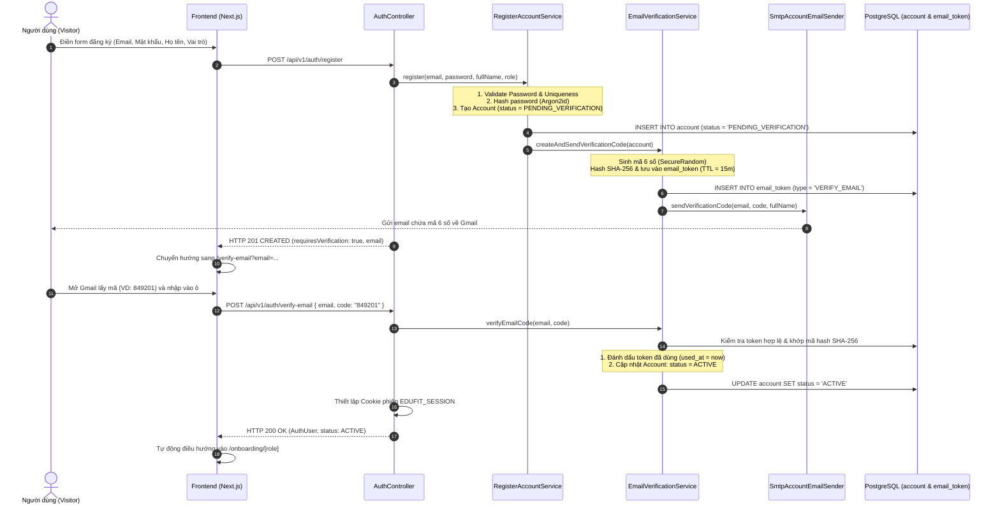

# Kế Hoạch Triển Khai: Xác Thực Mã Code Qua Gmail Khi Đăng Ký Tài Khoản (Anti-Bot & Anti-Spam Email)

> **Mục tiêu:** Khi người dùng hoàn tất biểu mẫu đăng ký (`/register`), hệ thống sẽ tạo tài khoản ở trạng thái chờ xác thực (`PENDING_VERIFICATION`), đồng thời tự động tạo và gửi một mã xác minh gồm **6 chữ số (OTP Code)** về địa chỉ Gmail của người dùng. Người dùng phải nhập đúng mã xác thực này để kích hoạt tài khoản (`ACTIVE`) và tiếp tục luồng Onboarding/Đăng nhập.

---

## 1. Tổng quan & Bối cảnh Nghiệp vụ (Context & Problem Statement)

### 1.1. Thực trạng Hiện tại
- Hiện tại, API `POST /api/v1/auth/register` kích hoạt tài khoản ngay lập tức ở trạng thái `ACTIVE` (bỏ qua bước xác minh email).
- Bất kỳ ai hoặc bot tự động đều có thể nhập các email giả lập, email rác (như `spam123@gmail.com` hay `fake@trashmail.com`) để tạo tài khoản tràn lan trong cơ sở dữ liệu, gây ô nhiễm dữ liệu và rủi ro an ninh thông tin.
- Tài liệu SRS (`docs/SRS Edufit.docx`, Bảng 13 - `UC1.1 Register Account`) đã quy định rõ:
  > *"A visitor creates a new account by choosing a role and supplying basic credentials. The account becomes usable only after the visitor verifies ownership of the email address."*

### 1.2. Giải pháp Đề xuất
1. **Trạng thái tài khoản:** Bổ sung trạng thái `PENDING_VERIFICATION` vào enum `AccountStatus` và cập nhật ràng buộc CSDL `chk_account_status`.
2. **Cơ chế Mã xác thực (OTP Code):**
   - Sinh mã ngẫu nhiên 6 chữ số bảo mật bằng `SecureRandom` (ví dụ: `849201`).
   - Thời hạn hiệu lực: **15 phút**.
   - Băm mã bằng **SHA-256** trước khi lưu vào bảng `email_token` (loại `VERIFY_EMAIL`).
   - Cơ chế giới hạn chống Brute-Force: Tối đa **5 lần nhập sai** trước khi mã bị vô hiệu hóa; giới hạn gửi lại mã (Resend Cooldown) là **60 giây** để chống spam SMTP.
3. **Email thông báo:** Gửi thư qua `JavaMailSender` (Mailpit ở local, SMTP Gmail/SendGrid ở Production) chứa mã số 6 chữ số rõ ràng, định dạng đẹp mắt.
4. **Giao diện Người dùng (Frontend UX):**
   - Sau khi ấn Đăng ký, giao diện chuyển mượt mà sang màn hình **Nhập mã xác thực email** (`/verify-email?email=...`).
   - 6 ô nhập mã số trực quan với tính năng tự động nhảy ô (Auto-focus), hỗ trợ dán cả 6 số (Paste detection).
   - Nút **"Xác thực tài khoản"** và nút **"Gửi lại mã"** kèm đồng hồ đếm ngược 60 giây.
   - Khi xác thực thành công: Tự động đăng nhập và chuyển tiếp vào luồng Onboarding theo vai trò (`STUDENT`, `TUTOR`, `PARENT`).

---

## 2. Kiến trúc Luồng Xử Lý (Sequence Diagram)



---

## 3. Chi Tiết Kỹ Thuật & Các Thay Đổi (Proposed Changes)

### 3.1. Cơ sở Dữ liệu & Database Migration (Backend)

#### [NEW] `backend/app/src/main/resources/db/migration/iam/V1.33__add_pending_verification_account_status.sql`
- Cập nhật ràng buộc `chk_account_status` trên bảng `account` để hỗ trợ trạng thái `PENDING_VERIFICATION`:
```sql
-- Migration V1.33: Bổ sung trạng thái PENDING_VERIFICATION cho tài khoản chưa xác thực email
ALTER TABLE account DROP CONSTRAINT IF EXISTS chk_account_status;
ALTER TABLE account ADD CONSTRAINT chk_account_status 
  CHECK (status IN ('ACTIVE', 'DEACTIVATED', 'PENDING_VERIFICATION'));
```
- Cập nhật số lượng file kỳ vọng trong `FlywayMigrationScriptTest.java` (từ 28 lên 29).

---

### 3.2. Phân Hệ IAM Backend (Spring Boot)

#### [MODIFY] `backend/modules/iam/src/main/java/vn/edufit/iam/api/AccountStatus.java`
- Thêm giá trị `PENDING_VERIFICATION`:
```java
public enum AccountStatus {
  /** Tài khoản đang hoạt động bình thường. */
  ACTIVE,

  /** Tài khoản mới đăng ký, đang chờ xác minh mã qua email. */
  PENDING_VERIFICATION,

  /** Tài khoản đã bị vô hiệu hóa bởi Quản trị viên. */
  DEACTIVATED
}
```

#### [MODIFY] `backend/modules/iam/src/main/java/vn/edufit/iam/infra/persistence/Account.java`
- Sửa hàm `Account.create(...)` để tài khoản khởi tạo với `status = AccountStatus.PENDING_VERIFICATION`.
- Thêm phương thức hành vi:
```java
public void activate() {
  if (this.status == AccountStatus.DEACTIVATED) {
    throw new InvalidOperationException(ErrorCode.USER_DEACTIVATED, "Tài khoản đã bị vô hiệu hóa");
  }
  this.status = AccountStatus.ACTIVE;
}
```

#### [NEW] `backend/modules/iam/src/main/java/vn/edufit/iam/application/EmailVerificationService.java`
- Quản lý toàn bộ vòng đời của mã xác thực 6 số:
  - `sendVerificationCode(Account account)`: Sinh mã 6 số ngẫu nhiên qua `SecureRandom`, vô hiệu hóa các token cũ chưa dùng của tài khoản, hash SHA-256 mã và lưu vào `AccountToken` (TTL: 15 phút), gọi `AccountEmailSender` gửi thư.
  - `verifyCode(String email, String rawCode)`: Kiểm tra tài khoản, tìm token `VERIFY_EMAIL` còn hạn, so khớp SHA-256, kích hoạt tài khoản `account.activate()` và đánh dấu token `used_at = now()`.
  - `resendVerificationCode(String email)`: Kiểm tra cooldown 60 giây để chống spam, nếu hợp lệ thì sinh mã mới và gửi lại.

#### [MODIFY] `backend/modules/iam/src/main/java/vn/edufit/iam/application/port/AccountEmailSender.java` & `SmtpAccountEmailSender.java`
- Bổ sung phương thức giao tiếp:
```java
void sendEmailVerificationCode(String recipientEmail, String code, String fullName);
```
- Hiện thực mẫu email HTML/Text trực quan:
  - Tiêu đề: `[EduFit] Mã xác thực đăng ký tài khoản của bạn`
  - Nội dung: Chào hỏi, hiển thị nổi bật mã 6 số, cảnh báo thời hạn 15 phút và khuyến nghị bảo mật.

#### [MODIFY] `backend/modules/iam/src/main/java/vn/edufit/iam/web/AuthController.java`
- Cập nhật endpoint `POST /api/v1/auth/register`:
  - Trả về thông điệp yêu cầu xác minh kèm `email` và `requiresVerification = true`.
- Bổ sung endpoint `POST /api/v1/auth/verify-email`:
  - Request DTO: `VerifyEmailRequest(String email, String code)`
  - Xác thực mã, tự động tạo phiên đăng nhập `EDUFIT_SESSION` và trả về `AuthUserResponse`.
- Bổ sung endpoint `POST /api/v1/auth/resend-verification`:
  - Request DTO: `ResendVerificationRequest(String email)`
  - Gửi lại mã mới có áp dụng cooldown 60 giây.

#### [MODIFY] `backend/modules/iam/src/main/java/vn/edufit/iam/application/AuthenticateAccountService.java`
- Bổ sung kiểm tra khi đăng nhập: Nếu tài khoản ở trạng thái `PENDING_VERIFICATION`, trả về thông báo lỗi thân thiện:
  > *"Tài khoản của bạn chưa được kích hoạt qua email. Vui lòng kiểm tra hộp thư để nhập mã xác nhận."*

---

### 3.3. Phân Hệ Frontend (Next.js 16 + React 19)

#### [MODIFY] `frontend/src/features/auth/api/authApi.ts`
- Thêm các hàm gọi API:
  - `verifyEmail({ email, code }): Promise<ApiResponse<AuthUser>>`
  - `resendVerification({ email }): Promise<ApiResponse<void>>`

#### [NEW] `frontend/src/features/auth/components/VerifyEmailView.tsx`
- Giao diện xác thực 6 số hiện đại:
  - Tiêu đề: **Xác thực địa chỉ Email của bạn**.
  - Hiển thị email đã gửi tới kèm icon Gmail / phong bì thư.
  - Hàng 6 ô nhập số (Digit Input Boxes) tự động chuyển con trỏ sang ô tiếp theo khi gõ hoặc dán toàn bộ chuỗi 6 số từ clipboard.
  - Nút **"Xác thực ngay"** (hiển thị spinner khi đang gửi yêu cầu).
  - Nút **"Gửi lại mã"** kèm bộ đếm ngược 60 giây (`Gửi lại sau (59s)...`).
  - Đường dẫn phụ: *"Nhập sai địa chỉ email? Đăng ký lại"*.

#### [NEW] `frontend/src/app/(auth)/verify-email/page.tsx`
- Trang định tuyến Next.js App Router bọc `<Suspense>` để đọc `email` từ `useSearchParams()`.

#### [MODIFY] `frontend/src/features/auth/hooks/useRegisterForm.ts` & `RegisterForm.tsx`
- Sau khi bấm "Tạo tài khoản" thành công:
  - Thay vì cố gắng đăng nhập ngay, lập tức chuyển hướng:
    `router.push(`/verify-email?email=${encodeURIComponent(email)}&role=${role}`);`

---

## 4. Kế Hoạch Kiểm Thử & Xác Nhận (Verification Plan)

### 4.1. Automated Unit & Integration Tests

1. **Backend Tests:**
   - `RegisterAccountServiceTest`: Xác nhận tài khoản mới được tạo với trạng thái `PENDING_VERIFICATION`.
   - `EmailVerificationServiceTest`:
     - Nhập đúng mã $\rightarrow$ Tài khoản chuyển sang `ACTIVE`, token chuyển `used`.
     - Nhập sai mã $\rightarrow$ Báo lỗi `INVALID_VERIFICATION_CODE`.
     - Mã đã hết hạn ($> 15\text{ phút}$) $\rightarrow$ Báo lỗi `EXPIRED_VERIFICATION_CODE`.
     - Thử gửi lại mã quá nhanh ($< 60\text{ giây}$) $\rightarrow$ Báo lỗi `RESEND_COOLDOWN_ACTIVE`.
   - `AuthControllerTest`: Kiểm thử trọn vẹn chuỗi gọi REST API `/register` $\rightarrow$ `/verify-email` $\rightarrow$ `/login`.
   - `FlywayMigrationScriptTest`: Xác nhận 29 file migration hợp lệ.

2. **Frontend Tests:**
   - `VerifyEmailView.test.tsx`:
     - Kiểm thử tự động nhảy 6 ô số khi gõ phím hoặc dán (Paste).
     - Kiểm thử đếm ngược 60 giây trước khi cho phép bấm nút "Gửi lại mã".
     - Kiểm thử hiển thị thông báo lỗi khi API trả về mã không hợp lệ.
     - Kiểm thử điều hướng thành công vào Onboarding sau khi xác thực.

### 4.2. Manual Verification (Kiểm Thử Thực Tế)
1. Mở trang đăng ký `http://localhost:3000/register`.
2. Đăng ký tài khoản mới với email thử nghiệm (VD: `test.student@gmail.com`).
3. Màn hình tự động chuyển sang trang `/verify-email?email=test.student@gmail.com`.
4. Mở Mailpit tại `http://localhost:8025`, kiểm tra email `[EduFit] Mã xác thực tài khoản của bạn`.
5. Lấy mã 6 số từ Mailpit điền vào giao diện web và bấm "Xác thực".
6. Xác nhận hệ thống đăng nhập thành công và đưa vào đúng màn hình Onboarding theo vai trò đã chọn.

---

> [!IMPORTANT]
> **Ràng buộc Dự án:**
> Tuyệt đối không thay đổi tệp `backend/app/src/main/resources/application.yml`. Mọi cấu hình mail và URL đều tận dụng các thuộc tính môi trường sẵn có (`edufit.mail.from`, `edufit.frontend.base-url`, Spring Mail).
