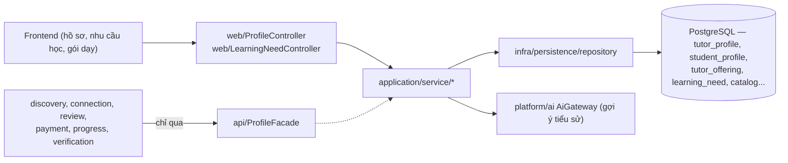
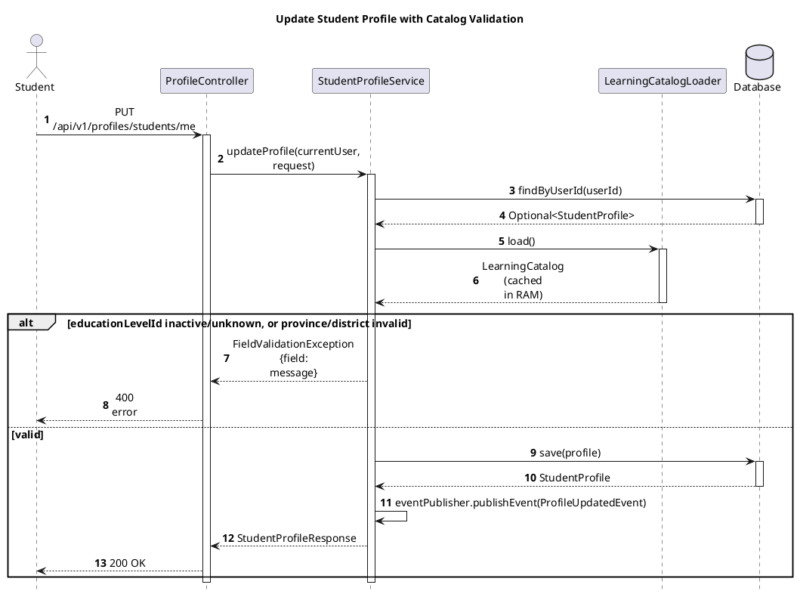

# Module Profile

- **Mã nguồn:** `backend/modules/profile/`
- **Mẫu kiến trúc:** Loại 1 — Standard, theo [backend-module-structure-guide.md](../backend-module-structure-guide.md).
- **Chưa có tài liệu kiến trúc trước đây** — README này được viết trực tiếp từ mã nguồn hiện tại (`ProfileController.java`, `TutorProfileService.java`, `StudentProfileService.java`, `LearningNeedController.java`, `LearningCatalog.java`).

---

## 1. Kiến trúc (Architecture)

```
backend/modules/profile/src/main/java/vn/edufit/profile/
│
├── api/
│   ├── ProfileFacade.java                   # Bề mặt công khai lớn nhất trong hệ thống — xem mục 5.1
│   ├── dto/  TutorSummaryDto, StudentSummaryDto, TutorDiscoveryProfileDto, TutorOfferingDto,
│   │         LearningNeedView, EducationLevelOrderDto, TutorSearchCriteria
│   └── fit/  NeedFitEvaluator, FitCriterion, FitCheck, FitAudience  (dùng chung bởi discovery + connection)
│
├── application/service/
│   ├── StudentProfileService.java            # Hồ sơ học viên — khối lớp, khu vực
│   ├── TutorProfileService.java               # Hồ sơ gia sư — gói dạy, khung giờ rảnh
│   ├── TutorProfileAssembler.java             # Lắp ráp DTO batch (chống N+1) cho Discovery
│   ├── TutorBioService.java                   # Gợi ý tiểu sử gia sư bằng AI
│   ├── LearningNeedService.java                # Nhu cầu học của học sinh (CRUD + archive)
│   ├── LearningCatalogLoader.java / LearningCatalog.java  # Danh mục tra cứu (môn, cấp, khu vực...) nạp 1 lần
│   └── ProfileFacadeImpl.java
│
├── infra/persistence/
│   ├── entity/  TutorProfile, StudentProfile, TutorOffering, TutorAvailabilitySlot, LearningNeed,
│   │            EducationLevel, Subject, SubjectTrack, GoalTag, TextbookSeries, Province, District...
│   └── repository/  tương ứng mỗi entity
│
└── web/
    ├── ProfileController.java        # /api/v1/profiles/**
    └── LearningNeedController.java   # /api/v1/learning-needs/**
```



Profile là module **được gọi nhiều nhất** trong hệ thống — gần như mọi module khác (`discovery`, `connection`, `review`, `payment`, `progress`, `verification`, `notification`) đều cần đọc dữ liệu hồ sơ qua `ProfileFacade`. Ngược lại, Profile **chỉ gọi ra ngoài** qua `AiGateway` (gợi ý tiểu sử) — không phụ thuộc module nghiệp vụ nào khác.

---

## 2. Tổng quan & Bối cảnh (Overview & Situation)

Profile lưu giữ **dữ liệu hồ sơ gốc** của 2 vai trò học tập (Học sinh, Gia sư) và danh mục tra cứu dùng chung toàn hệ thống (môn học, khối lớp, khu vực, giáo trình, mục tiêu học) — tách biệt hoàn toàn với `account` (danh tính/đăng nhập, thuộc `iam`). Ba nhóm dữ liệu chính:

1. **Hồ sơ Học viên (`StudentProfile`):** khối lớp (`educationLevelId`), khu vực (`provinceId`/`districtId`). `profileComplete` tự tính `true` khi đã có khối lớp — không phải cờ gia sư/admin tự đặt.
2. **Hồ sơ Gia sư (`TutorProfile`):** vòng đời trạng thái `DRAFT → PENDING_VERIFICATION → VERIFIED` (hoặc `REJECTED`/`UNVERIFIED` khi thu hồi — xem [VERIFICATION_README.md](../verification/VERIFICATION_README.md)), gói dạy (`TutorOffering` — môn + nhánh + cấp + giá + mục tiêu), khung giờ rảnh (`TutorAvailabilitySlot`). **Chỉ gia sư `VERIFIED`** mới xuất hiện ở Discovery (xem [DISCOVERY_README.md §2](../discovery/DISCOVERY_README.md)).
3. **Danh mục tra cứu (`LearningCatalog`):** nạp một lần vào RAM (`LearningCatalogLoader`) từ các bảng catalog tĩnh (môn, cấp theo `sort_order`, nhánh, mục tiêu, giáo trình, tỉnh/huyện, trường chuyên) — dùng để chuẩn hóa/kiểm hợp lệ dữ liệu nhập vào (`Classification`), tránh query lặp lại danh mục gần như bất biến.

**`NeedFitEvaluator` sống ở `profile.api.fit`** (không phải ở `discovery`) vì cả `discovery` (AI Match, tìm kiếm) và `connection` (hộp thư gia sư) đều cần dùng chung logic so khớp nhu cầu-gói dạy — đặt tại Profile tránh lặp code giữa 2 module tiêu thụ (xem [DISCOVERY_README.md §5.4](../discovery/DISCOVERY_README.md)).

---

## 3. API Contract

### 3.1. `/api/v1/profiles/**`

| Method | Endpoint | Mô tả |
|---|---|---|
| GET | `/me` | Thông tin tài khoản + vai trò hiện tại (gộp nhẹ, không phải hồ sơ chi tiết) |
| GET | `/students/me` | Hồ sơ học viên của chính mình (tự tạo nếu chưa có — `getOrCreateProfile`) |
| PUT | `/students/me` | Cập nhật hồ sơ học viên (khối lớp, khu vực) |
| GET | `/students/{studentId}` | Hồ sơ học viên công khai theo ID |
| GET | `/tutors/me` | Hồ sơ gia sư của chính mình |
| PUT | `/tutors/me` | Cập nhật hồ sơ gia sư |
| GET | `/tutors/{tutorId}` | Hồ sơ gia sư công khai theo ID |
| POST | `/tutors/me/offerings` | Tạo gói dạy mới |
| PUT | `/tutors/me/offerings/{offeringId}` | Sửa gói dạy |
| DELETE | `/tutors/me/offerings/{offeringId}` | Xóa gói dạy |
| PUT | `/tutors/me/availability-slots` | Thay toàn bộ khung giờ rảnh |
| POST | `/tutors/me/generate-bio` | Gợi ý tiểu sử bằng AI (`TutorBioService`) |

### 3.2. `/api/v1/learning-needs/**`

| Method | Endpoint | Mô tả |
|---|---|---|
| GET | `?studentId=` | Danh sách nhu cầu học (Phụ huynh truyền `studentId` của con đã liên kết) |
| POST | `/` | Tạo nhu cầu học mới |
| PUT | `/{needId}` | Sửa nhu cầu (không đổi được `subjectId` sau khi tạo) |
| POST | `/{needId}/archive` | Lưu trữ nhu cầu (không xóa cứng) |

---

## 4. Luồng triển khai từng bước (Implementation Flows)

### 4.1. Cập nhật hồ sơ học viên — validate qua `LearningCatalog`

**Trace table**

| # | From | To | Real method | File:line |
|---|---|---|---|---|
| 1 | Student | ProfileController | `updateMyStudentProfile(request)` — `PUT /api/v1/profiles/students/me` | `web/ProfileController.java:90-91` |
| 2 | ProfileController | StudentProfileService | `updateProfile(currentUser, request)` | `application/service/StudentProfileService.java:65` |
| 3 | StudentProfileService | Database | `findByUserId(userId)` | `:69` |
| 4 | StudentProfileService | LearningCatalogLoader | `load()` | `:72` |
| 5 | StudentProfileService | Database | `save(profile)` [profileComplete computed] | `:90` |
| 6 | StudentProfileService | StudentProfileService (self) | `eventPublisher.publishEvent(ProfileUpdatedEvent.of(userId, "STUDENT", studentId))` | `:91` |




Assumptions: none — every method name and line is read directly from `StudentProfileService.java` and `ProfileController.java`.

### 4.2. Nhu cầu học (`LearningNeed`) — Phụ huynh thao tác thay con

`LearningNeedService.create/update`: xác thực `authorizedStudent(actor, studentId)` — Học sinh là chính chủ, hoặc Phụ huynh có liên kết `CONFIRMED` (qua `ConnectionFacade`, cùng cơ chế dùng ở `NeedAccessService.authorizedNeed` của Discovery, xem [DISCOVERY_README.md §2](../discovery/DISCOVERY_README.md)) → validate phân loại (`LearningCatalog.validate`) → `apply()` ghi các trường đã chuẩn hóa → `replaceSlots()` thay toàn bộ khung giờ mong muốn. **Không đổi được `subjectId` sau khi tạo** (`update` ném `FieldValidationException` nếu client cố gửi `subjectId` khác) — phải tạo nhu cầu mới cho môn khác, giữ lịch sử nhu cầu cũ nguyên vẹn.

### 4.3. Batch Hydration cho Discovery/Connection (chống N+1)

`TutorProfileAssembler.discoveryProfiles()` ghép `TutorProfile` + `TutorOffering` + `TutorAvailabilitySlot` của **nhiều** gia sư cùng lúc thành `TutorDiscoveryProfileDto` trong `O(1)` câu truy vấn cố định (không lặp theo từng gia sư) — được `ProfileFacadeImpl.searchVerifiedTutors`/`findVerifiedCandidatesBySubject` dùng, đúng nguyên tắc đã áp dụng ở [DISCOVERY_README.md §5.2](../discovery/DISCOVERY_README.md) và [CONNECTION_README.md §4.3](../connection/CONNECTION_README.md).

---

## 5. Chi tiết bổ sung & Kỹ thuật

### 5.1. `ProfileFacade` — bề mặt công khai lớn nhất hệ thống

Vì gần như mọi module đều cần dữ liệu hồ sơ, `ProfileFacade` có số lượng phương thức public nhiều nhất trong các `api/*Facade` của dự án: `findTutorByUserId/ById`, `findStudentByUserId/ById`, `searchVerifiedTutors` (lọc cứng + cận trên — [DISCOVERY_README.md §5.2](../discovery/DISCOVERY_README.md)), `findVerifiedCandidatesBySubject` (AI Match), `findVerifiedTutorDetail`, `findLearningNeed(s)ForStudent`, `findEducationLevelsForMatching`, `updateTutorRatingStats` (ghi từ `review`), `getTutorIdByUserId`, cùng các hàm trạng thái xác minh (`markTutorPendingVerification/Rejected/Unverified`, `applyVerificationApproval` — gọi từ `verification`, xem [VERIFICATION_README.md](../verification/VERIFICATION_README.md)). Một interface lớn là đánh đổi hợp lý ở đây: tách thành nhiều facade nhỏ sẽ buộc mỗi module tiêu thụ phải tiêm nhiều dependency hơn cho cùng một "nguồn sự thật" (hồ sơ), không giảm coupling thực tế.

### 5.2. Danh mục tra cứu nạp một lần, không query lặp

`LearningCatalogLoader.load()` nạp toàn bộ bảng catalog tĩnh (môn, cấp, nhánh, mục tiêu, giáo trình, tỉnh/huyện, trường chuyên — gần như không đổi trong một phiên vận hành) vào một đối tượng `LearningCatalog` bất biến trong RAM. Mọi service cần tra cứu/validate danh mục (Profile, Discovery, Connection) gọi `load()` thay vì tự viết `JOIN`/`IN (...)` lặp lại — nếu catalog đổi (ví dụ thêm môn mới), cần cơ chế invalidate cache phù hợp (hiện tại nạp theo từng lần gọi `load()`, không có TTL/cache thủ công riêng ngoài phạm vi module này).

### 5.3. Vòng đời trạng thái Gia sư (`TutorStatus`)

`DRAFT` (mới tạo, chưa gửi duyệt) → `PENDING_VERIFICATION` (đã gửi hồ sơ xác minh) → `VERIFIED` (được duyệt, xuất hiện ở Discovery) hoặc `REJECTED`. Việc chuyển `PENDING_VERIFICATION → VERIFIED/REJECTED` **không nằm ở module Profile** — Profile chỉ cung cấp các hàm cập nhật trạng thái (`markTutorPendingVerification`, `applyVerificationApproval`, `markTutorRejected`, `markTutorUnverified`) để `verification` gọi vào sau khi ra quyết định (xem [VERIFICATION_README.md](../verification/VERIFICATION_README.md)) — đúng nguyên tắc tách "nơi lưu dữ liệu" khỏi "nơi ra quyết định nghiệp vụ".
