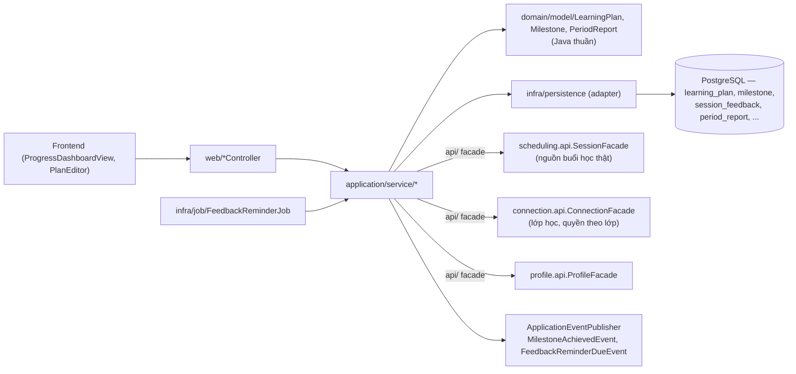
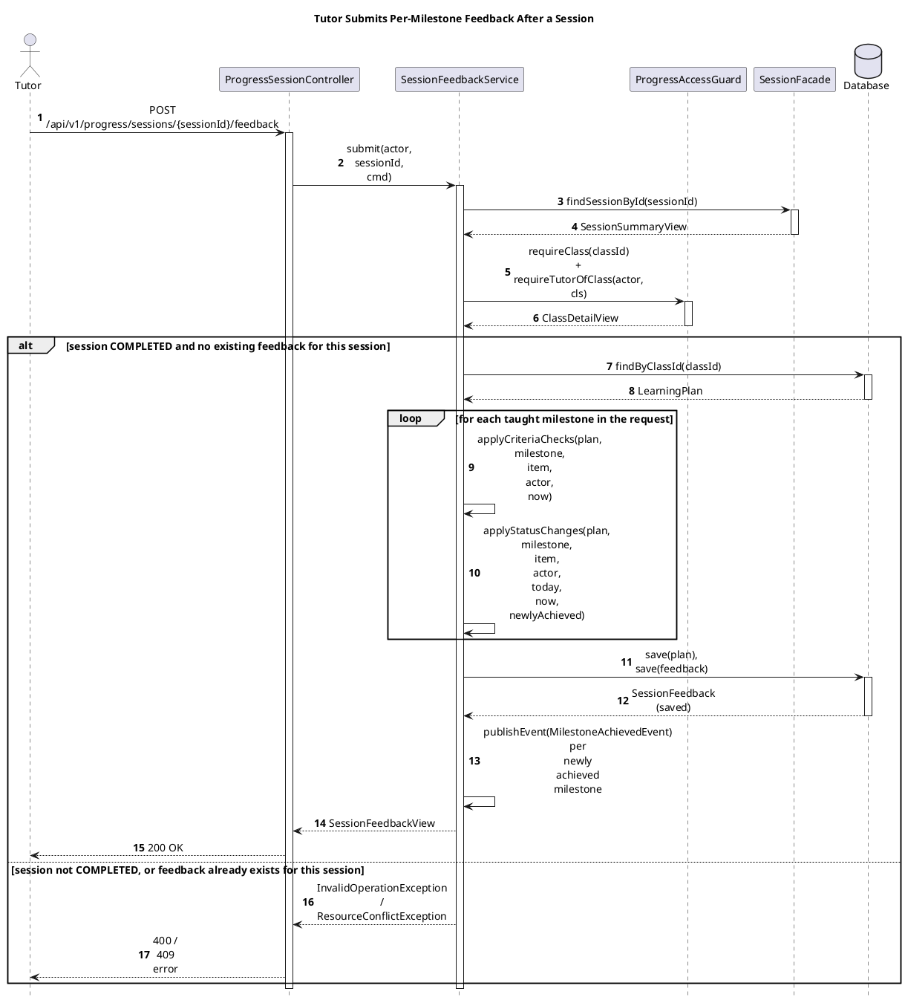

# Module Progress

- **Mã nguồn:** `backend/modules/progress/`
- **Mẫu kiến trúc:** Loại 2 — Complex Domain (`domain/` thuần Java: `LearningPlan`, `Milestone`, `PeriodReport`...), theo [backend-module-structure-guide.md](../backend-module-structure-guide.md).
- **Tài liệu liên quan:** [progress-dashboard-redesign-decisions.md](progress-dashboard-redesign-decisions.md) (quyết định thiết kế lại dashboard — tài liệu bổ trợ, không thay thế README này).
- **Chưa có tài liệu kiến trúc trước đây** — README này được viết trực tiếp từ mã nguồn hiện tại (`LearningPlan.java`, `ProgressPlanController.java`, `ProgressSessionController.java`, `PeriodReportController.java`, `ProgressDashboardController.java`).

---

## 1. Kiến trúc (Architecture)

```
backend/modules/progress/src/main/java/vn/edufit/progress/
│
├── api/
│   ├── event/  MilestoneAchievedEvent, FeedbackReminderDueEvent
│   └── dto/
│
├── domain/                                     # [TRÁI TIM NGHIỆP VỤ] Java thuần
│   ├── model/
│   │   ├── LearningPlan.java                    # Aggregate Root — danh sách Milestone, version (optimistic lock)
│   │   ├── Milestone.java / MilestoneCriterion.java / MilestoneStatus.java
│   │   ├── IndependenceLevel.java                # Thang 4 mức: NOT_YET → WITH_HINTS → INDEPENDENT → MASTERY
│   │   ├── SessionSelfRating.java / SelfRating.java  # Cảm nhận buổi học của học sinh (1..3)
│   │   ├── SessionMilestoneLink.java             # Liên kết buổi học ↔ cột mốc (PLANNED/ACTUAL)
│   │   ├── PeriodReport.java                     # Báo cáo kỳ 30 ngày (DRAFT → SENT, tự gửi sau 48h)
│   │   └── PlanHistory.java                      # Audit trail thay đổi kế hoạch
│   ├── policy/  RoadmapShapePolicy, FeedbackTimingPolicy
│   └── repository/  LearningPlanDomainRepository, SessionFeedbackDomainRepository,
│                     SessionMilestoneLinkDomainRepository, PeriodReportDomainRepository,
│                     SessionSelfRatingDomainRepository, FeedbackReminderDomainRepository
│
├── application/service/
│   ├── LearningPlanService.java            # Tạo/sửa kế hoạch, đổi trạng thái cột mốc
│   ├── SessionFeedbackService.java         # Gia sư chấm độc lập theo cột mốc sau mỗi buổi
│   ├── SessionSelfRatingService.java       # Học sinh tự chọn cảm nhận buổi học
│   ├── SessionMilestonePlanningService.java# Gắn cột mốc "dự kiến" cho buổi chưa diễn ra
│   ├── SessionNoteService.java             # Ghép timeline ghi chú buổi học theo lớp
│   ├── PeriodReportService.java            # Lập/sửa/gửi báo cáo kỳ 30 ngày
│   ├── FeedbackReminderService.java        # Nhắc gia sư chấm feedback còn thiếu
│   ├── ProgressOverviewService.java        # Tổng hợp % hoàn thành cho dashboard
│   └── ProgressAccessGuard.java            # Kiểm quyền dùng chung theo lớp học (Component)
│
├── infra/
│   ├── persistence/entity+repository+adapter/  (JPA ↔ Domain POJO)
│   └── job/  FeedbackReminderJob (quét định kỳ)
│
└── web/
    ├── ProgressPlanController.java          # /api/v1/progress/plans/**, /milestones/**, /classes/{id}/notes
    ├── ProgressSessionController.java       # /api/v1/progress/sessions/**
    ├── PeriodReportController.java          # /api/v1/progress/classes/{id}/reports, /reports/{id}/**
    ├── ProgressDashboardController.java     # /api/v1/progress/dashboard/**, /teaching-history
    ├── PlanTemplateController.java / PlanDraftController.java / TopicCatalogController.java
    └── request/, response/
```



Progress **không tự quản lý buổi học** — mọi dữ liệu buổi học (thời gian, trạng thái, timeline) đọc qua `scheduling.api.SessionFacade`; quyền theo lớp học (ai là Tutor/Student/Parent của lớp, lớp còn `ACTIVE` hay không) đọc qua `connection.api.ConnectionFacade` và tập trung ở `ProgressAccessGuard` — mọi service trong module đều gọi qua guard này, không tự viết lại logic phân quyền.

---

## 2. Tổng quan & Bối cảnh (Overview & Situation)

Progress theo dõi **tiến bộ học tập theo lộ trình cột mốc (milestone roadmap)** của từng lớp dạy kèm, tách biệt hẳn với việc quản lý lịch học (đó là việc của `scheduling`). Ba trục dữ liệu chính:

1. **Kế hoạch học tập (`LearningPlan`):** Gia sư lập một kế hoạch/lớp gồm nhiều `Milestone` có trọng số (`weight`), hạn (`targetDate` hoặc nội suy theo `RoadmapShapePolicy`), tối đa `MAX_CRITERIA` tiêu chí đạt mỗi cột mốc. Trạng thái cột mốc: `NOT_STARTED → IN_PROGRESS → ACHIEVED`, có thể `reopen()` nếu đánh giá lại; `IN_PROGRESS` được **tự động** đặt khi buổi học được gắn vào cột mốc — gia sư không tự tay chuyển sang trạng thái này.
2. **Phản hồi sau mỗi buổi học — hai luồng độc lập, không trộn lẫn:**
   - **Gia sư chấm theo cột mốc** (`SessionFeedbackService`): với mỗi cột mốc đã dạy trong buổi, chấm mức độ tự lập theo thang 4 bậc (`IndependenceLevel`: `NOT_YET` → `WITH_HINTS` → `INDEPENDENT` → `MASTERY`) — **thang duy nhất** để đo tiến bộ theo cột mốc, kèm tick các tiêu chí đạt (`MilestoneCriterion`).
   - **Học sinh tự chọn cảm nhận** (`SessionSelfRatingService`): giá trị 1–3 (`SelfRating`), độc lập hoàn toàn với đánh giá của gia sư — chỉ cho buổi đã `COMPLETED`.
3. **Báo cáo kỳ 30 ngày (`PeriodReport`):** chụp ảnh số liệu tại cuối mỗi kỳ (cột mốc đạt trong kỳ, bước tiến lớn nhất, trọng tâm kỳ tới) — bản nháp (`DRAFT`) **tự động gửi sau 48 giờ** (`isDueForAutoSend`) kể cả khi Gia sư không viết thêm câu tổng kết, tránh báo cáo bị "treo" vô thời hạn chỉ vì Gia sư quên gửi.

**Dự kiến vs Thực tế:** `SessionMilestoneLink` có 2 loại — `PLANNED` (Gia sư gắn tùy chọn cho buổi **chưa diễn ra**, qua `SessionMilestonePlanningService`) và `ACTUAL` (ghi cùng lúc với `SessionFeedbackService.submit`, phản ánh cột mốc **thật sự đã dạy**). Hai loại tách bạch để timeline ghi chú buổi học (`SessionNoteService`) phân biệt được "dự kiến dạy gì" và "đã dạy gì".

---

## 3. API Contract — `/api/v1/progress/**`

| Method | Endpoint | Controller | Mô tả |
|---|---|---|---|
| POST | `/plans` | ProgressPlanController | Tạo kế hoạch học tập mới cho lớp |
| GET | `/plans/{classId}` | ProgressPlanController | Lấy kế hoạch theo lớp |
| PUT | `/plans/{planId}` | ProgressPlanController | Sửa kế hoạch (bắt buộc `version` — optimistic lock) |
| PATCH | `/milestones/{milestoneId}/status` | ProgressPlanController | UC5.4 — đổi trạng thái cột mốc (`ACHIEVED`/`IN_PROGRESS` để reopen) |
| GET | `/classes/{classId}/notes?from&to&page&size` | ProgressPlanController | Timeline ghi chú buổi học của lớp |
| POST | `/sessions/{sessionId}/feedback` | ProgressSessionController | Gia sư nộp phản hồi theo cột mốc cho 1 buổi đã dạy |
| PUT | `/sessions/{sessionId}/self-rating` | ProgressSessionController | Học sinh chọn cảm nhận buổi học (1..3) |
| PUT | `/sessions/{sessionId}/planned-milestones` | ProgressSessionController | Gắn/đổi cột mốc dự kiến cho buổi chưa diễn ra |
| GET | `/sessions/milestones` | ProgressSessionController | Danh sách cột mốc để chọn khi lập kế hoạch/gắn dự kiến |
| GET | `/classes/{classId}/reports` | PeriodReportController | Danh sách báo cáo kỳ (Gia sư/Admin thấy cả `DRAFT`; Học sinh/Phụ huynh chỉ thấy `SENT`) |
| PUT | `/reports/{reportId}/summary` | PeriodReportController | Sửa câu tổng kết bản nháp (bắt buộc `version`) |
| POST | `/reports/{reportId}/send` | PeriodReportController | Gửi ngay kèm câu tổng kết |
| GET | `/dashboard/student/{studentId}` | ProgressDashboardController | Dashboard tiến độ cho Học sinh |
| GET | `/dashboard/tutor/todos` | ProgressDashboardController | Danh sách việc cần làm cho Gia sư (feedback còn thiếu, báo cáo chờ gửi...) |
| GET | `/dashboard/parent` | ProgressDashboardController | Dashboard tổng hợp cho Phụ huynh (nhiều con) |
| GET | `/teaching-history` | ProgressDashboardController | Lịch sử dạy học |
| GET/POST/PUT/DELETE | `/templates/**` | PlanTemplateController | Mẫu kế hoạch học tập dùng lại |
| POST | `/plans/draft` | PlanDraftController | Soạn nháp kế hoạch (hỗ trợ AI gợi ý, trước khi tạo thật) |
| GET/POST/PUT | `/topics/**` | TopicCatalogController | Danh mục chủ đề dùng trong cột mốc |

---

## 4. Luồng triển khai từng bước (Implementation Flows)

### 4.1. Gia sư nộp phản hồi theo cột mốc sau buổi học

**Trace table**

| # | From | To | Real method | File:line |
|---|---|---|---|---|
| 1 | Tutor | ProgressSessionController | `submitFeedback(sessionId, req)` — `POST /api/v1/progress/sessions/{sessionId}/feedback` | `web/ProgressSessionController.java:45` |
| 2 | ProgressSessionController | SessionFeedbackService | `submit(actor, sessionId, cmd)` | `application/service/SessionFeedbackService.java:78` |
| 3 | SessionFeedbackService | SessionFacade | `findSessionById(sessionId)` | call site `SessionFeedbackService.java:79` |
| 4 | SessionFeedbackService | ProgressAccessGuard | `requireClass(classId)`, `requireTutorOfClass(actor, cls)`, `requireActiveClass(cls, ...)` | `SessionFeedbackService.java:81-83` |
| 5 | SessionFeedbackService | Database | `planRepository.findByClassId(cls.classId())` | `SessionFeedbackService.java:93` |
| 6 | SessionFeedbackService | SessionFeedbackService (self) | `applyCriteriaChecks(plan, milestone, item, actor, now)` per taught milestone | `:123`, defined at `:164` |
| 7 | SessionFeedbackService | SessionFeedbackService (self) | `applyStatusChanges(plan, milestone, item, actor, today, now, newlyAchieved)` per taught milestone | `:126`, defined at `:179` |
| 8 | SessionFeedbackService | Database | `planRepository.save(plan)`, `feedbackRepository.save(feedback)` | `:142-143` |
| 9 | SessionFeedbackService | SessionFeedbackService (self) | `events.publishEvent(MilestoneAchievedEvent)` per newly achieved milestone | `:144-145` |

![Sequence Diagram](https://www.plantuml.com/plantuml/svg/XLNlJzim4FsUl-B4frOh2Y0qQGWX-WCcD5Yh5UtxrRuq5ewTsKwXc_ZVTt7ID5GWlaIkVU_Tk-VpzTe7TA4gT19Kq0IFLR0EbjMgKC73WjpnWzBaWpK4jqHoXU89nbaW1mXBybvPao23J5Mio2MvaWIPjM5bNnB_f4o93WlmEKhxhCmQCjIUUYS5lZmm3QvfgVuIV3tfe-XFHKPG6p3MQcr0aE7ioQKFMqrN2KS69LI99i2_1621KjPvJi-Ir-GoRQFsd98oh7IujIRyn8BWQ4BmMr4mVBPmzkZzqAZjz3n9KDJ-H9VUf3vYxDgnpjQJAOESrPhS4Q27_S-tg3Pwv-oIt4O9Yf1nMRwVOIm4VxzNw6GCZAltQL6WRDYM8YUPI0ouGizLpzfLF9nDagIv-EEhdbIuWCLy-GWfbYhTdAPbAo3r3RrF_xMhE_cQPcqDjKLgWu7wHVT8EGMNnjm-DjaWEZg2Zca4ef33FKljGmrWN2o2aPaoiYrnihsJWmxRWpK5DuZZBcUBMbP5WMxBz_wSI3h0jCcYhGnnt8JAqLIZzmDHVpaFVDdjHz_cMNFSrYAqxobfxgUXsok9W1a5LFfGHWD07NQcm7J-iBY_URoP0He9nWAzA1_YSzgzoOnlB-JAxp3y5Df2PfFMiibssiZlok2WBYit0TInUudtXCvmaeN6cgwdCCPgQykOblTp25Yjym15DosKOJqKRU8TZky4DUnObdexTOeViy9fJkB93qhEDDfpZ81FYn6qjXhxFFo0PnamL7wQerdJPpJ1Ijn6DlxGizwEHQveGz4EClB0EOyRYep3KRFUMVw9UmTF6mOrEEOuDF9DEMMrqihdDniUSuDkzkuankqXbFoEedGMq1pigzqH7Zxb0psnwQ0VKYEQAN01PoSdCF-H4C_ghWcD3Vj67077TSs7sX7ARTEM_iDUF9HqPpQebPnpEHWuxkP5K5al88LVv6tb134Wqqg4xknZqUSiEkNlDo3dU3xNTzdpkXualP-zwNJDaVmN-1y=)



Assumptions: none — every method name and line is read directly from `SessionFeedbackService.java` and `ProgressSessionController.java`.

### 4.2. Báo cáo kỳ 30 ngày — tự gửi sau 48 giờ nếu Gia sư quên

1. `PeriodReportService` tạo bản nháp (`draft`) cho kỳ vừa kết thúc của mỗi lớp — **mỗi kỳ chỉ một báo cáo** (`existsByClassIdAndPeriodIndex`), chụp `Snapshot` số liệu tại thời điểm tạo (không đổi sau đó dù kế hoạch có sửa tiếp).
2. Gia sư có thể sửa câu tổng kết (`PUT /reports/{id}/summary`, bắt buộc gửi đúng `version` hiện tại — sai version nghĩa là có người/tab khác đã sửa trước, tránh ghi đè mất dữ liệu) hoặc gửi ngay (`POST /reports/{id}/send`).
3. Nếu không ai gửi, `autoSendAt = createdAt + 48h`; job quét định kỳ tìm `findDraftsDueBy(now)` và tự chuyển `DRAFT → SENT` kể cả không có câu tổng kết — Học sinh/Phụ huynh không phải chờ vô thời hạn.
4. Báo cáo đã `SENT` là bất biến (`requireDraft()` chặn sửa/gửi lại).

### 4.3. Phân quyền dùng chung theo lớp (`ProgressAccessGuard`)

Mọi service đều đi qua đúng 3 bước: `requireClass(classId)` (lớp có tồn tại, qua `ConnectionFacade.findClassById`) → `requireTutorOfClass`/`requireStudentOfClass`/`requireMemberOrParentAccess` (đúng vai trò, Phụ huynh phải có liên kết `CONFIRMED`) → `requireActiveClass` (nếu hành động chỉ hợp lệ khi lớp còn hoạt động, ví dụ đổi trạng thái cột mốc). Không service nào tự viết lại 3 bước này.

---

## 5. Chi tiết bổ sung & Kỹ thuật

### 5.1. Optimistic locking trên `LearningPlan`/`PeriodReport`

Cả hai aggregate đều có `version` — sửa kế hoạch (`PUT /plans/{id}`) hoặc báo cáo kỳ (`PUT /reports/{id}/summary`) đều bắt buộc client gửi lại đúng `version` đã đọc; sai → xung đột (cùng nguyên tắc với `TutoringSessionJpaEntity.version` ở [SCHEDULING_README.md §5.1](../scheduling/SCHEDULING_README.md)), tránh hai tab/hai người cùng sửa ghi đè mất thay đổi của nhau.

### 5.2. Thang đo tiến bộ duy nhất — `IndependenceLevel`

4 mức được mô tả bằng **hành vi nhìn thấy được** (không phải điểm số trừu tượng): `NOT_YET` (chưa làm được) → `WITH_HINTS` (làm được khi có gợi ý) → `INDEPENDENT` (tự làm đúng) → `MASTERY` (tự làm đúng cả dạng khó và giải thích lại được). Đây là thang duy nhất dùng để đo tiến bộ theo cột mốc trong toàn module — không có thang điểm số song song nào khác, tránh học sinh/phụ huynh bối rối giữa nhiều hệ quy đổi.

### 5.3. `RoadmapShapePolicy` — nội suy hạn cột mốc

Khi Gia sư không tự đặt `targetDate` cho một cột mốc, hệ thống nội suy hạn dựa trên `startDate()` (ngày lập lộ trình theo giờ Việt Nam, `BUSINESS_ZONE = Asia/Ho_Chi_Minh`) và vị trí cột mốc trong danh sách đã sắp `sortOrder` — cột mốc không có hạn nào (tự đặt hoặc nội suy) thì không bị khóa deadline.

### 5.4. Nhắc nhở phản hồi còn thiếu (`FeedbackReminderService`, `FeedbackTimingPolicy`)

Job quét định kỳ tìm buổi học đã `COMPLETED` (`SessionFacade.findCompletedSessionsEndedBetween`) nhưng chưa có `SessionFeedback` tương ứng, trong cửa sổ nhắc đã định (`reminderWindowStart/End`); mỗi buổi chỉ nhắc theo đúng các `ReminderStage` đã định nghĩa, không nhắc lại vô hạn (`findSentStagesBySessionIdIn` tránh gửi trùng) — publish `FeedbackReminderDueEvent` cho `notification` xử lý tiếp (xem [NOTIFICATION_README.md §5.3](../notification/NOTIFICATION_README.md) — module notification chưa có hàng cho sự kiện này trong bảng ánh xạ, cần bổ sung nếu module notification đã lắng nghe).
