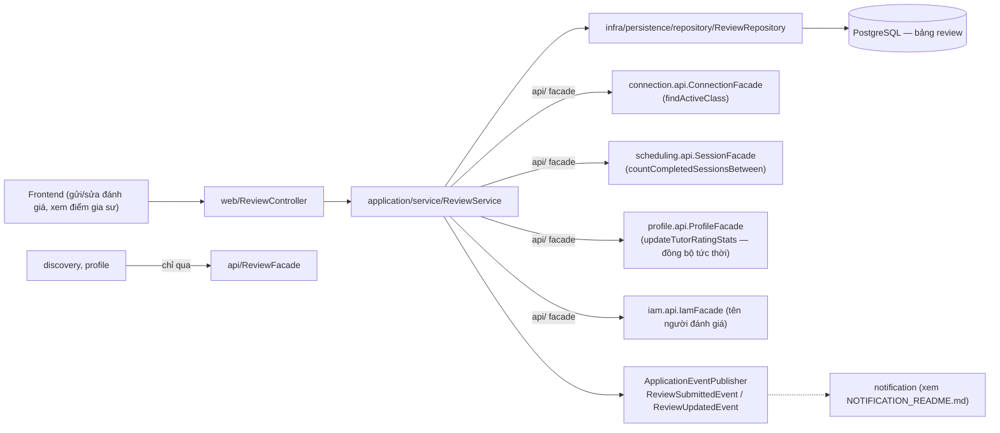
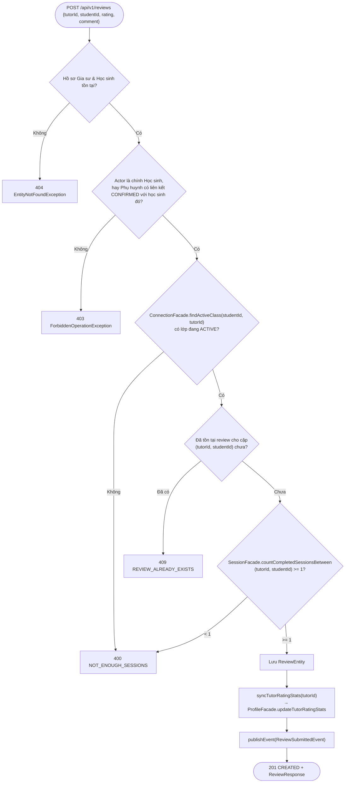
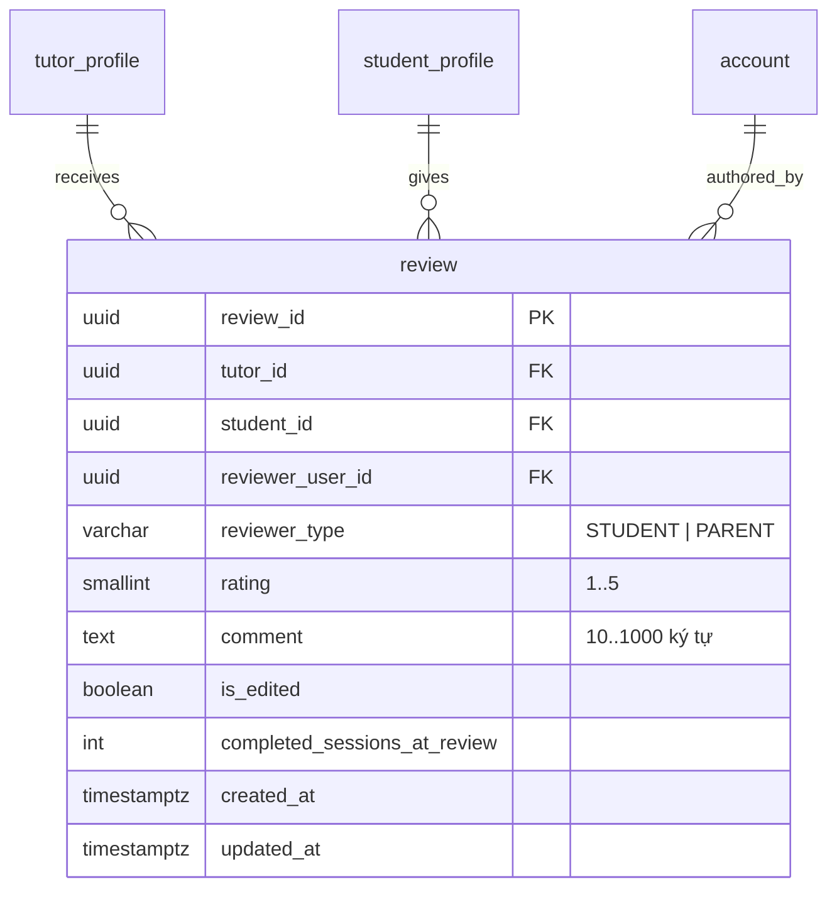

# Module Review

- **Mã nguồn:** `backend/modules/review/`
- **Mẫu kiến trúc:** Loại 1 — Standard, theo [backend-module-structure-guide.md](../backend-module-structure-guide.md).
- **Cập nhật nội dung:** 11/11/2026 — cấu trúc lại từ [review_implementation_plan.md](review_implementation_plan.md) theo khung README chuẩn, đối chiếu với `ReviewService.java`/`ReviewController.java` hiện tại.

---

## 1. Kiến trúc (Architecture)

```
backend/modules/review/src/main/java/vn/edufit/review/
│
├── api/
│   ├── ReviewFacade.java                 # Query điểm gia sư cho Discovery/Profile
│   ├── dto/  ReviewDto, TutorRatingSummaryDto
│   └── event/  ReviewSubmittedEvent, ReviewUpdatedEvent
│
├── application/service/
│   ├── ReviewService.java                # Tạo, sửa, tra cứu đánh giá — thẩm định 7 bước (mục 4.1)
│   └── ReviewFacadeImpl.java
│
├── infra/persistence/
│   ├── entity/ReviewEntity.java
│   └── repository/ReviewRepository.java   # findAverageRatingByTutorId, countByTutorId
│
└── web/
    ├── ReviewController.java              # /api/v1/reviews/**
    ├── request/  CreateReviewRequest, UpdateReviewRequest
    └── response/ ReviewResponse, TutorRatingSummaryResponse
```



---

## 2. Tổng quan & Bối cảnh (Overview & Situation)

Review là hệ thống thẩm định uy tín: Học sinh/Phụ huynh đánh giá chất lượng dạy thực tế của Gia sư, giúp cộng đồng người học có cơ sở tin cậy để chọn gia sư. Hai nguyên tắc chống gian lận cốt lõi:

- **Chỉ được đánh giá khi đã học thật (BR-56, BR-61):** phải có lớp đang hoạt động (`ConnectionFacade.findActiveClass`) **và** đã hoàn thành tối thiểu 1 buổi học thực tế với đúng gia sư đó (`SessionFacade.countCompletedSessionsBetween(tutorId, studentId) >= 1`).
- **Mỗi cặp (tutor, student) chỉ một đánh giá duy nhất (BR-57, NFR-24):** ràng buộc `UNIQUE(tutor_id, student_id)` ở tầng DB, không chỉ kiểm tra ở tầng ứng dụng.

Thang điểm 1–5 sao nguyên (`chk_review_rating`), nhận xét bắt buộc 10–1000 ký tự (`chk_review_comment_len`). Quyền sửa bị giới hạn: **đúng 1 lần duy nhất** (`is_edited=true` sau khi sửa), không được đổi người thụ hưởng — bảo vệ tính toàn vẹn lịch sử đánh giá.

---

## 3. API Contract — `/api/v1/reviews/**`

| Method | Endpoint | Quyền | Mô tả |
|---|---|---|---|
| POST | `/` | STUDENT hoặc PARENT (liên kết hợp lệ) | Tạo đánh giá mới `{tutorId, studentId, rating, comment}` → 201 |
| PUT | `/{reviewId}` | Đúng người đã tạo đánh giá | Sửa `comment`/`rating` — chỉ 1 lần, sai → 400 `INVALID_OPERATION` |
| GET | `/tutors/{tutorId}?page&size` | Công khai | Danh sách đánh giá của gia sư, phân trang; `isAuthor=true` nếu người xem chính là tác giả |
| GET | `/tutors/{tutorId}/summary` | Công khai | `TutorRatingSummaryResponse(tutorId, averageRating, totalReviews, ratingCounts)` |

**Giao tiếp nội bộ (`api/ReviewFacade`)** — `discovery` và `profile` chỉ đọc điểm/tóm tắt đánh giá qua đây, không truy vấn trực tiếp bảng `review`.

---

## 4. Luồng triển khai từng bước (Implementation Flows)

### 4.1. Tạo đánh giá — thẩm định 7 bước trước khi chấp thuận (UC6.1)



### 4.2. Đồng bộ điểm trung bình tức thời (không batch job)

Ngay sau khi lưu review trong **cùng transaction**:
```sql
SELECT AVG(rating), COUNT(review_id) FROM review WHERE tutor_id = :tutorId;
```
`syncTutorRatingStats` làm tròn 1 chữ số thập phân (`Math.round(avg*10.0)/10.0`) và gọi `ProfileFacade.updateTutorRatingStats(tutorId, avgRating, totalReviews)` — ghi trực tiếp `rating`/`total_reviews` trên `tutor_profile`. Nhờ vậy Discovery (xem [DISCOVERY_README.md §4.2](../discovery/DISCOVERY_README.md), `ratingFit`) và trang chi tiết gia sư luôn phản ánh điểm mới nhất, không có độ trễ của batch job định kỳ.

### 4.3. Sửa đánh giá — đúng 1 lần

`PUT /{reviewId}`: xác minh `reviewerUserId` khớp actor hiện tại → nếu `isEdited == true` → 400; ngược lại cập nhật `rating`/`comment`, đặt `isEdited = true`, `updatedAt = now`, chạy lại `syncTutorRatingStats` (điểm trung bình phải phản ánh giá trị mới), publish `ReviewUpdatedEvent`.

---

## 5. Chi tiết bổ sung & Kỹ thuật

### 5.1. Lược đồ CSDL



Ràng buộc cốt lõi: `uk_review_tutor_student UNIQUE(tutor_id, student_id)` (chặn race condition gửi trùng ở tầng DB, không chỉ ứng dụng), `chk_review_rating CHECK (rating BETWEEN 1 AND 5)`, `chk_review_comment_len CHECK (length BETWEEN 10 AND 1000)`, index `idx_review_tutor(tutor_id)` cho phân trang.

### 5.2. Vì sao chặn ở cả 2 tầng (ứng dụng + DB)

Bước 4 (kiểm trùng) trong luồng 4.1 chạy trước khi `INSERT`, nhưng ràng buộc `UNIQUE` ở DB là lưới an toàn cuối cho trường hợp hai request gần như đồng thời đều qua được kiểm tra ứng dụng (cùng nguyên tắc 2 tầng đã dùng ở [CONNECTION_README.md §5.1](../connection/CONNECTION_README.md) và [SCHEDULING_README.md §5.1](../scheduling/SCHEDULING_README.md)) — vi phạm unique constraint được dịch sang `ResourceConflictException(REVIEW_ALREADY_EXISTS)`.

### 5.3. Tên người đánh giá hiển thị ẩn danh một phần

`resolveReviewerName` lấy `UserSummaryView` qua `IamFacade` chỉ để hiển thị tên công khai trên đánh giá — không trả email/thông tin liên hệ ra `ReviewResponse`.
