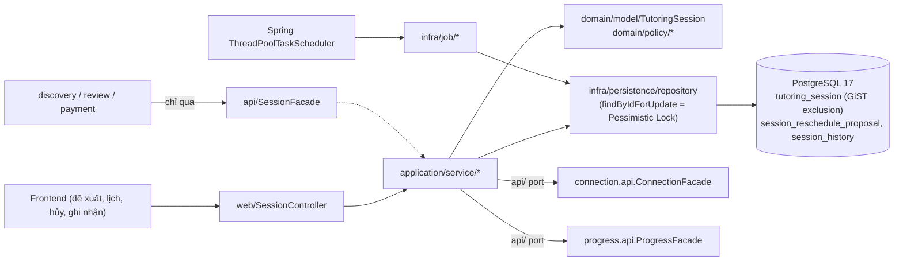
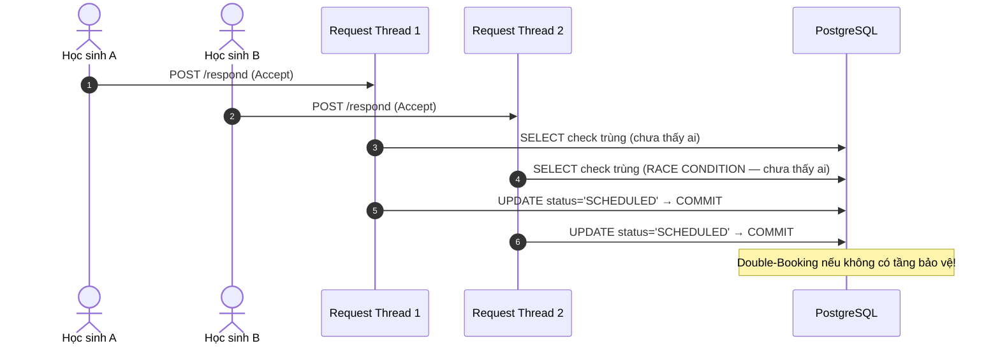
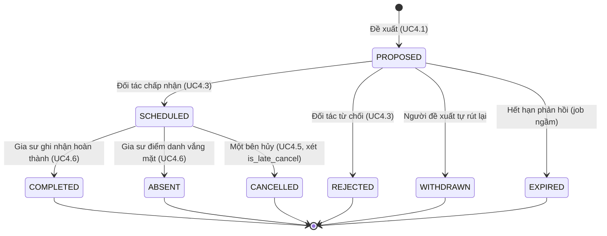
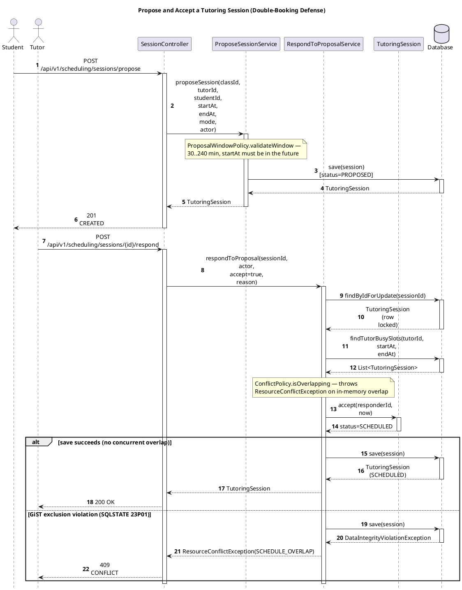
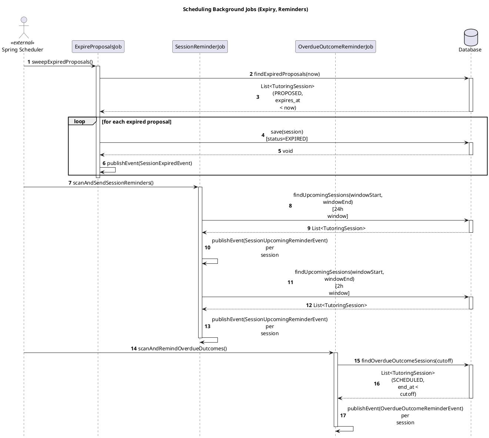

# Module Scheduling

- **Mã nguồn:** `backend/modules/scheduling/`
- **Mẫu kiến trúc:** Loại 2 — Complex Domain / DDD Clean Architecture (`domain/` thuần Java), theo [backend-module-structure-guide.md](../backend-module-structure-guide.md).
- **Cập nhật nội dung:** 11/11/2026 — cấu trúc lại từ `scheduling_implementation_plan.md` cũ (đã gộp nội dung vào đây và xóa khỏi repo) theo khung README chuẩn (Kiến trúc → Tổng quan → API → Luồng triển khai → Chi tiết kỹ thuật); đối chiếu lại với mã nguồn thật trong `backend/modules/scheduling/` (các service, `SessionController`, `TutoringSession`) — không chép nguyên văn mã nguồn đề xuất trong bản kế hoạch cũ vì đã được triển khai thật, chỉ còn tham chiếu đường dẫn file.
- **Phân hệ có rủi ro kỹ thuật cao nhất của hệ thống** do phải giải quyết đồng thời 2 bài toán: quản lý vòng đời buổi học 1-1 và chống trùng lịch (double-booking) trong môi trường đa luồng/đa request.

---

## 1. Kiến trúc (Architecture)

```
backend/modules/scheduling/src/main/java/vn/edufit/scheduling/
│
├── api/                                  # Bề mặt công khai (JVM RAM) cho discovery, progress, review, payment gọi
│   ├── SessionFacade.java
│   ├── dto/  SessionSummaryView, TutorBusySlotView, CompletedSessionStatsView, ...
│   └── event/  SessionProposedEvent, SessionScheduledEvent, SessionRescheduleProposedEvent,
│               SessionRescheduledEvent, SessionCancelledEvent, SessionOutcomeRecordedEvent, SessionExpiredEvent
│
├── web/
│   ├── SessionController.java            # /api/v1/scheduling/** (mục 3)
│   ├── request/   ProposeSessionRequest, RespondProposalRequest, RescheduleSessionRequest, CancelSessionRequest, ...
│   └── response/  SessionResponse, CalendarItemResponse, RescheduleProposalResponse
│
├── domain/                                # [TRÁI TIM NGHIỆP VỤ] Java thuần — không Spring, không JPA
│   ├── model/    TutoringSession (Aggregate Root), SessionRescheduleProposal, SessionHistory,
│   │             SessionStatus (8 trạng thái), SessionMode, CancelReason, ProposalStatus
│   └── policy/   ConflictPolicy (BR-42), ProposalWindowPolicy (BR-41/43), LateCancelPolicy (BR-46),
│                 SessionStateMachine (ma trận chuyển trạng thái)
│
├── application/service/                   # Mỗi service = 1 use case, biên giao dịch @Transactional
│   ProposeSessionService · BatchProposeSessionService · RespondToProposalService · BatchRespondSessionService
│   RescheduleSessionService · RescheduleClassScheduleService · CancelSessionService
│   RecordSessionOutcomeService · GetCalendarService · GetSessionDetailService · SessionFacadeImpl
│
└── infra/
    ├── persistence/
    │   ├── entity/  TutoringSessionJpaEntity (`@Version`), SessionRescheduleProposalJpaEntity, SessionHistoryJpaEntity
    │   ├── repository/  SpringDataTutoringSessionRepository (`findByIdForUpdate` — pessimistic lock)
    │   └── mapper/, adapter/   ánh xạ Domain POJO <-> JPA Entity
    ├── job/   ExpireProposalsJob (FR-17) · SessionReminderJob (FR-31) · OverdueOutcomeReminderJob (FR-20)
    └── adapter/   ConnectionValidationAdapter, ProgressSyncAdapter (gọi facade module khác qua JVM RAM)
```

Scheduling gọi vào `api/` của `connection` (kiểm `classId` đang ACTIVE) và đẩy dữ liệu sang `progress` (lưu `SessionNote`) qua cặp Port/Adapter — không phụ thuộc trực tiếp vào tầng trong của module kia. Ngược lại, `discovery`, `progress`, `review`, `payment` chỉ được gọi vào `api/SessionFacade` (không truy vấn trực tiếp `tutoring_session`).



---

## 2. Tổng quan & Bối cảnh (Overview & Situation)

Scheduling quản lý **toàn bộ vòng đời buổi học 1-1** giữa đúng 1 Gia sư và 1 Học sinh trong một lớp (`class_id`, kế thừa từ `Engagement` của module `connection`): đề xuất (`PROPOSE`), xác nhận/từ chối (`RESPOND`), đổi lịch (`RESCHEDULE`), hủy (`CANCEL`), ghi nhận kết quả (`OUTCOME`), tra cứu lịch (`CALENDAR`) — song song với các **tác vụ ngầm theo thời gian** (`ThreadPoolTaskScheduler`, cấu hình `@EnableScheduling` tại `SchedulingConfig.java`): tự hết hạn đề xuất quá hạn, nhắc lịch trước 24h/2h, nhắc gia sư ghi nhận kết quả.

Bài toán trọng tâm là **Race Condition & Double-Booking (NFR-17, BR-42):** nếu kiểm tra trùng lịch bằng một `SELECT COUNT(*)` thông thường, hai request đến gần như đồng thời (ví dụ hai học sinh cùng chấp nhận một slot `14:00–16:00` của cùng một gia sư) đều thấy `COUNT = 0` (vì chưa ai commit) và cả hai đều ghi `SCHEDULED` — gia sư bị xếp trùng giờ.

> Sơ đồ dưới đây là **minh họa giả định** cho tình huống KHÔNG có tầng bảo vệ nào (không phải mã nguồn thật — "Request Thread 1/2" không phải là class có thật trong repo), chỉ để giải thích vì sao cần tầng bảo vệ ở mục 4.1. Sơ đồ thật, dựng từ mã nguồn thực tế với bảng trace đầy đủ, nằm ở mục 4.1 bên dưới.



Buổi học được mô hình hóa là **khoảng thời gian nửa mở `[start, end)`** (BR-42): bao gồm điểm bắt đầu, không bao gồm điểm kết thúc — nhờ vậy hai buổi liền kề (`[08:00,10:00)` và `[10:00,12:00)`) hợp lệ, không bị coi là trùng.

```text
IsOverlapping(A=[S1,E1), B=[S2,E2)) ⟺ (S1 < E2) ∧ (S2 < E1)
```

| # | Tình huống | Ví dụ | Kết quả |
|---|---|---|---|
| 1 | Trùng khớp hoàn toàn | `[14:00,16:00)` vs `[14:00,16:00)` | Xung đột |
| 2 | B lọt trong A | `[14:00,16:00)` vs `[14:30,15:30)` | Xung đột |
| 3 | B bao trùm A | `[14:00,16:00)` vs `[13:30,16:30)` | Xung đột |
| 4 | Chồng lấn đầu | `[14:00,16:00)` vs `[13:30,14:30)` | Xung đột |
| 5 | Chồng lấn cuối | `[14:00,16:00)` vs `[15:30,16:30)` | Xung đột |
| 6 | Tiếp giáp đuôi (E1=S2) | `[14:00,16:00)` vs `[16:00,18:00)` | Hợp lệ |
| 7 | Tiếp giáp đầu (E2=S1) | `[14:00,16:00)` vs `[12:00,14:00)` | Hợp lệ |
| 8 | Rời rạc | `[14:00,16:00)` vs `[18:00,20:00)` | Hợp lệ |

### Máy trạng thái (FSM) — 8 trạng thái



Trạng thái terminal (`COMPLETED`, `ABSENT`, `CANCELLED`, `REJECTED`, `WITHDRAWN`, `EXPIRED`) **tuyệt đối bất biến** — mọi hành động sau đó ném `InvalidOperationException(SESSION_ALREADY_FINALIZED)` (`TutoringSession.validateNotTerminal()`). Đổi lịch (`RESCHEDULE`) **không** đổi trạng thái buổi học gốc (vẫn `SCHEDULED`) — tạo một `SessionRescheduleProposal` riêng (`PENDING`); chỉ khi được chấp nhận mới gọi `TutoringSession.updateTime()`.

---

## 3. API Contract — `/api/v1/scheduling/**`

| Method | Endpoint | Mô tả | Service xử lý |
|---|---|---|---|
| POST | `/sessions/propose` | UC4.1 — đề xuất buổi học mới | `ProposeSessionService` |
| POST | `/sessions/propose-batch` | Đề xuất nhiều buổi cùng lúc (lịch định kỳ) | `BatchProposeSessionService` |
| POST | `/sessions/{id}/respond` | UC4.3 — chấp nhận/từ chối đề xuất | `RespondToProposalService` |
| POST | `/sessions/respond-batch` | Phản hồi hàng loạt đề xuất | `BatchRespondSessionService` |
| POST | `/sessions/{id}/reschedule` | UC4.4 — tạo đề xuất đổi lịch | `RescheduleSessionService` |
| POST | `/sessions/reschedule-proposals/{proposalId}/respond` | Phản hồi đề xuất đổi lịch | `RescheduleSessionService` |
| GET | `/sessions/{id}/reschedule-proposal` | Xem đề xuất đổi lịch đang chờ của 1 buổi học | `RescheduleSessionService` |
| GET/POST | `/recurring/**` (`/recurring/propose`, `/recurring/respond`, `/recurring/proposals/{proposalId}`, `/recurring/classes/{classId}/active-proposal`) | Đổi lịch định kỳ theo lớp (UC4.8 Bounded Horizon) | `RescheduleClassScheduleService` |
| POST | `/sessions/{id}/cancel` | UC4.5 — hủy buổi học (xét `isLateCancel`, BR-46) | `CancelSessionService` |
| POST | `/sessions/{id}/outcome` | UC4.6 — ghi nhận `COMPLETED`/`ABSENT` + đồng bộ `SessionNote` sang `progress` | `RecordSessionOutcomeService` |
| GET | `/sessions/{id}` | Chi tiết một buổi học | `GetSessionDetailService` |
| GET | `/calendar?from&to` | Lịch tổng hợp theo khoảng thời gian | `GetCalendarService` |

Actor luôn lấy từ `CurrentUser` (`currentUserProvider.getIfAvailable()`), ném `UNAUTHORIZED` nếu chưa đăng nhập. Quyền tham gia buổi học (Gia sư/Học sinh/Phụ huynh xác nhận) được giải quyết qua `SchedulingSecurityResolver` — **không so sánh trực tiếp `user_id == tutor_id`/`== student_id`** (xem mục 5.4 của backend-module-structure-guide.md).

**Giao tiếp nội bộ (`api/SessionFacade`)** — các module khác chỉ được gọi qua đây: `findSessionById`, `findBusySlotsByTutorId` (discovery loại trừ slot bận), `hasActiveSessionAt`, `getCompletedStatsByClassId` (review — đủ buổi mới mở đánh giá, BR-61), `outcomeRecorded` (payment mở cửa sổ phản hồi 24h, xem [PAYMENT_README.md §4.3](../payment/PAYMENT_README.md)).

---

## 4. Luồng triển khai từng bước (Implementation Flows)

### 4.1. Đề xuất & xác nhận buổi học — chống trùng lịch 2 tầng

**Trace table**

| # | From | To | Real method | File:line |
|---|---|---|---|---|
| 1 | Student | SessionController | `proposeSession(req)` — `POST /api/v1/scheduling/sessions/propose` | `web/SessionController.java:112-113` |
| 2 | SessionController | ProposeSessionService | `proposeSession(classId, tutorId, studentId, startAt, endAt, mode, ..., actor)` | `application/ProposeSessionService.java:50` |
| 3 | ProposeSessionService | Database | `save(session)` [status=PROPOSED] | `TutoringSessionDomainRepository.save` at `domain/repository/TutoringSessionDomainRepository.java:22` |
| 4 | Tutor | SessionController | `respondToProposal(id, req)` — `POST /api/v1/scheduling/sessions/{id}/respond` | `web/SessionController.java:159-160` |
| 5 | SessionController | RespondToProposalService | `respondToProposal(sessionId, actor, accept, reason)` | `application/RespondToProposalService.java:49` |
| 6 | RespondToProposalService | Database | `findByIdForUpdate(sessionId)` (pessimistic lock) | `TutoringSessionDomainRepository.java:20`, adapter at `infra/.../TutoringSessionRepositoryAdapter.java:35` |
| 7 | RespondToProposalService | Database | `findTutorBusySlots(tutorId, startAt, endAt)` | call site `RespondToProposalService.java:94` |
| 8 | RespondToProposalService | TutoringSession | `accept(responderId, now)` | domain aggregate, `domain/model/TutoringSession.java:229` |
| 9 | RespondToProposalService | Database | `save(session)` inside `try` | `RespondToProposalService.java:121`, `catch (DataIntegrityViolationException)` at `:122` |

![Sequence Diagram](https://www.plantuml.com/plantuml/svg/hLRjQjj85Fq_Jt7nBnkIs4v3eI4DzLTsGztQZTtqntPPnj9rCdGqevqFDsufz27s2VT9UYNFM999DnGM39OyzzoFSywL_CewRfpF97F2IOIvqRcs25obC4WIp1rmM7gdZL1ti41hXLRG7ck_adWyrFfJyViOrwWiTXYdIEMp5HfsBrA4jTPkfH-OfR2S6vw1lUUf_bo0rbnQh9ra_E4DvUTtk11V49xtwYZyswDAC0GCfBXJaA1oLEZ2kgt4IqQHJYGYvyh1LmOmvsbQrEcVic_ieXkYgfmfhhcNxaehzvPd2AqXmgr0f-YCQ6Wz7bhsrZzZZ2T42YoSJwcDS5SIrMYa5IWR4THeAT6qW5keRflHWVu0Mg3PY0HBH3XfXj-WpRLAbtftocKT4GwRY2Xbg506XckMSiTNdCHlZSDLUJmUCXR6XEFBMkjm3lFPOWbTdelkfj-roJscNbBshjsbjDqyj4tyY0rtM9-ybedoHkUTGzuWePr8RkrrUWIkwBsuiBjkTfSqtS0T0Qgq-CfqYaTGgj6fYaRobAORlQ62LRL8tGUXo9XpBKMoFTbmAOWEtFq8_tx_vwDwrZivEJthGIRKlYvatZfO8GW5xfxyxfqto69s6ciyf1gMRx0TEEd07mHsthwStyo8lydupwfHufe0nmqw3YHZATR3zwKEfVaFMAIZBW31eyZdSDhhm-XcCbXEndLSJJjMflzrFtmLwRUk2SvysXJ1mvJP75ezybcueDIx-2eUM2-TyUG1WzmIsrMHk0ynPnHdJHeFjzVfbJRlyqBqAdFdCMMgdWueXhOXhqYTV492DcLwh6W97tgxNKZjRBjcxxgdd-XXAgoxE6Zayg1uPViAHpoloUek65xO6PrBdkV58vFyJdQcQUn7HH3jJO8HC7aeI2x6fOzGnnbcscpBz0Il3nffEG_2j8E6M4wfzEVQQD6b4TCSCYpCOlJxPFn-sZHbH7BfoZq3wwaQfXRQIaEYLUADAMmTEkpGg-5GZSP-qdcTF82dTTytLe2RtDUAFRMX00SBkTknOXrxC7lDaDwNy9kW3SE7HFgoz4PeoTskYNVJnP9M5awVpNlz_s7CuYrmJQ_OEoFSzZOMskl_AwF-r4HxwlwQtKvkfeDvv-SqdFLUm6ZszcfwFLeosesw2-9oF_wqUaNHz1_d1m==)



Assumptions: this is a genuine three-tier defense in the real code — pessimistic lock (message 6), an in-memory overlap check that can reject before any write (note before message 8), and the GiST exclusion constraint caught around the final `save()` (the one `alt` block, message 9) — all three are shown; none is invented.

### 4.2. Ghi nhận kết quả & đồng bộ tiến độ (UC4.6)

`RecordSessionOutcomeService`: khóa dòng (`findByIdForUpdate`) → chỉ Gia sư của buổi mới được ghi nhận, phải sau `startAt` → `session.recordOutcome()` → nếu có `noteContent`, gọi `ProgressSyncPort` (Port/Adapter) để lưu `SessionNote` sang module `progress` qua JVM RAM → publish `SessionOutcomeRecordedEvent` (notification) → **payment** lắng nghe gián tiếp qua `SessionFacade.outcomeRecorded()` để mở cửa sổ phản hồi 24h (không tất toán ở bước này).

### 4.3. Hủy buổi học & phân loại hủy trễ (UC4.5, BR-46)

`CancelSessionService`: khóa dòng → `SchedulingSecurityResolver.requireCancelAccess()` → `LateCancelPolicy.isLateCancel(startAt, now)` (hủy dưới 12 giờ trước giờ học → `isLateCancel=true`) → `session.cancel()` → ghi `SessionHistory` → publish `SessionCancelledEvent`.

### 4.4. Đổi lịch (UC4.4, BR-44)

Tạo `SessionRescheduleProposal` riêng (`PENDING`, tối đa 1 đề xuất đang chờ/buổi — partial unique index) → buổi gốc giữ nguyên `SCHEDULED` và giờ cũ → đối tác chấp nhận → `proposal.accept()` + `session.updateTime()` (đi qua lại đúng tầng bảo vệ GiST ở mục 4.1) → đối tác từ chối/hết hạn → buổi gốc không đổi.

### 4.5. Tác vụ ngầm định kỳ

**Trace table**

| # | From | To | Real method | File:line |
|---|---|---|---|---|
| 1 | Spring Scheduler | ExpireProposalsJob | `sweepExpiredProposals()` — `@Scheduled(cron=".../15 * * * *")` | `infra/job/ExpireProposalsJob.java:56-58` |
| 2 | ExpireProposalsJob | Database | `findExpiredProposals(now)` | `TutoringSessionDomainRepository.java:24`, query at `SpringDataTutoringSessionRepository.java:38-42` |
| 3 | ExpireProposalsJob | Database | `save(session)` [status=EXPIRED] per expired proposal | `TutoringSession.expire` at `domain/model/TutoringSession.java:289` |
| 4 | Spring Scheduler | SessionReminderJob | `scanAndSendSessionReminders()` — `@Scheduled(cron=".../10 * * * *")` | `infra/job/SessionReminderJob.java:50-52` |
| 5 | SessionReminderJob | Database | `findUpcomingSessions(windowStart, windowEnd)` — called twice (24h, 2h windows) | `SessionReminderJob.java:57,60`, query at `SpringDataTutoringSessionRepository.java:124-132` |
| 6 | Spring Scheduler | OverdueOutcomeReminderJob | `scanAndRemindOverdueOutcomes()` — `@Scheduled(cron="0 0 * * * *")` | `infra/job/OverdueOutcomeReminderJob.java:46-48` |
| 7 | OverdueOutcomeReminderJob | Database | `findOverdueOutcomeSessions(cutoff)` | query at `SpringDataTutoringSessionRepository.java:137-143` |




Assumptions: the three jobs run independently on their own cron expressions (not chained) — shown sequentially here only for page layout. No `alt` block is needed: this flow has no business-critical branch, only three independent scheduled sweeps, so it is omitted per the "no `alt` unless essential" rule.

---

## 5. Chi tiết bổ sung & Kỹ thuật

### 5.1. Phòng thủ 2 tầng chống Double-Booking

| Cơ chế | Vị trí | Bảo vệ gì | Hành vi khi xung đột |
|---|---|---|---|
| **Optimistic Locking** (`@Version`) | `TutoringSessionJpaEntity.version` | Chống **Lost Update** khi sửa ghi chú/hủy/rút đề xuất song song | `UPDATE ... WHERE version = ?` ra `0 rows` → `ObjectOptimisticLockingFailureException` |
| **Pessimistic Locking** (`@Lock(PESSIMISTIC_WRITE)`) | `findByIdForUpdate()` | Tuần tự hóa các request cùng sửa một buổi học cụ thể (RESPOND, RESCHEDULE) | `SELECT ... FOR UPDATE` — request thứ hai bị chặn chờ đến khi request đầu `COMMIT` |
| **PostgreSQL GiST Exclusion** (`btree_gist`) | `ex_tutoring_session_no_tutor_overlap` trên `tutoring_session` | Chặn trùng **dải thời gian** của cùng một gia sư ở tầng Storage Engine — toàn năng, đúng cả khi 100 instance backend chạy song song | `SQLSTATE 23P01 (exclusion_violation)` → Spring bọc `DataIntegrityViolationException` → tầng application dịch sang `ResourceConflictException(SCHEDULE_OVERLAP)` → HTTP 409 |

Ràng buộc thực tế trong migration `V1.05__create_tutoring_session_tables.sql`:
```sql
CREATE EXTENSION IF NOT EXISTS btree_gist;

CONSTRAINT ex_tutoring_session_no_tutor_overlap EXCLUDE USING gist (
    tutor_id WITH =,
    tstzrange(start_at, end_at, '[)') WITH &&
) WHERE (status IN ('SCHEDULED', 'PROPOSED'));
```

B-Tree thông thường (dùng cho `UNIQUE`) chỉ so sánh giá trị đơn lẻ (`=`), không thể biểu diễn phép giao thoa `&&` giữa hai dải thời gian có `start`/`end` khác nhau — đây là lý do cần GiST (cây chỉ mục tổng quát theo "vùng bao", pruning nhánh không giao nhau, độ phức tạp `O(log N)`) kết hợp extension `btree_gist` để GiST hiểu được cả toán tử `=` trên cột `UUID`.

**Vì sao không dùng Redis Distributed Lock?** EduFit là Modular Monolith trên một PostgreSQL duy nhất (ADR-001, ADR-002). Khóa Redis là khóa "ngoài luồng" (out-of-band) — nếu tiến trình dừng vì GC pause hoặc TTL hết hạn trước khi transaction commit, hai luồng vẫn có thể ghi đè nhau. GiST Exclusion Constraint nằm ngay trong transaction ACID của PostgreSQL, không có cửa sổ hở đó, và không cần thêm hạ tầng (Redis) phải vận hành/giám sát riêng.

### 5.2. Cơ chế chuyển mạch Adapter độc lập tiến độ (`ConnectionValidationPort`)

`application/port/ConnectionValidationPort` là interface; Spring chọn implementation theo `@ConditionalOnProperty("edufit.scheduling.use-mock-connection")` — cho phép `scheduling` phát triển và test độc lập trước khi `connection` hoàn tất, rồi chuyển sang `RealConnectionValidationAdapter` (gọi thật `ConnectionFacade`) chỉ bằng đổi cấu hình, không đổi code nghiệp vụ.

### 5.3. Xử lý hàng loạt & nguyên tử (Batch, UC4.8 Bounded Horizon)

`propose-batch`, `respond-batch` và đổi lịch định kỳ xử lý **toàn bộ danh sách trong đúng một `@Transactional`** (All-or-Nothing) — một buổi vi phạm cửa sổ thời gian hoặc trùng GiST làm rollback toàn bộ batch (400/409), không áp dụng partial-commit (xem mục 5 của backend-module-structure-guide.md).

### 5.4. Giải phẫu nhanh theo tầng

| File/nhóm | Vì sao tồn tại | Nếu thiếu thì sao? |
|---|---|---|
| `api/SessionFacade` | Cửa duy nhất cho module khác đọc dữ liệu lịch | Module ngoài sẽ import trực tiếp repository → vi phạm ranh giới Modular Monolith |
| `domain/policy/ConflictPolicy` | Thuật toán toán học giao thoa `[start,end)` thuần Java | Logic lẫn vào SQL/Service, khó test biên |
| `domain/policy/SessionStateMachine` | Ma trận chuyển trạng thái hợp lệ | API có thể "hồi sinh" buổi đã `CANCELLED` hoặc nhảy `PROPOSED → COMPLETED` |
| `TutoringSessionJpaEntity.version` | Optimistic Locking nền tảng | Lost Update khi 2 người cùng sửa 1 buổi trong 1 giây |
| `infra/job/ExpireProposalsJob` | Tự thu hồi đề xuất treo | Đề xuất cũ nằm `PROPOSED` vĩnh viễn, gây hiểu nhầm |

### 5.5. Quy ước thời gian & kiểm thử

Mọi trường thời gian (`start_at`, `end_at`, `expires_at`) lưu `TIMESTAMPTZ` (UTC) — frontend gửi/nhận ISO-8601 UTC, tự format theo `Asia/Ho_Chi_Minh` khi hiển thị (NFR-18). Domain/policy test ở `src/test/java/.../domain/` (POJO thuần, không Spring) dùng `@CsvFileSource` tham số hóa (ví dụ `conflict-policy-intervals.csv` — 8 ca biên của bảng mục 2); kiểm thử tải đồng thời thật ở `ConcurrentSchedulingIT` (Testcontainers PostgreSQL 17, 10 thread tranh chấp cùng slot — kỳ vọng đúng 1 thành công, 9 nhận `409 SCHEDULE_OVERLAP`), theo đúng chuẩn kiểm thử tham số hóa ở mục 6 của backend-module-structure-guide.md.
