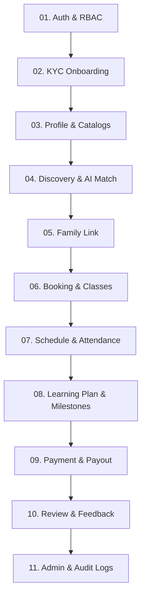

# ĐẶC TẢ KIỂM THỬ GIAO DIỆN WEB (AUTOMATED WEB UI TESTING) — CÁC LUỒNG CHÍNH & LUỒNG PHỤ

> **Hệ thống:** Nền tảng kết nối Gia sư & Học sinh — **EduFit Tutoring Platform**  
> **Phạm vi kiểm thử:** **Web UI End-to-End Testing (Lớp B)** — Tập trung vào các **Luồng chính (Main Flows)** và **Luồng phụ / Rẽ nhánh (Alternative / Exception Flows)**.  
> *(Ghi chú: Các kiểm thử chi tiết về format input, regex email/mật khẩu, Zod schema và boundary value đã được bao phủ bởi tầng Unit / Component Testing).*  
> **Bộ công nghệ:** Selenium WebDriver 4.x (TypeScript) · Vitest 3.x · Page Object Model (POM)  
> **Tài khoản dùng chung:** Mật khẩu `Password123@`

---

## 1. NGUYÊN TẮC PHÂN TẦNG KIỂM THỬ (TESTING PYRAMID)

```
        / \
       /   \        WEB UI TESTING (E2E) — CHỈ TEST LUỒNG CHÍNH & PHỤ
      / E2E \       - Hành trình người dùng xuyên suốt (User Journeys)
     /-------\      - Bắt tay đa vai trò (Multi-Role Handshake)
    /  Integ  \     - Chuyển đổi trạng thái nghiệp vụ (State Transitions)
   /-----------\
  /  Unit Test  \   UNIT / COMPONENT TESTING (Đã triển khai riêng)
 / (Zod, Slices) \  - Validate regex, boundary, format, error message chi tiết
-----------------
```

1. **Luồng chính (Main Flow / Happy Path):** Kịch bản chuẩn từ đầu đến cuối dẫn đến thành công (đăng nhập thành công, nộp KYC được duyệt, gửi yêu cầu học được gia sư đồng ý, lập kế hoạch học tập, tạo cột mốc và điểm danh).
2. **Luồng phụ / Rẽ nhánh (Alternative Flow):** Người dùng chọn một phương án nghiệp vụ khác (gia sư từ chối yêu cầu kèm lý do; chỉnh sửa thêm bớt cột mốc; đề xuất đổi lịch thay vì xác nhận; phụ huynh thu hồi liên kết).
3. **Luồng ngoại lệ / Bảo mật (Exception & RBAC Flow):** Kiểm tra hành vi hệ thống khi gặp tình huống bất thường hoặc truy cập trái phép (kế hoạch không có cột mốc bị chặn; học sinh cố vào trang Admin; tài khoản bị khóa không được đăng nhập).

---

## 2. DANH MỤC 11 LUỒNG WEB UI TESTING (LUỒNG CHÍNH & PHỤ)



---

### Luồng 01: Xác Thực, Đăng Nhập Đa Vai Trò & Phân Quyền (Auth & RBAC)
*File spec:* `01-auth-flow.e2e.test.ts` · *Page Object:* `AuthPage.ts`

* **Luồng chính (Main Flow - Happy Path):**
  - **MF_01.1:** Đăng nhập thành công với vai trò **Admin** (`admin.demo@edufit.vn`) $\rightarrow$ Điều hướng chính xác vào `/admin/dashboard`.
  - **MF_01.2:** Đăng nhập thành công với vai trò **Gia sư** (`tutor.demo@edufit.vn`) $\rightarrow$ Điều hướng chính xác vào `/tutor/dashboard`.
  - **MF_01.3:** Đăng nhập thành công với vai trò **Học sinh** (`student.demo@edufit.vn`) $\rightarrow$ Điều hướng chính xác vào `/student/dashboard`.
  - **MF_01.4:** Đăng nhập thành công với vai trò **Phụ huynh** (`parent.demo@edufit.vn`) $\rightarrow$ Điều hướng vào `/parent/dashboard`.
  - **MF_01.5:** Đăng xuất (Logout) $\rightarrow$ Hủy phiên làm việc, chuyển hướng an toàn về `/login`.
* **Luồng phụ / Rẽ nhánh (Alternative Flow):**
  - **AF_01.1:** Người dùng mới chọn điều hướng sang `/register` $\rightarrow$ Chọn vai trò "Gia sư" $\rightarrow$ Mở form đăng ký tương ứng.
  - **AF_01.2:** Quên mật khẩu $\rightarrow$ Điều hướng sang `/forgot-password` $\rightarrow$ Nhập email $\rightarrow$ Hiển thị thông báo hướng dẫn khôi phục.
* **Luồng ngoại lệ / Bảo mật (Exception & RBAC):**
  - **EF_01.1 (Sai mật khẩu):** Đăng nhập với mật khẩu sai $\rightarrow$ Hiển thị cảnh báo lỗi màu đỏ, giữ nguyên tại trang `/login`.
  - **EF_01.2 (Chặn quyền Học sinh):** Đăng nhập Học sinh cố tình gõ URL `/admin/dashboard` $\rightarrow$ Bị chặn quyền truy cập (403 Forbidden hoặc redirect).
  - **EF_01.3 (Chặn khách vãng lai):** Chưa đăng nhập mở link bảo mật `/tutor/dashboard` $\rightarrow$ Tự động chuyển hướng về `/login`.

---

### Luồng 02: Xác Minh Bằng Cấp KYC & Phê Duyệt Của Admin (Tutor Verification)
*File spec:* `02-kyc-flow.e2e.test.ts` · *Page Object:* `KycPage.ts`

* **Luồng chính (Main Flow):**
  - **MF_02.1 (Gia sư nộp hồ sơ):** Gia sư đăng nhập $\rightarrow$ Truy cập `/tutor/verification` $\rightarrow$ Điền thông tin trường, năm tốt nghiệp $\rightarrow$ Đính kèm tệp PDF văn bằng hợp lệ $\rightarrow$ Nộp thành công, trạng thái chuyển sang `PENDING`.
  - **MF_02.2 (Admin phê duyệt):** Admin đăng nhập $\rightarrow$ Mở `/admin/verification-queue` $\rightarrow$ Xem hồ sơ gia sư trong hàng đợi $\rightarrow$ Nhấn "Phê duyệt" $\rightarrow$ Hồ sơ được duyệt thành công (`VERIFIED`), rời khỏi hàng đợi.
* **Luồng phụ / Rẽ nhánh (Alternative Flow):**
  - **AF_02.1 (Admin từ chối có lý do):** Admin xem hồ sơ nhưng thấy mờ $\rightarrow$ Nhập lý do từ chối *"Ảnh chụp bằng bị mờ không rõ số hiệu"* $\rightarrow$ Nhấn "Từ chối" $\rightarrow$ Trạng thái chuyển sang `REJECTED`, thông báo gửi về cho gia sư.
* **Luồng ngoại lệ (Exception Flow):**
  - **EF_02.1 (Từ chối thiếu lý do):** Admin bấm Từ chối nhưng bỏ trống ô lý do $\rightarrow$ Giao diện chặn thao tác, cảnh báo bắt buộc nhập lý do.
  - **EF_02.2 (Chặn file mã độc):** Gia sư tải lên file script giả mạo đuôi `.pdf` $\rightarrow$ Hệ thống phát hiện Magic Bytes không hợp lệ $\rightarrow$ Từ chối lưu tệp và cảnh báo lỗi.

---

### Luồng 03: Thiết Lập Hồ Sơ Chuyên Môn & Quản Lý Danh Mục (Profile & Catalogs)
*File spec:* `03-catalog-profile-flow.e2e.test.ts` · *Page Objects:* `CatalogPage.ts`, `ProfilePage.ts`

* **Luồng chính (Main Flow):**
  - **MF_03.1 (Gia sư cập nhật hồ sơ):** Gia sư vào `/tutor/profile` $\rightarrow$ Cập nhật biểu phí (250,000đ/buổi), số năm kinh nghiệm, tiểu sử $\rightarrow$ Nhấn "Lưu hồ sơ" $\rightarrow$ Hiển thị thông báo cập nhật thành công.
  - **MF_03.2 (Học sinh tạo nhu cầu học):** Học sinh vào `/student/profile` $\rightarrow$ Chọn khối lớp (Lớp 9), môn học (Toán), mục tiêu (Luyện thi vào 10) $\rightarrow$ Lưu thành công.
  - **MF_03.3 (Admin thêm môn học):** Admin vào `/admin/catalogs` $\rightarrow$ Nhấn "Thêm môn học" $\rightarrow$ Nhập thông tin môn mới $\rightarrow$ Môn học mới xuất hiện trong danh mục toàn hệ thống.
* **Luồng phụ (Alternative Flow):**
  - **AF_03.1:** Gia sư thay đổi hình thức dạy từ "Chỉ Online" sang "Cả Online và Trực tiếp (BOTH)" $\rightarrow$ Hệ thống cập nhật hiển thị khu vực dạy.

---

### Luồng 04: Khám Phá Gia Sư & Gợi Ý Thông Minh AI Match (Discovery & AI)
*File spec:* `04-tutors-discovery-flow.e2e.test.ts` · *Page Object:* `TutorsPage.ts`

* **Luồng chính (Main Flow):**
  - **MF_04.1 (Tìm kiếm & Lọc gia sư):** Khách/Học sinh truy cập `/tutors` $\rightarrow$ Chọn bộ lọc Môn "Toán", Cấp học "Lớp 9" $\rightarrow$ Danh sách gia sư tự động lọc đúng tiêu chí $\rightarrow$ Click xem chi tiết hồ sơ một gia sư.
  - **MF_04.2 (Gợi ý AI Match):** Học sinh đã có nhu cầu học truy cập `/student/tutors` $\rightarrow$ Nhấn nút "Gợi ý AI Match" $\rightarrow$ Hệ thống hiển thị Top 5 gia sư phù hợp nhất kèm điểm tương thích và lý do gợi ý.
* **Luồng phụ (Alternative Flow):**
  - **AF_04.1 (Xóa bộ lọc):** Người dùng bấm "Xóa bộ lọc" $\rightarrow$ Danh sách quay lại hiển thị toàn bộ gia sư công khai.

---

### Luồng 05: Quản Lý Liên Kết Gia Đình Phụ Huynh & Học Sinh (Family Connection)
*File spec:* `05-family-link-flow.e2e.test.ts` · *Page Object:* `FamilyPage.ts`

* **Luồng chính (Main Flow - Bắt tay 2 chiều):**
  - **MF_05.1 (Phụ huynh gửi lời mời):** Phụ huynh vào `/parent/children` $\rightarrow$ Nhập email của con (`student.demo@edufit.vn`) $\rightarrow$ Bấm "Gửi lời mời" $\rightarrow$ Lời mời xuất hiện trong bảng "Chờ xác nhận".
  - **MF_05.2 (Học sinh chấp nhận liên kết):** Học sinh đăng nhập vào `/student/family` $\rightarrow$ Thấy lời mời của phụ huynh $\rightarrow$ Nhấn "Chấp nhận" $\rightarrow$ Quan hệ chuyển sang `ACTIVE`, phụ huynh thấy dashboard học tập của con.
* **Luồng phụ (Alternative Flow):**
  - **AF_05.1 (Học sinh từ chối):** Học sinh nhấn "Từ chối" $\rightarrow$ Lời mời bị hủy bỏ.
  - **AF_05.2 (Hủy liên kết):** Phụ huynh hoặc học sinh nhấn "Hủy liên kết" $\rightarrow$ Trạng thái chuyển sang `REVOKED`.

---

### Luồng 06: Đề Nghị Kèm Cặp & Khởi Tạo Lớp Học 1-1 (Connection & Classes)
*File spec:* `06-connection-classes-flow.e2e.test.ts` · *Page Object:* `ClassConnectionPage.ts`

* **Luồng chính (Main Flow):**
  - **MF_06.1 (Gửi yêu cầu học):** Học sinh mở hồ sơ gia sư $\rightarrow$ Bấm "Gửi yêu cầu học tập" kèm lời nhắn $\rightarrow$ Yêu cầu chuyển đến gia sư.
  - **MF_06.2 (Gia sư chấp thuận & Tạo lớp):** Gia sư mở `/tutor/requests` $\rightarrow$ Thấy yêu cầu mới $\rightarrow$ Nhấn "Chấp nhận" $\rightarrow$ Lớp học 1-1 được tạo thành công.
  - **MF_06.3 (Đồng bộ lớp học 2 phía):** Kiểm tra danh sách lớp học tại `/tutor/classes` và `/student/classes` $\rightarrow$ Lớp học hiển thị đồng bộ ở cả 2 tài khoản.
* **Luồng phụ (Alternative Flow):**
  - **AF_06.1 (Gia sư từ chối):** Gia sư nhấn "Từ chối" kèm lý do $\rightarrow$ Yêu cầu kết thúc, không tạo lớp học.

---

### Luồng 07: Lập Lịch Giảng Dạy, Thời Khóa Biểu & Buổi Học (Scheduling & Attendance)
*File spec:* `07-schedule-attendance-flow.e2e.test.ts` · *Page Object:* `SchedulePage.ts`

* **Luồng chính (Main Flow):**
  - **MF_07.1 (Đặt lịch học mới):** Gia sư/Học sinh chọn lớp $\rightarrow$ Đặt lịch học cho buổi tới vào khung giờ rảnh $\rightarrow$ Buổi học hiển thị trên thời khóa biểu.
  - **MF_07.2 (Học sinh xác nhận lịch):** Học sinh vào `/student/schedule` $\rightarrow$ Xem chi tiết và xác nhận buổi học $\rightarrow$ Lịch chuyển sang `CONFIRMED`.
  - **MF_07.3 (Điểm danh buổi học):** Sau giờ học, gia sư thực hiện điểm danh "Có mặt" $\rightarrow$ Trạng thái buổi học chuyển sang `COMPLETED`.
* **Luồng phụ (Alternative Flow):**
  - **AF_07.1 (Đổi lịch - Reschedule):** Một bên bấm "Đề xuất đổi lịch" sang giờ khác $\rightarrow$ Bên còn lại chấp nhận thời gian mới.
  - **AF_07.2 (Hủy buổi học):** Chọn lý do hủy (bận việc đột xuất) $\rightarrow$ Buổi học chuyển sang `CANCELLED`.
* **Luồng ngoại lệ (Exception Flow):**
  - **EF_07.1 (Chống trùng lịch - NFR-17):** Cố tình đặt đè lên khung giờ đã có lịch học $\rightarrow$ Hệ thống cảnh báo xung đột lịch và chặn lưu.

---

### Luồng 08: Kế Hoạch Học Tập, Cột Mốc (Milestones) & Tiến Trình Học (Progress Tracking)
*Màn hình:* `/tutor/classes` $\rightarrow$ `CreateLearningPlanModal` & `/student/progress` $\rightarrow$ `ProgressDashboardView`  
*Page Object đề xuất:* `ProgressPage.ts`

* **Luồng chính (Main Flow - Bắt tay giữa Gia sư và Học sinh):**
  - **MF_08.1 (Gia sư thiết lập Kế hoạch học tập & Cột mốc):**
    1. Gia sư đăng nhập, vào trang Quản lý lớp học `/tutor/classes`.
    2. Chọn lớp học của học sinh Trần Minh Anh $\rightarrow$ Bấm nút **"Lập kế hoạch học tập"** (Create Learning Plan).
    3. Hộp thoại modal xuất hiện:
       - Nhập tóm tắt mục tiêu: *"Lộ trình bồi dưỡng Đại số & Hình học thi vào 10"*.
       - Thêm Cột mốc 1 (Milestone 1): Tiêu đề: *"Nắm chắc phương trình bậc hai & hệ thức Vi-ét"*, Hạn chót: `30/11/2026`, Trọng số (Weight): `1`.
       - Bấm **"Thêm cột mốc"** $\rightarrow$ Thêm Cột mốc 2: Tiêu đề: *"Chinh phục Hình học đường tròn & góc nội tiếp"*, Hạn chót: `31/12/2026`, Trọng số: `2`.
    4. Nhấn **"Lưu kế hoạch"** $\rightarrow$ Kế hoạch học tập được tạo thành công, tiến độ ban đầu hiển thị **0%**.
  - **MF_08.2 (Gia sư cập nhật hoàn thành Cột mốc):**
    1. Trong quá trình học, Gia sư bấm vào Cột mốc 1 $\rightarrow$ Đổi trạng thái từ `IN_PROGRESS` sang **`ACHIEVED`** (Đã đạt được).
    2. Hệ thống tự động tính toán lại tỷ lệ hoàn thành có trọng số (Weighted Progress) $\rightarrow$ Tiến độ tăng từ **0% lên 33%**.
  - **MF_08.3 (Học sinh & Phụ huynh theo dõi tiến trình thực tế):**
    1. Học sinh đăng nhập, vào trang Tiến độ cá nhân `/student/progress`.
    2. Thanh tiến độ học tập hiển thị chính xác **33% hoàn thành**.
    3. Danh sách cột mốc hiển thị Cột mốc 1 có huy hiệu xanh **`Đã đạt được`** và Cột mốc 2 đang **`Chờ thực hiện`**.
    4. Phụ huynh đăng nhập vào `/parent/progress` cũng thấy thanh tiến độ của con được cập nhật theo thời gian thực.
* **Luồng phụ / Rẽ nhánh (Alternative Flow):**
  - **AF_08.1 (Chỉnh sửa Kế hoạch & Bổ sung Cột mốc):** Gia sư mở kế hoạch đã có $\rightarrow$ Nhấn "Chỉnh sửa" $\rightarrow$ Thêm Cột mốc 3: *"Luyện đề thi thử tuyển sinh đạt 8+"* $\rightarrow$ Lưu cập nhật $\rightarrow$ Số lượng cột mốc tăng lên và trọng số được phân bổ lại.
  - **AF_08.2 (Ghi nhận biên bản & Đánh giá buổi học):** Sau buổi học, Gia sư mở modal Đánh giá buổi học (`SessionOutcomeModal`) $\rightarrow$ Điểm danh "Có mặt" kèm ghi chú: *"Học sinh hiểu bài tốt, làm đúng 9/10 câu trắc nghiệm"* $\rightarrow$ Nhận xét hiển thị trực tiếp trong lịch sử buổi học trên Dashboard tiến độ của Học sinh.
* **Luồng ngoại lệ (Exception Flow):**
  - **EF_08.1 (Chặn lưu Kế hoạch rỗng):** Gia sư xóa toàn bộ cột mốc rồi nhấn Lưu $\rightarrow$ Hệ thống chặn lại và báo lỗi: *"Kế hoạch học tập phải có ít nhất 1 cột mốc"*.
  - **EF_08.2 (Chặn sửa kế hoạch khi không có quyền):** Học sinh cố tình gọi action sửa cột mốc $\rightarrow$ Bị chặn quyền (chỉ Gia sư phụ trách lớp mới có quyền thiết lập và cập nhật cột mốc).

---

### Luồng 09: Cổng Thanh Toán Nạp Tiền VietQR & Rút Thu Nhập (Billing & Payout)
*File spec:* `08-billing-payout-flow.e2e.test.ts` · *Page Object:* `PaymentPage.ts`

* **Luồng chính (Main Flow):**
  - **MF_09.1 (Phụ huynh nạp tiền ví):** Phụ huynh vào `/parent/billing` $\rightarrow$ Nhập số tiền nạp (ví dụ 100,000đ) $\rightarrow$ Nhấn "Tạo mã nạp" $\rightarrow$ Hộp thoại hiển thị mã VietQR thanh toán (PayOS testbed).
  - **MF_09.2 (Gia sư yêu cầu rút thu nhập):** Gia sư vào `/tutor/earnings` $\rightarrow$ Kiểm tra số dư khả dụng $\rightarrow$ Nhập thông tin tài khoản ngân hàng và số tiền muốn rút $\rightarrow$ Gửi yêu cầu rút tiền thành công.
* **Luồng phụ / Rẽ nhánh (Alternative Flow):**
  - **AF_09.1 (Hủy giao dịch nạp):** Phụ huynh bấm "Đóng" hộp thoại QR $\rightarrow$ Giao dịch nạp tiền được hủy an toàn.
* **Luồng ngoại lệ (Exception Flow):**
  - **EF_09.1 (Rút vượt số dư ví):** Gia sư nhập số tiền rút lớn hơn số dư khả dụng $\rightarrow$ Giao diện cảnh báo số dư không đủ và khóa nút rút.

---

### Luồng 10: Đánh Giá Chất Lượng & Phản Hồi Sau Khóa Học (Review & Ratings)
*File spec:* `09-review-flow.e2e.test.ts` · *Page Object:* `ReviewPage.ts`

* **Luồng chính (Main Flow):**
  - **MF_10.1 (Gửi đánh giá):** Học sinh vào buổi học đã hoàn thành $\rightarrow$ Bấm "Đánh giá gia sư" $\rightarrow$ Chọn 5 sao và viết nhận xét hài lòng $\rightarrow$ Bấm Gửi $\rightarrow$ Đánh giá được lưu thành công.
  - **MF_10.2 (Cập nhật điểm uy tín):** Mở trang hồ sơ gia sư $\rightarrow$ Điểm trung bình sao và nhận xét mới xuất hiện công khai.
* **Luồng ngoại lệ (Exception Flow):**
  - **EF_10.1 (Chặn đánh giá trùng lặp):** Học sinh đã đánh giá lớp học này rồi cố bấm gửi lại lần nữa $\rightarrow$ Hệ thống báo lỗi đã đánh giá.

---

### Luồng 11: Quản Trị Hệ Thống, Quản Lý Người Học & Nhật Ký Kiểm Toán (Admin Management)
*File spec:* `10-admin-management-flow.e2e.test.ts` · *Page Object:* `AdminManagementPage.ts`

* **Luồng chính (Main Flow):**
  - **MF_11.1 (Kiểm tra Dashboard KPI):** Admin truy cập `/admin/dashboard` $\rightarrow$ Xem các thẻ thống kê tổng số gia sư, học sinh, số buổi học hoàn thành.
  - **MF_11.2 (Tra cứu Audit Logs):** Admin truy cập `/admin/audit-logs` $\rightarrow$ Lọc theo hành động `ACCOUNT_LOGIN` hoặc `KYC_APPROVE` $\rightarrow$ Bảng hiển thị chính xác các dòng vết kiểm toán.
* **Luồng phụ (Alternative Flow):**
  - **AF_11.1 (Khóa & Mở khóa tài khoản):** Admin vào `/admin/learners` $\rightarrow$ Nhấn "Khóa tài khoản" một học sinh vi phạm $\rightarrow$ Nhập lý do khóa $\rightarrow$ Tài khoản chuyển sang trạng thái `SUSPENDED` (Tài khoản này sau đó sẽ không thể đăng nhập vào hệ thống).

---

## 3. TÓM TẮT MA TRẬN 11 LUỒNG CHO BÁO CÁO NGHIỆM THU

| STT | Tên Luồng Kiểm Thử Web UI | Kịch bản Luồng chính (Happy Path) | Kịch bản Luồng phụ / Rẽ nhánh (Alternative) | Kịch bản Ngoại lệ / Bảo mật (Exception) |
|:---:|---|---|---|---|
| **01** | **Xác thực & Phân quyền (Auth & RBAC)** | Đăng nhập Admin, Tutor, Student, Parent thành công; Đăng xuất an toàn | Điều hướng sang Đăng ký chọn role; Yêu cầu Quên mật khẩu | Nhập sai pass báo lỗi; Học sinh cố vào Admin bị 403; Khách bị đẩy về login |
| **02** | **Xác minh bằng cấp (KYC)** | Gia sư nộp PDF hợp lệ; Admin vào hàng đợi duyệt `VERIFIED` | Admin từ chối hồ sơ kèm lý do rõ ràng | Admin từ chối không lý do bị chặn; Tải file giả mạo đuôi `.pdf` bị chặn |
| **03** | **Hồ sơ & Danh mục (Profile & Catalogs)** | Gia sư cập nhật giá/tiểu sử; Học sinh lưu nhu cầu học; Admin thêm môn | Gia sư đổi hình thức dạy Online $\leftrightarrow$ Trực tiếp | Giá dạy âm hoặc vượt khung trần bị chặn |
| **04** | **Khám phá gia sư & AI Match (Discovery)** | Lọc gia sư theo Môn & Lớp; Học sinh nhận gợi ý Top 5 AI Match | Xóa trắng bộ lọc để quay lại danh sách toàn bộ | Giá min > max báo lỗi; UUID nhu cầu sai bị chặn |
| **05** | **Liên kết Gia đình (Family Link)** | Phụ huynh gửi lời mời qua email; Học sinh chấp nhận liên kết | Học sinh từ chối lời mời; Phụ huynh hủy kết nối | Tự mời chính mình bị chặn; Mời tài khoản gia sư bị chặn |
| **06** | **Yêu cầu kèm cặp & Lớp học (Classes)** | Học sinh gửi đề nghị học; Gia sư chấp thuận; Lớp học hiển thị 2 phía | Gia sư từ chối yêu cầu kèm lý do | Gia sư từ chối bỏ trống lý do bị chặn |
| **07** | **Lịch học & Điểm danh (Scheduling)** | Đặt lịch buổi học mới; Học sinh xác nhận; Gia sư điểm danh hoàn tất | Đề xuất đổi lịch học; Hủy buổi học kèm lý do | Đặt trùng giờ buổi học khác bị chặn (**NFR-17**) |
| **08** | **Kế hoạch học tập & Cột mốc (Progress)** | Gia sư tạo kế hoạch & 2 cột mốc; Đổi cột mốc sang `ACHIEVED` $\rightarrow$ Học sinh & Phụ huynh thấy thanh tiến độ tăng % | Chỉnh sửa thêm/bớt cột mốc; Ghi nhận nhận xét buổi học vào tiến trình | Lưu kế hoạch không có cột mốc bị chặn; Học sinh cố sửa cột mốc bị chặn 403 |
| **09** | **Thanh toán nạp ví & Rút tiền (Billing)** | Phụ huynh tạo mã VietQR nạp tiền; Gia sư tạo lệnh rút thu nhập | Đóng popup hủy giao dịch nạp tiền an toàn | Rút tiền vượt quá số dư khả dụng bị chặn |
| **10** | **Đánh giá & Phản hồi (Review)** | Buổi học xong: Học sinh chấm 5 sao + nhận xét; Hồ sơ gia sư tăng rating | — | Đánh giá lần thứ 2 cho cùng 1 lớp bị chặn |
| **11** | **Quản trị & Audit Logs (Admin)** | Xem KPI Dashboard; Tra cứu & lọc nhật ký kiểm toán | Khóa và Mở khóa tài khoản người học | Tài khoản bị khóa (Suspended) không thể đăng nhập |

---

## 4. HƯỚNG DẪN THỰC THI KIỂM THỬ

Để thực thi và trích xuất bằng chứng (Screenshots & Video):
```powershell
cd "frontend"

# 1. Chạy toàn bộ các luồng kiểm thử (mở trình duyệt Chrome trực quan quan sát):
$env:E2E_HEADLESS="false"
npm run test:e2e

# 2. Chạy kiểm thử kết hợp tự động quay video nghiệm thu MP4:
npm run test:e2e:record

# 3. Chạy riêng một luồng cụ thể (ví dụ Luồng Lớp học hoặc Lịch học):
npx vitest run tests/e2e/specs/06-connection-classes-flow.e2e.test.ts --config tests/e2e/vitest.e2e.config.ts
```
