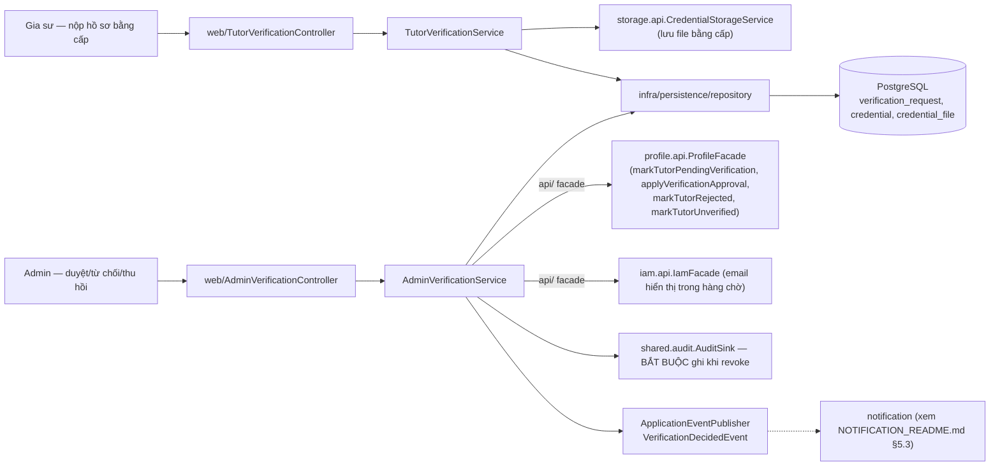
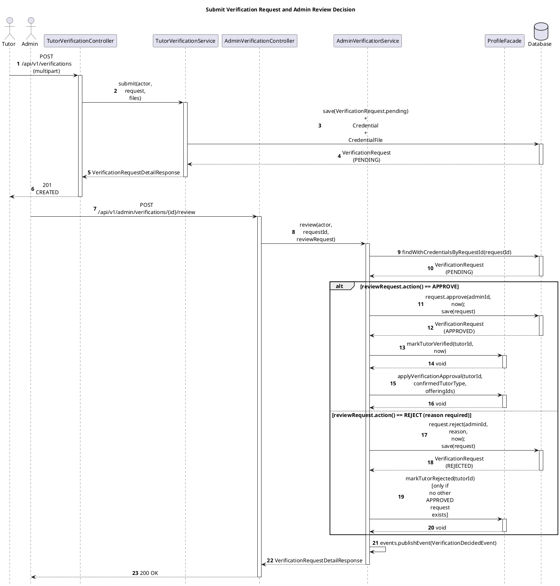
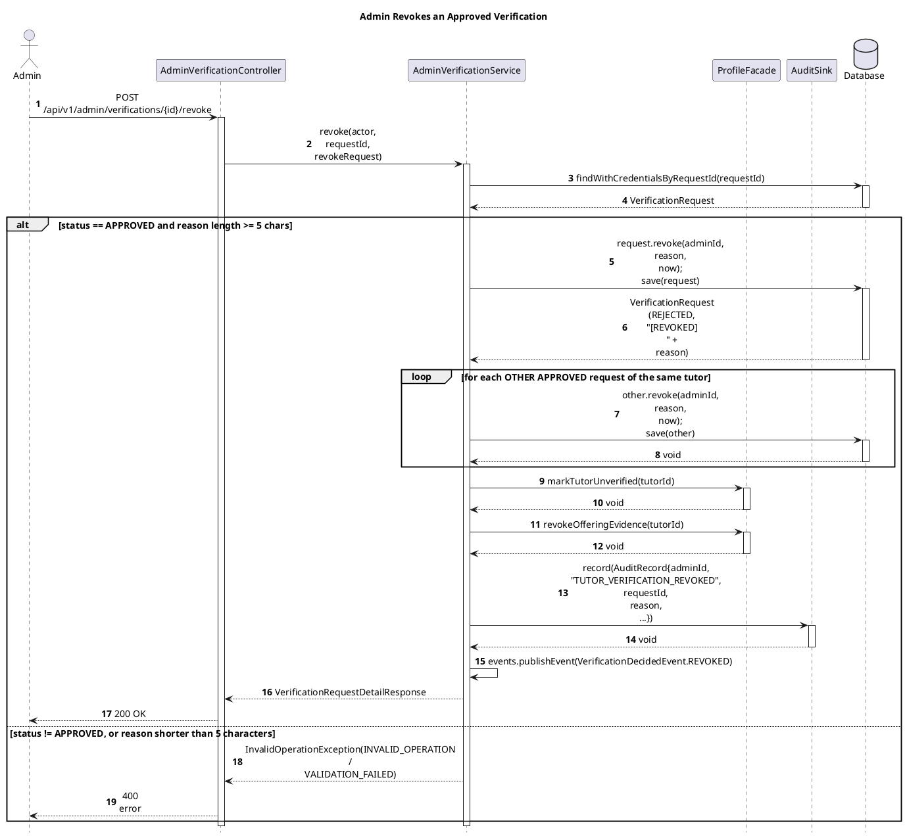

# Module Verification

- **Mã nguồn:** `backend/modules/verification/`
- **Mẫu kiến trúc:** Loại 1 — Standard, theo [backend-module-structure-guide.md](../backend-module-structure-guide.md).
- **Chưa có tài liệu kiến trúc trước đây** — README này được viết trực tiếp từ mã nguồn hiện tại (`TutorVerificationController.java`, `AdminVerificationController.java`, `VerificationRequest.java`).

---

## 1. Kiến trúc (Architecture)

```
backend/modules/verification/src/main/java/vn/edufit/verification/
│
├── api/event/VerificationDecidedEvent.java   # APPROVED / REJECTED / REVOKED — notification lắng nghe
│
├── application/service/
│   ├── TutorVerificationService.java          # Gia sư: nộp hồ sơ, xem trạng thái, tải file bằng cấp
│   └── AdminVerificationService.java          # Admin: danh sách chờ, duyệt/từ chối/thu hồi — ghi audit bắt buộc
│
├── infra/persistence/
│   ├── entity/  VerificationRequest (PENDING/APPROVED/REJECTED), Credential, CredentialFile
│   └── repository/  VerificationRequestRepository, CredentialFileRepository
│
└── web/
    ├── TutorVerificationController.java   # /api/v1/verifications/**
    ├── AdminVerificationController.java   # /api/v1/admin/verifications/**
    └── response/VerificationRequestDetailResponse, PendingVerificationQueueResponse
```



Verification **không tự lưu trạng thái `VERIFIED`/`DRAFT` của gia sư** — nó chỉ quản lý hồ sơ xin xác minh (`VerificationRequest`) và **gọi vào** `ProfileFacade` để cập nhật trạng thái thật trên `TutorProfile` (xem [PROFILE_README.md §5.3](../profile/PROFILE_README.md)) sau khi ra quyết định. Đây là ranh giới rõ ràng: Verification = nơi ra quyết định nghiệp vụ; Profile = nơi lưu trạng thái.

---

## 2. Tổng quan & Bối cảnh (Overview & Situation)

Verification quản lý quy trình Gia sư nộp hồ sơ bằng cấp để được cấp huy hiệu "đã xác minh" — điều kiện để xuất hiện ở Discovery (`TutorStatus.VERIFIED`, xem [DISCOVERY_README.md §2](../discovery/DISCOVERY_README.md)). Vòng đời `VerificationRequest.Status`: `PENDING → APPROVED` hoặc `PENDING → REJECTED` (bắt buộc có lý do, `rejection_reason`); `APPROVED` có thể bị Admin **thu hồi** sau đó (`revoke()`), chuyển về `REJECTED` với tiền tố `[REVOKED]` trong lý do để phân biệt với từ chối lần đầu — **không có trạng thái `REVOKED` riêng**, tái dùng `REJECTED` có đánh dấu.

Mỗi Gia sư có thể nộp **nhiều lần** (`findByTutorIdOrderBySubmittedAtAsc`) — ví dụ nộp lại sau khi bị từ chối. `getMyLatestRequest` không chỉ trả hồ sơ mới nhất mà còn gộp toàn bộ `Credential` từ các hồ sơ `APPROVED` trước đó cùng hồ sơ hiện tại (khử trùng theo `credentialId`) — để Gia sư không mất các bằng cấp đã được duyệt trước đây khi nộp bổ sung hồ sơ mới.

---

## 3. API Contract

### 3.1. `/api/v1/verifications/**` (Gia sư)

| Method | Endpoint | Quyền | Mô tả |
|---|---|---|---|
| POST | `/` (multipart: `payload` + `files`) | TUTOR | Nộp hồ sơ xác minh kèm file bằng cấp |
| GET | `/my-request` | TUTOR | Hồ sơ mới nhất của chính mình + toàn bộ credential đã từng được duyệt |
| GET | `/credentials/files/{fileId}` | TUTOR (chủ hồ sơ) hoặc ADMIN | Tải file bằng cấp |

### 3.2. `/api/v1/admin/verifications/**` (Admin)

| Method | Endpoint | Mô tả |
|---|---|---|
| GET | `?status=&page=&size=` | Danh sách hồ sơ theo trạng thái, phân trang |
| GET | `/pending` | Hàng chờ duyệt (alias của trên với `status=PENDING`) |
| GET | `/{id}` | Chi tiết 1 hồ sơ kèm toàn bộ credential |
| POST | `/{id}/review` | Duyệt hoặc từ chối (`approve: boolean`, `reason` bắt buộc nếu từ chối) |
| POST | `/{id}/revoke` | Thu hồi một hồ sơ đã `APPROVED` (`reason` bắt buộc) |

Toàn bộ endpoint Admin được chặn ở tầng Controller bằng `@PreAuthorize("hasRole('ADMIN')")` **và** kiểm lại lần hai ở `AdminVerificationService.ensureAdmin()` — phòng thủ 2 lớp, không chỉ dựa vào annotation.

---

## 4. Luồng triển khai từng bước (Implementation Flows)

### 4.1. Gia sư nộp hồ sơ → Admin duyệt → đồng bộ sang Profile

**Trace table**

| # | From | To | Real method | File:line |
|---|---|---|---|---|
| 1 | Tutor | TutorVerificationController | `submit(request, files)` — `POST /api/v1/verifications` (multipart) | `web/TutorVerificationController.java:36-38` |
| 2 | TutorVerificationController | TutorVerificationService | `submit(actor, request, files)` | `application/service/TutorVerificationService.java:96` |
| 3 | Admin | AdminVerificationController | `review(id, reviewRequest)` — `POST /api/v1/admin/verifications/{id}/review` | `web/AdminVerificationController.java:70-71` |
| 4 | AdminVerificationController | AdminVerificationService | `review(actor, requestId, reviewRequest)` | `AdminVerificationService.java:129` |
| 5 | AdminVerificationService | Database | `findWithCredentialsByRequestId(requestId)` | `:135` |
| 6 | AdminVerificationService | Database | `request.approve(adminId, now)` then `save(request)` | `:147,172` |
| 7 | AdminVerificationService | ProfileFacade | `markTutorVerified(tutorId, now)` | `:148` |
| 8 | AdminVerificationService | ProfileFacade | `applyVerificationApproval(tutorId, confirmedTutorType, offeringIds)` | `:150-154` |
| 9 | AdminVerificationService | Database | `request.reject(adminId, reason, now)` then `save(request)` | `:163,172` |
| 10 | AdminVerificationService | ProfileFacade | `markTutorRejected(tutorId)` — only if tutor has no other APPROVED request | `:164-169` |
| 11 | AdminVerificationService | AdminVerificationService (self) | `events.publishEvent(VerificationDecidedEvent)` | `:174-176` |

![Sequence Diagram](https://www.plantuml.com/plantuml/svg/hLPDKzim4BthL-pa54y30QRJ0mK61uSExHGoIGOEdHuKQvses98hAO6KuRzNaktOJlaeCzpiQD--jszNwvngGvLPPYantAG8a-KiumQkKV64nzHmAM2ClvUe3L3186GPTx-iEDv1X37NDeBGfP5YcSrGaGLd28cKPYRlYRxb8gUAPg0NbCaxBkQGq5HZuoIZzzzHQph72V-3y6clYNBC8iOo84pvN42CmbYY8stMAPuG6sbup7Cg33mGW15bpF7i7v17SjGle-gS31EwJCsv5EQIPWYT0S8rHoFisKZ9pjEXNjl-Hq9eRAI2gIrObS_UafQCZZzkUdXcKoYPfgWwG3NSu6pw2cA2QiLZzE5Xdc-5UywN2S9N45i4M-7MYOIdU4vZoegOyXV2gA4pggrnKVdaZwC18Ru8s3dnzS4XZAucK-ZJdFTN-_rLWrj3DxF6SaSPE1lvYXeiRF5OcyCLRNDeFv1TRtKFL36AFN1IT0FgBV8G2uq63aXNs6qMN8xnRex23KW07-1C8RFJn6dQUZbtTMvIsyfimfrQqXD9eJiQNaONbry2mh29B2JLbZo1ZT1GdevHvzOORE9zKOKVDaFXxY4SxEt3sNWOJeTHCzYRHuhxMV25sosWxh3TYFu3PuzzvUzpgn4XyHcAgbsc8cQh4HUiLnwKnRHR4X8FhbgISC5kk5dKJkl1Ubnbwcvo1i-O7xxHV9gQjhfTTof5Du3ZOmX7e_7LzT2kZ9P8LONckP9sXBnfhauXxuBFnLYfgbY09X_0VsWjQIC7RikjXPHtpQR8gBfjx0PaNUFUAZrD0TK5XGsy8MKbEMiJrk7_ijhQqtLJVUZDe6dD7akHS9KXy-gcwnnx89F4OiJyWkdtK8RsG_52_yR3hyEpATXcK6s_Kgudt0vMy5n35Vx2sDJzB73lrjT2pflxElQgwhu6y4EAT0qyiS90cWMgQbAZgXJ0UwwD_laU7WkskQDbCAxitTIx-NAMShqOkhVM7dLVVORC7mGbk5uuRrrmrPvn_7vtkGMt1rVVjdPRI4wjLlj7vIy=)



Assumptions: none — corrected against the real `AdminVerificationService.review()` body: the approve branch calls **both** `markTutorVerified` and `applyVerificationApproval` (not just the latter, as an earlier draft of this doc said), and the reject branch only calls `markTutorRejected` when the tutor has no other still-`APPROVED` request.

### 4.2. Thu hồi phê duyệt (revoke) — bắt buộc ghi audit

**Trace table**

| # | From | To | Real method | File:line |
|---|---|---|---|---|
| 1 | Admin | AdminVerificationController | `revoke(id, revokeRequest)` — `POST /api/v1/admin/verifications/{id}/revoke` | `web/AdminVerificationController.java:84-85` |
| 2 | AdminVerificationController | AdminVerificationService | `revoke(actor, requestId, revokeRequest)` | `application/service/AdminVerificationService.java:181` |
| 3 | AdminVerificationService | Database | `findWithCredentialsByRequestId(requestId)` | `:187` |
| 4 | AdminVerificationService | Database | `request.revoke(adminId, reason, now)`; `save(request)` | `:208-209` |
| 5 | AdminVerificationService | Database | for each **other** `APPROVED` request of the same tutor: `other.revoke(...)`; `save(other)` | `:212-220` |
| 6 | AdminVerificationService | ProfileFacade | `markTutorUnverified(tutorId)` | `:223` |
| 7 | AdminVerificationService | ProfileFacade | `revokeOfferingEvidence(tutorId)` | `:224` |
| 8 | AdminVerificationService | AuditSink | `record(new AuditRecord(adminId, "TUTOR_VERIFICATION_REVOKED", "VERIFICATION_REQUEST", requestId, reason, now, {tutorId, verificationId, reason}))` | `:227-239` |
| 9 | AdminVerificationService | AdminVerificationService (self) | `events.publishEvent(VerificationDecidedEvent.of(requestId, tutorId, REVOKED, reason))` | `:241-242` |

![Sequence Diagram](https://www.plantuml.com/plantuml/svg/jLLDSzCm4BtxLomv9KD8saxX0BH3Mhj3ADGPDwG7XkaerZhMr96Cf9X2f_-TbUmaJkW05sxwUFlsxMftzSvOfkrgMGHMs09Xn9T2GeALkaC3JCAeBBMgaCCCjSX4ognGCc0hg-HgEKSTv88ZP4hPkReFp9sG9TDi2IPdN7qNSW4PAmosRfRi_XCQmnPuBNuYl3feM-6t5SeK6y2e40i9AKfBZjuQ-wF0qu2GLgIYPDB2Gm0mOPmxFuT7mMFmTjYWjfmSCxOgx8MIzeej4Jfd23E1LjBTHAlEqr2lxV0u25XgbQxpikEwuu_QMJadCwsA0dK7c84RdF_5u1fr9LBqQChpBfgaPQB02vOoNaEQaptI5HSaLjxLB6uNS6RPd1aADMnM_Z8y2uBwVL-SEdNm6YRnzHI6h1J3wd38tDsmQWaqmmV17uVQbuFBXAYOHH-PioSQaaqqDQ3hKzMd7JsYiMFURowI-g2tPN3HEbDY2C-881EItmYRdslazDg2IkRiHxBcwMuOMnGK3Pc-s6Xe9xQn33YsuQomGELkLmPEJc0qcIJnB0gfo3dfP4P9A50kR0wd9_0IqfnfG-NLbjde6ApZTGchmtJcVP3gU-yD65RXMdAF6DeQ0Fuc6hf9z24wdqPX7pfVacWMNqRXL-Z0yyQDezmD3A1GggGcr43dESJJzr6o3R2H0Ye3coF9eoQmrC2Q37VZKtIl_oKw3-nv-rqXU_5LId1_kYyO9T_cjYbimY-PlfiwQPzbNOV8krwgU_gMhtKhmCRsDvyjZrlqRmxhMECi8szo4LKqp6Zy_0-VlZMznrHftlNRnAyVDfdkJ3zFu-Hs5YNZY_7vQ3gEhswR2kZizLNz98F1u757P3q0eF7s9u4RP2FFmx2YxZE3SZKlXCaZj-ksQpJ4b3B4_SMWKTPRasocoXDL7Q9beaZGb3HLN5Ry_71-_K1w3KS71n1V1aX_nRf9dssRj0zKsqsJcbnf-W-ebkbxglkKWi9jisvqZ6N52i7Z4hNN4jsdMBf5Ttmr6tqSXxVn94fycc48_gJE-SLe_B4ER5_cCSb4hQbtN0MtqqaJhRLr8_8TGUXd_GK=)



Assumptions: corrected against the real `revoke()` body — it also cascades to revoke every **other** still-`APPROVED` verification request of the same tutor (message 5, e.g. from a later re-submission) and calls `revokeOfferingEvidence` (message 7) in addition to `markTutorUnverified`, and the audit action string is `"TUTOR_VERIFICATION_REVOKED"` with a structured `AuditRecord` (not the simpler `record(actor, action, type, id, reason)` 5-arg shape an earlier draft of this doc showed).

### 4.3. Kiểm soát truy cập file bằng cấp

`getCredentialFile`: Admin xem được mọi file; Gia sư chỉ xem được file thuộc **chính hồ sơ của mình** — so khớp `profileFacade.getTutorIdByUserId(actor.getUserId())` với `tutorId` gắn trên `VerificationRequest` chứa `Credential` đó (`FORBIDDEN` nếu khác), chặn một gia sư xem bằng cấp của gia sư khác dù biết `fileId`.

---

## 5. Chi tiết bổ sung & Kỹ thuật

### 5.1. Vì sao tái dùng `REJECTED` cho revoke thay vì thêm trạng thái `REVOKED`

`VerificationRequest.Status` chỉ có 3 giá trị (`PENDING`, `APPROVED`, `REJECTED`) — thu hồi phê duyệt chuyển về `REJECTED` với tiền tố `[REVOKED]` trong `rejectionReason` để phân biệt "chưa từng được duyệt" và "đã duyệt rồi bị thu hồi" mà không cần thêm enum/migration. Phía Profile, hai trường hợp này được xử lý khác nhau (`markTutorRejected` cho từ chối lần đầu, `markTutorUnverified` cho thu hồi) vì ý nghĩa nghiệp vụ khác nhau dù cùng nằm trong `Status.REJECTED` ở tầng Verification.

### 5.2. Audit bắt buộc, không phải tùy chọn

Constructor của `AdminVerificationService` gọi `Objects.requireNonNull(auditSink)` kèm chú thích "Quyết định thu hồi của Admin bắt buộc phải được ghi audit, không được là tùy chọn" — khác với phần lớn service khác trong hệ thống coi audit là best-effort, revoke verification luôn ghi `AuditSink.record()` cùng transaction với việc đổi trạng thái, vì đây là hành động có thể ảnh hưởng trực tiếp đến thu nhập/uy tín của Gia sư.

### 5.3. Sự kiện gửi tới Notification

`VerificationDecidedEvent` (`APPROVED`/`REJECTED`/`REVOKED`) được `notification.NotificationEventListener.onVerificationDecided` lắng nghe, tạo thông báo `VERIFICATION_APPROVED`/`_REJECTED`/`_REVOKED` cho Gia sư (xem [NOTIFICATION_README.md §5.3](../notification/NOTIFICATION_README.md)) — cùng cơ chế chống "thông báo ma" (`@Transactional(propagation = MANDATORY)`) đã dùng cho mọi sự kiện khác trong hệ thống.
